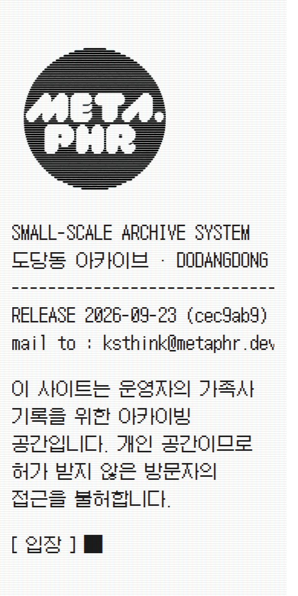
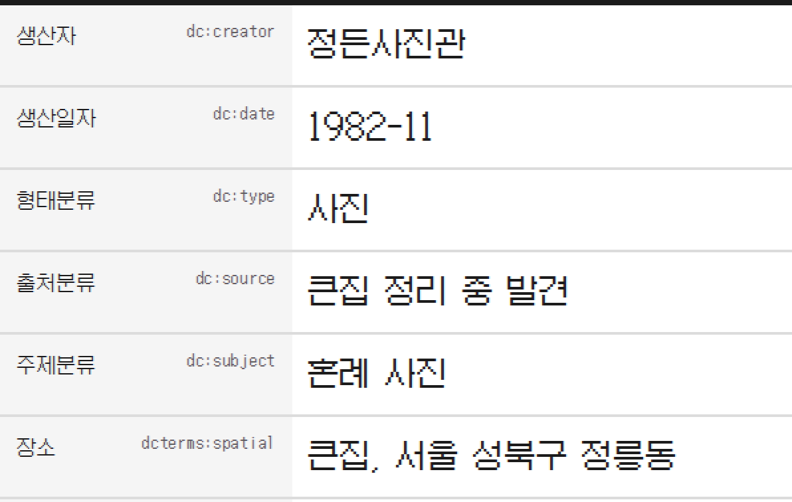
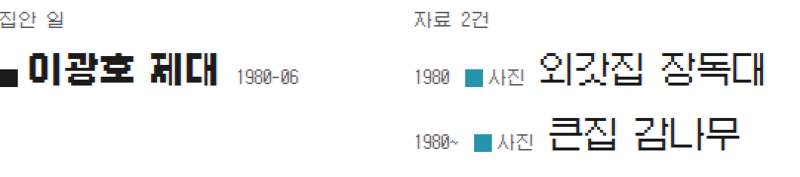
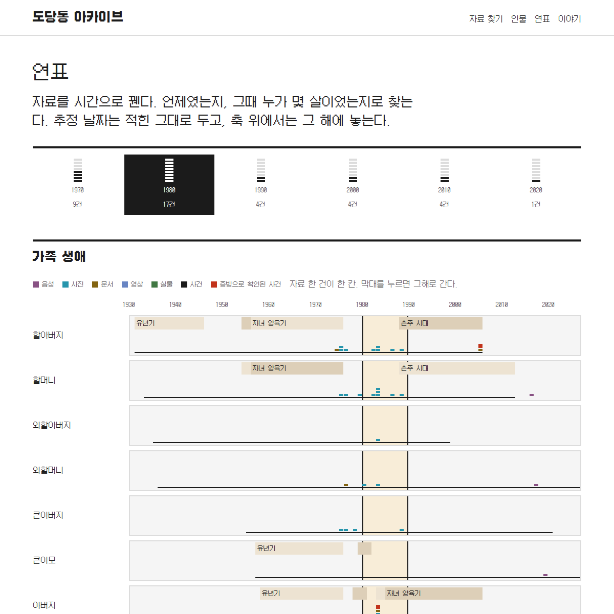
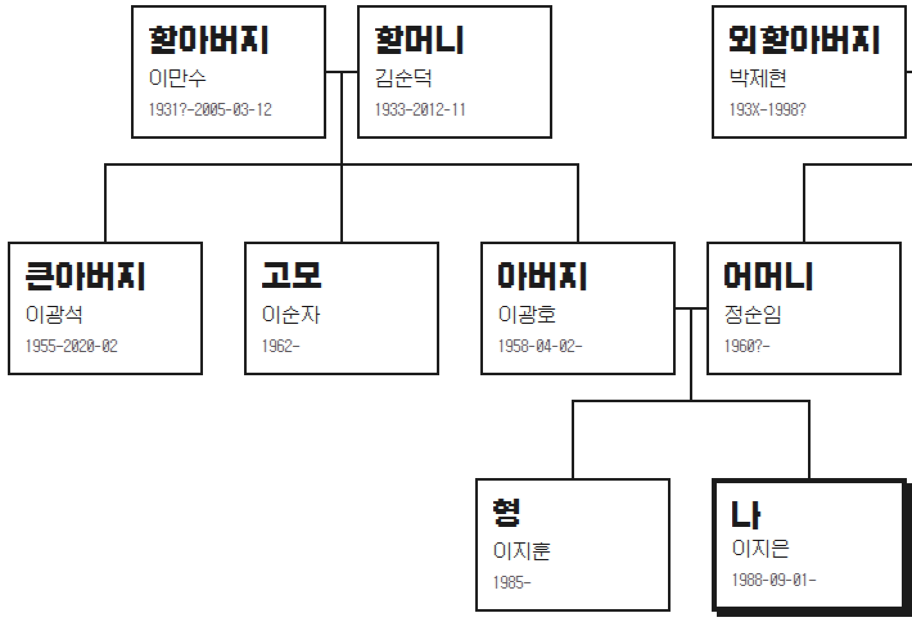
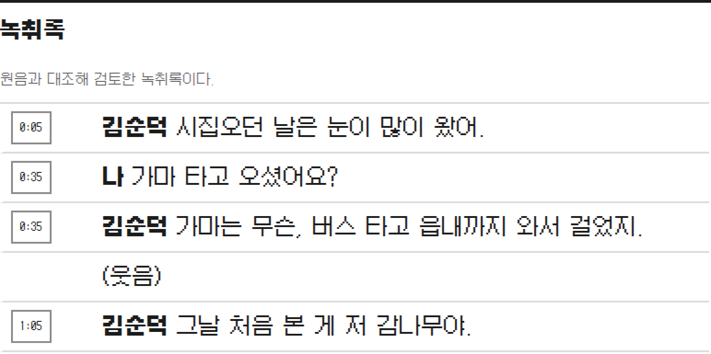
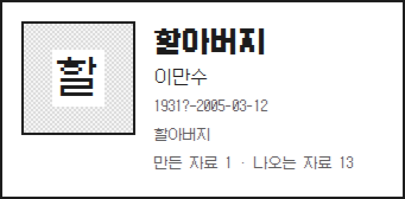
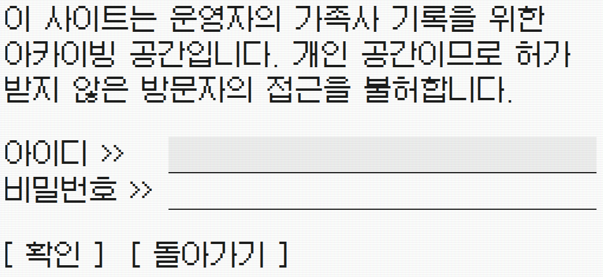
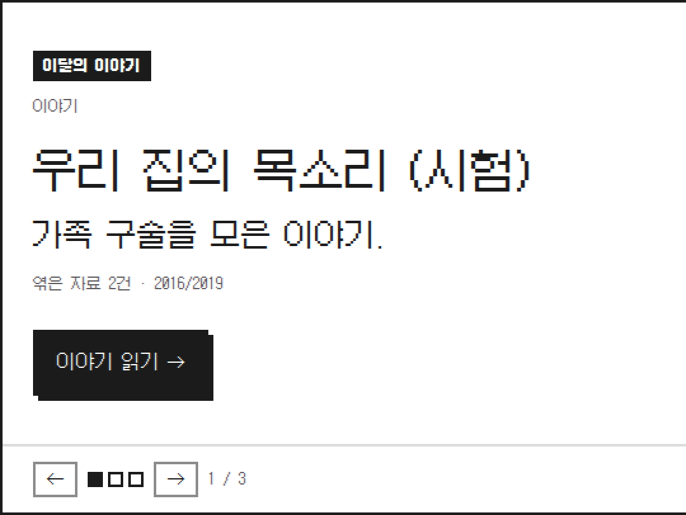

집에는 상자가 있다. 앨범에서 빠진 사진, 누가 보냈는지 모를 편지, 녹음테이프. 이걸 스캔해서 폴더에 넣는 건 하루면 끝난다. 그런데 몇 년 뒤 그 폴더를 열면 `IMG_0412.jpg`가 언제 어디서 누구를 찍은 사진인지 아무도 모른다. 스캔과 기술(記述)은 다른 일이다.

도당동 아카이브는 그 뒤쪽 일을 맡는 개인 아카이브다. 한 집안의 사진·편지·음성·영상과 그에 얽힌 사건을 도서관이 자료를 적는 방식, 더블린코어(Dublin Core)로 기술해 둔다.

- 소개: [metaphr.dev — 가족 아카이브](https://metaphr.dev/app.html?id=family-archive) (맞춤 가족 아카이브의 첫 제작 사례)
- 저장소: [github.com/ksthink/dodangdong_archive](https://github.com/ksthink/dodangdong_archive)
- 운영 주소: dodangdong-archive.vercel.app — 가족사 기록이라 닫아 두었다. 열면 문 화면만 보인다.

글에 실은 화면은 기능 시험용으로 넣었던 **가상 자료**로 찍었다. 이름·장소·사진은 모두 지어낸 것이고, 실제 가족 자료는 싣지 않았다.


*문. 로그인하지 않으면 어떤 주소로 들어와도 여기로 돌아온다.*

## 자료 하나는 세 곳에 산다

처음 정한 것은 파일을 어디에 둘지였다. 사진과 영상을 앱의 저장소에 넣으면 편하다. 대신 앱이 사라지면 사진도 같이 사라진다. 가족 기록이 내가 만든 앱의 수명에 묶이는 건 이상하다.

그래서 자료 하나를 세 곳에 나눴다.

| 무엇이 | 어디에 |
|---|---|
| 기술(더블린코어) — 제목·날짜·사람·장소 | Supabase Postgres |
| 원본 파일 — 사진·음성·영상 | 가족의 Google Drive |
| 둘을 잇는 한 줄 — Drive 파일 id | Postgres의 파일 표 |

올릴 때 파일은 서버를 거치지 않는다. 서버가 Drive의 이어 올리기(resumable) 주소를 열어 주면 브라우저가 바이트를 Drive로 곧장 보내고, 끝나면 서버는 파일 id만 적는다. Drive 권한도 앱이 만든 파일만 만질 수 있는 `drive.file` 하나만 받는다.

내려올 때는 반대로 늘 프록시 한 곳을 지난다. 이 프록시가 권한을 한 번 더 확인하고 구간(Range) 요청만 넘긴다. Drive 주소를 화면에 그대로 내지 않는다.

파일 이름은 `DA-0017_20260922190012.jpg`처럼 식별자와 올린 시각으로만 짓는다. 한글 이름은 Drive를 거치며 깨지기 쉬워서 이름 규칙 함수가 아예 ASCII만 받는다. 앱이 없어져도 Drive 폴더만 보고 어느 자료의 원본인지 알 수 있다.

## 도서관의 방식으로 적는다

자료마다 더블린코어 요소를 채운다. 생산자, 생산일자, 형태분류, 출처, 주제, 장소, 등장인물, 식별자, 이용조건. 자료 상세 화면에서는 이 표를 설명 바로 아래에 그대로 펼친다.


*더블린코어 표. 왼쪽 칸에 요소 이름이 붙어 있다.*

굳이 도서관 표준을 고른 데는 이유가 있다. 내가 정한 칸은 몇 년 뒤의 나도 뜻을 잊는다. 표준 요소는 정의가 문서로 남아 있고, 나중에 다른 시스템으로 옮길 때 그대로 매핑된다.

식별자는 자료 `DA-####`, 인물 `DP-###`, 묶음 `DC-###`이고 DB가 매긴다. 한번 붙은 번호는 바꾸지 않는다.

## 모르는 것은 모른다고 적는다

집안 기록의 날짜는 대개 흐리다. "아마 78년", "70년대 언젠가", "75년에서 79년 사이". 이걸 날짜 칸에 넣으려면 하나를 골라야 하는데, 고르는 순간 거짓이 된다.

그래서 날짜를 EDTF(Extended Date/Time Format)로 받았다.

| 적은 값 | 뜻 |
|---|---|
| `1978` | 1978년 |
| `1978-05-14` | 그날 |
| `1978?` | 아마 1978년 |
| `1978~` | 1978년 무렵 |
| `197X` | 1970년대 |
| `1975/1979` | 그 사이 |
| `19XX` | 1900년대 |

적은 값은 그대로 둔다. 연표에 놓을 때만 규칙을 정했다. `197X`는 1975년에, 기간은 시작한 해에 놓는다. 세기만 아는 `19XX`는 연표에 아예 놓지 않는다. 100년 중 아무 데나 찍는 건 정보가 아니라 잡음이다.

증빙 — 혼인신고서나 졸업장처럼 날짜를 확정해 주는 자료 — 로 확인한 날짜에만 빨간 "확인됨" 인장을 붙인다. 이 사이트에서 색은 먹색과 종이색 둘뿐인데, 인장색만 예외다. 확인된 것과 추정한 것이 한눈에 갈려야 해서다.


*연표의 한 해. 집안 일, 그해의 자료, 바깥 세상이 나란히 놓인다. `1980~`은 1980년 무렵이다.*

연표는 연대 막대에서 시작한다. 막대를 누르면 해별로 펼쳐지고, 위쪽에는 사람마다 생애 띠가 그려진다. 띠 위의 작은 칸 하나가 자료 한 건이다. 그해에 누가 몇 살이었는지도 EDTF에서 계산한다. 태어난 해가 `1931?`이면 나이 앞에 `~`가 붙는다.


*연표 위쪽. 연대 막대와 가족 생애 띠.*

## 가계도는 '나'에서 시작한다

인물 사이에는 부모와 배우자 관계만 적는다. 형제·삼촌·외할머니 같은 관계는 그 둘에서 저절로 나온다.

가계도는 관계 칸이 '나'인 사람에서 출발해 세대별로 쌓는다. 같은 세대 안에서는 부부를 붙이고, 자식이 부모 아래 오도록 순서를 맞춘 뒤 가로 위치를 정한다. 친가와 외가는 부모의 혼인에서 만난다. 측근이나 지인처럼 혈연·혼인으로 이어지지 않는 사람은 "가계도 밖의 인물"로 따로 모은다.


*가계도 일부. 이름과 날짜는 모두 가상이다. 굵은 테두리가 '나'다.*

## 시각을 누르면 그 자리부터 들린다

녹음은 그냥 두면 아무도 다시 듣지 않는다. 30분짜리 파일에서 원하는 한마디를 찾으려면 30분이 든다. 그래서 음성·영상 자료에는 녹취록을 하나씩 붙인다.

형식은 일부러 단순하게 했다.

```
[00:12] 화자A: 그때는 전화가 동네에 한 대뿐이었어.
[1:02:05] 나: 그럼 어디서 걸었어요?
(웃음)
```

한 줄이 한 구간이고, `[분:초]`는 재생 위치, `이름:`은 말한 사람이 된다. 원문은 적은 그대로 저장하고 구간은 저장할 때마다 다시 만든다. 텍스트 편집기에서 대충 받아 적어도 그대로 동작한다.


*녹취록. 왼쪽 시각을 누르면 그 자리부터 재생된다.*

영상은 서버에서 변환하지 않는다. 아이폰이 찍은 HEVC 영상은 브라우저마다 재생 여부가 다르다. 그렇다고 서버에서 트랜스코딩하면 시간·비용·실패가 커지고, 무엇보다 원본이 바뀐다. 그래서 규격(MP4·H.264·AAC·목차가 앞에 있는 파일) 밖의 원본은 그대로 보존하고, 관리자가 PC에서 변환한 재생용 사본을 따로 붙인다. 올릴 때 브라우저가 mp4 머리를 읽어 규격에 맞는지 미리 알려 준다. 아카이브에서는 원본이 먼저다.

## 얼굴은 단체 사진에서 잘라 쓴다

인물 페이지에 얼굴을 붙이려고 보니 독사진이 거의 없었다. 옛 집안 사진은 대부분 단체 사진이다. 얼굴만 따로 오려 새로 올리면 그 얼굴이 어느 사진에서 왔는지가 사라진다.

그래서 얼굴 사진을 따로 올리지 않는다. 관리 화면에서 그 사람이 나오는 사진을 고르고, 사진 위를 누르면 그 자리가 네모의 가운데가 된다. 크기는 슬라이더로 바꾼다. 끌어서 옮기는 방식은 넣지 않았다. 사이트에 끌어 움직이는 것이 하나도 없고, 누르기와 슬라이더면 키보드로도 된다.

저장하면 브라우저가 **원본에서** 256×256으로 잘라 파생 파일로 올린다. 썸네일에서 자르면 단체 사진 속 작은 얼굴이 뭉개진다. 파생 파일은 원본을 가리키므로 원본 자료를 지우면 얼굴도 같이 떨어진다.

잘라 낸 자리는 비율로 적어 둔다. 다시 고칠 때 그 자리에서 시작하려는 값인데, 적고 보니 "이 사진의 이 자리에 이 사람이 있다"는 기록이기도 했다. 나중에 사진 한 장에 나온 사람을 모두 적는 태깅으로 넓힐 여지가 여기 있다. 집안 사진에서 가장 빨리 사라지는 지식이 "이 사람이 누구냐"이기 때문이다.


*얼굴을 고르기 전에는 디더 면에 호칭 첫 글자가 온다.*

## 화면만 잠그면 잠긴 것이 아니었다

처음에는 손님에게 일부 자료를 보여 주는 구조였다. 자료마다 공개·비공개를 두고, 비공개는 DB의 행 수준 보안(RLS)이 행 자체를 내주지 않게 했다. 목록에서도, 연표에서도, 건수에서도, 가계도에서도 저절로 빠진다. 자물쇠 표시나 "N건 숨김" 안내도 두지 않았다. 숨겼다는 사실조차 알리지 않는 편이 가족 기록에는 맞다고 봤다.

그러다 사이트 전체를 닫기로 했다. 허가받지 않은 방문자를 들이지 않는 게 맞다고 판단했다. 낡은 단말기를 흉내 낸 인트로를 문으로 세우고, 로그인하지 않은 요청은 모두 그리로 돌려보냈다.

여기서 끝난 줄 알았는데, 보안 점검을 돌려 보니 아니었다. 화면은 잠갔지만 DB의 손님 읽기 정책이 그대로 살아 있었다. 브라우저에 실리는 공개용(publishable) 키를 들고 Supabase REST를 곧장 부르면 공개 자료의 기술 정보와 인물 정보, Drive 파일 id까지 로그인 없이 읽혔다. 앱의 문은 앱으로 들어오는 사람만 막는다.

그날 마이그레이션 하나로 손님 역할의 정책·표 권한·함수 실행 권한·기본 권한을 모두 걷었다. 그래도 하나가 남았다. 식별자를 매기는 함수는 만들 때 모든 역할(PUBLIC)에 실행 권한이 기본으로 붙어서, 손님 권한을 걷어도 PUBLIC을 타고 실행됐다. 이것까지 걷고 나서야 공개용 키만으로는 아무것도 읽지 못하게 됐다.

이후로 규칙은 하나다. **권한은 DB가 정한다.** 쓰기도 읽기도 관리자 확인 함수 하나뿐이고, 서버 동작은 저마다 관리자인지 다시 확인한다. 화면 코드의 잠금은 그 위에 얹은 편의일 뿐이다.


*[입장]을 누르면 로그인 칸이 열린다. 가입 화면은 없다.*

## 사이트는 움직이지 않는다

생김새는 흑백 픽셀 아트다. 모든 선은 2px, 모서리는 직각, 그림자는 흐림 없는 4px 계단이다. 글꼴은 갈무리 하나만 쓰고, 픽셀 글꼴이 선명한 크기(12·15·24·36·48px)만 쓴다. 색은 먹색과 종이색 둘이고 다크 모드는 없다.

그리고 움직이지 않는다. 전역 스타일에 전환과 애니메이션을 모두 끄는 줄이 있다. 첫 화면 히어로도 이야기 세 자리를 정해진 순서로 채울 뿐 저절로 넘어가지 않는다. 넘기는 건 사람이다. 예외는 문 역할을 하는 인트로 하나다. 인트로 로고는 216px에 고정했는데, 그림 속 줄무늬 한 주기가 그 크기에서 화면 주사선과 같은 3px가 되기 때문이다.


*히어로 한 자리. 화살표를 눌러야 넘어간다.*

기록이 주인공이고 장식은 그 앞에 서지 않는다. 이 규칙을 디자인 문서 맨 앞에 적어 두었다.

## 시험 자료를 지운 날

기능을 다 붙이고 나서 가상 자료를 한 벌 만들었다. 지어낸 가족 열두 명과 그들의 사진·편지·녹음, 이야기, 바깥 세상 사건. EDTF의 모든 형식, 비공개 자료에만 나오는 사람, 비공개 자료를 인용한 이야기 블록처럼 경계에 걸리는 경우를 일부러 넣었다. 이 글의 스크린샷이 전부 그때 찍은 것이다.

검증이 끝나고 9월 27일에 시험 자료를 DB와 Drive에서 모두 걷어냈다. 식별자도 처음부터 다시 매기게 했다. 그날부터 실제 자료가 들어가기 시작했다.

## 남은 것

- **사진 태깅.** 지금은 인물마다 얼굴 하나다. (사진, 사람, 네모)를 따로 적는 표로 넓히면 사진 한 장에 누가 어디 있는지 전부 남길 수 있다.
- **자료 찾기의 상한.** 지금은 결과를 100건까지만 가져온다. 자료가 그보다 많아지기 전에 손봐야 한다.
- **공개 범위의 뜻.** 사이트를 닫고 나니 공개·비공개는 "첫 화면 히어로에 걸리는가"라는 뜻만 남았다. 이 칸을 계속 둘지 정해야 한다.

상자는 아직 다 열지 못했다. 그래도 이제 사진 한 장을 올릴 때마다 그 사진이 언제, 어디서, 누구를 찍은 것인지 같이 남는다.
