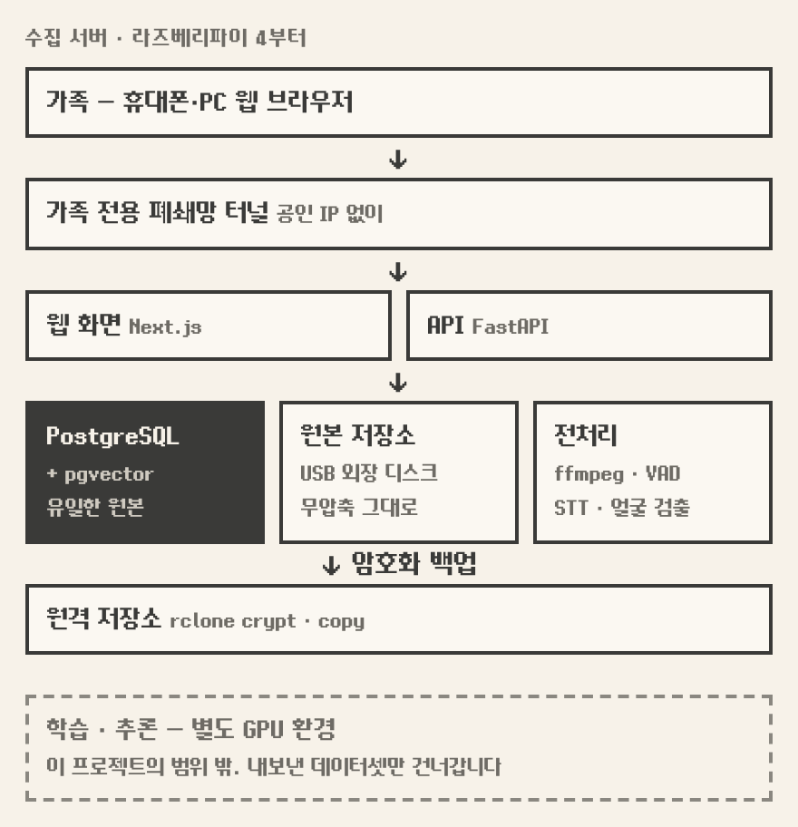
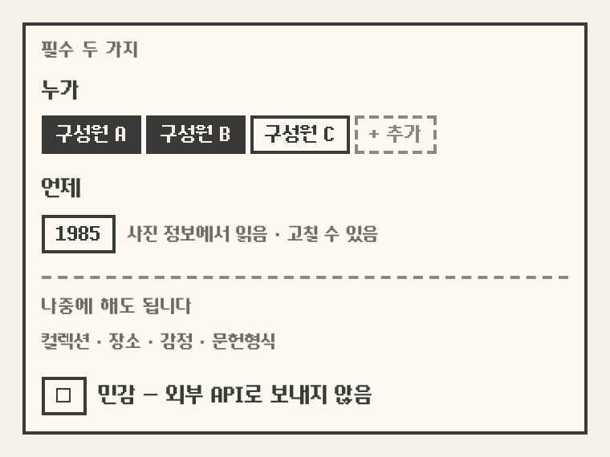
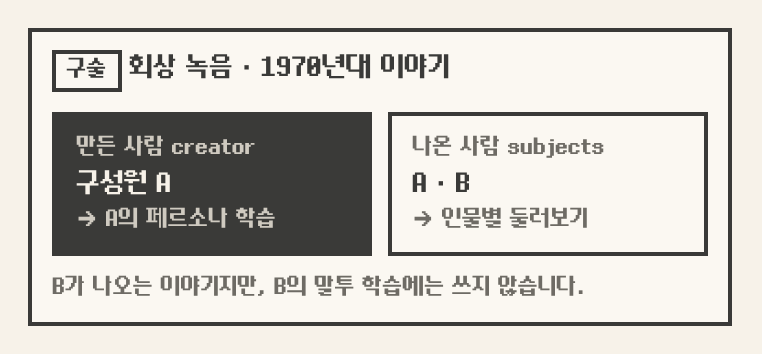
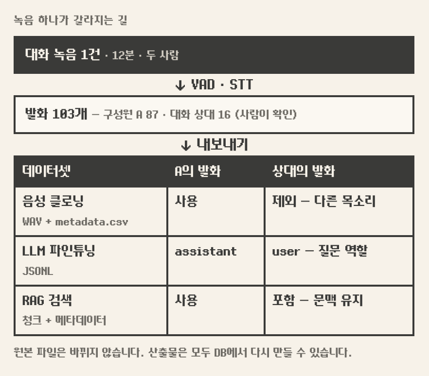
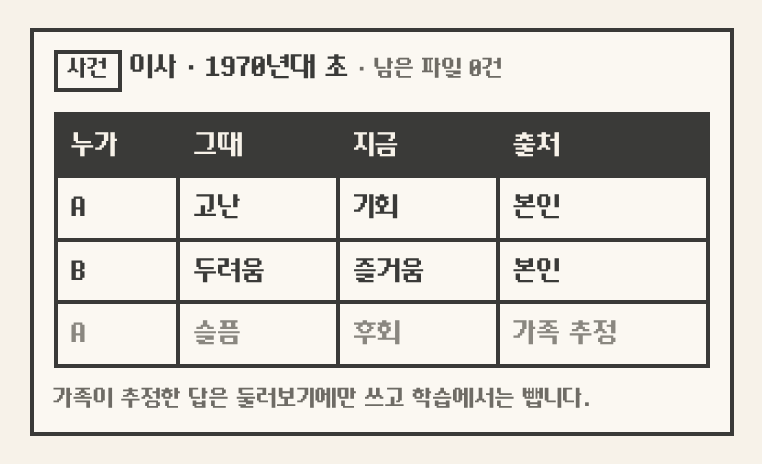
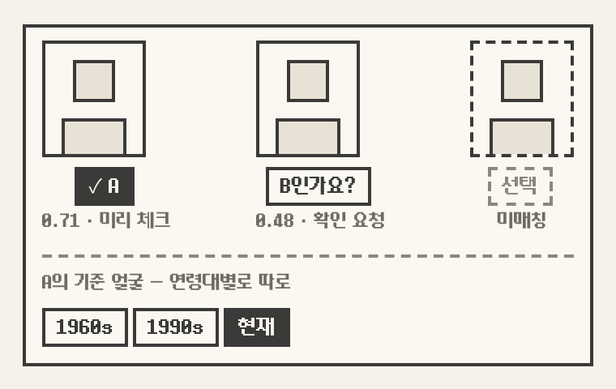
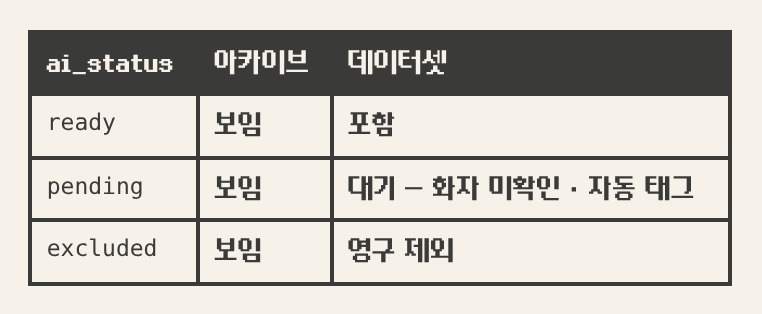
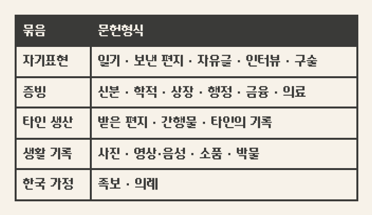
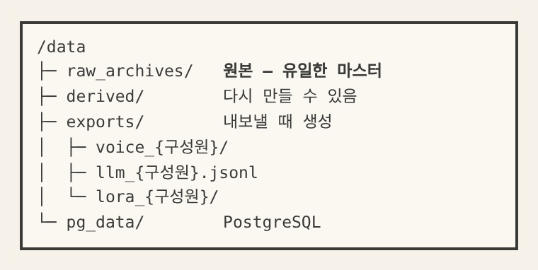
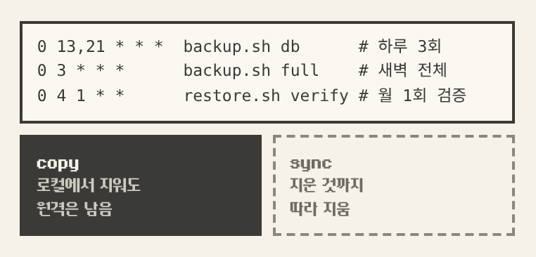

언젠가 가족의 목소리와 말투로 대화하는 AI를 만들 수 있을 것이다. 모델은 해마다 좋아지고, 학습에 드는 비용은 해마다 싸진다. 그런데 그때 넣을 자료는 해마다 줄어든다. 녹음할 수 있는 이야기는 지금만 녹음할 수 있다.

그래서 모델보다 **자료를 모으는 집**을 먼저 짓기로 했다. 가족 아카이브는 가족의 글·사진·영상·목소리를 모아 보존하는 아카이브 사이트이면서, 그 자료를 나중에 페르소나 AI 학습에 바로 넣을 수 있는 형태로 쌓아 두는 시스템이다. 이 글은 그 설계에서 내린 결정과 이유를 정리한 것이다.

- 소개: [metaphr.dev/app.html?id=family-archive](https://metaphr.dev/app.html?id=family-archive)
- 저장소: [github.com/ksthink/family](https://github.com/ksthink/family)

아직 설계 단계다. 저장소에는 설계 문서와 백업 스크립트가 있고, 앱 코드는 이제 올린다. 글에 실은 그림은 설계 문서를 옮긴 도식이며 실제 가족 자료는 싣지 않았다.

*구조. 수집 서버 한 대가 모으고 정리한다. 학습과 추론은 점선 바깥이다.*

## 범위부터 잘랐다

처음 계획서의 이름은 "AI-Ready 가족 아카이브 시스템"이었다. 문서를 쓰다 보니 학습·추론까지 한 프로젝트에 넣으면 아무것도 끝나지 않을 것 같았다. 그래서 선을 그었다.

- **이 프로젝트:** 수집·정제·구조화
- **범위 밖:** 모델 학습과 실시간 추론 — 클라우드 GPU나 나중에 들일 별도 머신에서

이 선 하나로 하드웨어 문제가 풀렸다. 수집 서버는 업로드를 받고, 음성을 받아 적고, 사진의 얼굴을 찾고, DB에 넣으면 된다. 라즈베리파이 4면 충분하고, 저전력이라 24시간 켜 둘 수 있다. 대화형 AI가 필요해지는 날 GPU를 빌리면 되고, 그날에도 이 서버는 데이터 공급원으로만 남는다.

다음 날 두 번째 전환이 있었다. 학습 데이터를 모으는 도구로만 두면 가족이 쓸 이유가 없다. 데이터셋을 만들자고 하면 아무도 안 올린다. 앨범을 정리하자고 하면 올린다. 그래서 범위를 **가족이 쓰는 아카이브 사이트**로 다시 정했다. 가족에게는 인물·연도·컬렉션으로 둘러보는 평범한 사이트고, 데이터셋은 그 뒤에서 쌓인다.

*올릴 때 꼭 받는 것은 누가와 언제 두 가지뿐이다. 이 태그가 둘러보기 축이자 학습 메타데이터가 된다.*

## 기록학 논문에서 고른 것과 버린 것

스키마를 짜기 전에 국내 기록학 연구 두 편을 읽었다. 하나는 개인기록 관리를, 하나는 생애 기억 아카이브와 개인 서사를 다룬 연구였다. 둘 다 좋은 틀이었지만, 연구 기관이 아니라 한 가족이 운영하는 시스템에 그대로 가져올 수는 없었다.

| 가져온 것 | 버린 것 |
|---|---|
| 감정의 이중 구조 (그때와 지금) | 정해진 질문 구조 |
| 생산자와 주제인물의 구분 | 서사 플롯의 자동 분류 |
| 실물 원본의 위치·상태 추적 | 사후 기록관리자 지정 |
| 사건을 기본 단위로 | 형식적인 사전 동의 절차 |

버린 쪽의 공통점은 운영 부담이다. 가족이 매번 지킬 수 없는 절차는 결국 아무도 안 지킨다.

## 말한 사람과 나온 사람

가장 먼저 부딪힌 문제는 "이 기록은 누구의 것인가"였다.

한 사람이 다른 가족의 어린 시절을 회상한 녹음이 있다고 하자. 두 사람이 이야기에 나오지만, 말한 사람은 한 명이다. 이 녹음으로 두 번째 사람의 말투를 학습하면 엉뚱한 봇이 나온다.

그래서 기록마다 두 칸을 둔다.

- `creator_id` — 만든 사람, 말한 사람. **페르소나 학습**에 쓴다.
- `subject_ids` — 나온 사람들. **둘러보기**에 쓴다.

*나온 사람에는 둘 다 들어가지만, 학습은 만든 사람만 본다.*

대화 녹음은 한 단계 더 쪼갠다. 녹음을 문장 단위 발화로 자르고, 발화마다 말한 사람을 붙인다. 그러면 같은 발화가 용도에 따라 다르게 쓰인다.

*대화 상대의 발화는 음성 학습에서는 빠지지만, LLM 데이터셋에서는 질문 역할로 쓰이고 검색용으로는 문맥 때문에 남는다.*

## 같은 사건을 두 번 기억한다

인생의 큰 사건 대부분은 남은 기록이 없다. 이사, 결혼, 처음 일한 곳. 사진 한 장 없는 일이 더 많다. 그래서 파일이 아니라 **사건**을 기본 단위로 삼았다. `collections` 테이블의 `kind`가 `event`면 연결된 파일이 0건이어도 유효한 기록이다. 그 빈칸이 곧 "이 이야기를 녹음하자"는 수집 과제가 된다.

사건에 얽힌 기억은 `memories` 테이블에 사람마다 따로 적는다. 여기서 연구에서 가져온 이중 구조를 썼다.

- `emotion_then` — 그때의 감정 (고난, 두려움, 기쁨…)
- `evaluation_now` — 지금의 평가 (기회, 후회, 즐거움…)

그때는 고난이었는데 지금 돌아보면 기회였다고 말하는 간극이 그 사람이 삶을 해석하는 방식이다. 말투만 흉내 내는 봇과 그 사람처럼 생각하는 봇의 차이가 여기서 난다고 봤다.

*같은 사건을 두 사람이 다르게 기억한다. 회색 줄은 가족이 대신 추정한 답이다.*

`answered_by`로 본인 답과 가족 추정을 나눈다. 가족이 "아마 이렇게 느꼈을 거야"라고 적은 답은 둘러보기에는 쓰지만 학습에서는 뺀다.

## 얼굴 인식은 답이 아니라 제안이다

사진을 올릴 때 가장 귀찮은 일은 나온 사람을 전부 고르는 것이다. 그래서 얼굴 인식을 붙였다. InsightFace의 작은 모델(`buffalo_s`)을 ONNX Runtime으로 CPU에서 돌리면 라즈베리파이 4에서도 사진 한 장에 1~3초다. 업로드 뒤 백그라운드로 돌리니 느려도 괜찮다. 벡터 검색은 이미 있는 pgvector를 그대로 쓴다.

다만 결과를 답으로 쓰지 않는다.

| 유사도 | 동작 |
|---|---|
| 높음 (0.6 안팎 이상) | 미리 체크해서 보여 준다. 사람은 확인만 |
| 애매함 | "○○인가요?" 하고 묻는다 |
| 낮음·미매칭 | 얼굴 상자만 그리고 사람이 고른다 |

*유사도에 따라 미리 체크, 확인 요청, 직접 선택으로 갈린다.*

`face_detections`에는 AI가 제안한 `suggested_member`와 사람이 확정한 `confirmed_member`를 따로 둔다. 자동으로 붙은 태그는 학습 적격 상태를 `ready`로 올리지 않는다. 가족은 서로 닮았다. 부모와 자식, 형제를 헷갈린 태그가 학습에 들어가면 되돌리기 어렵다.

이 프로젝트에만 있는 어려움도 있다. **나이**다. 20대 얼굴과 80대 얼굴은 벡터로 멀다. 그래서 한 사람에게 연령대별 기준 얼굴을 여럿 둔다(`face_references.era_label`). 옛날 사진을 태깅할수록 그 시대의 정확도가 올라간다. 흑백 스캔에서 얼굴을 못 찾는 것은 실패가 아니라 정상으로 보고, 수동 태깅으로 넘긴다.

얼굴 임베딩은 생체정보라 전 과정을 로컬에서만 돌린다. 외부 API로 보내지 않는다.

## 학습에 못 써도 아카이브에는 남긴다

화자가 확인되지 않은 대화 녹음은 학습에 쓸 수 없다. 그렇다고 버릴 수는 없다. 가족에게는 소중한 기록이고, 검색 자료로는 그대로 유용하다. 그래서 "보이는가"와 "학습에 들어가는가"를 분리했다.

*세 상태 모두 아카이브에는 보인다. 데이터셋에 들어가는 것은 ready뿐이다.*

## 동의서 대신 예외를 적는다

처음 스키마에는 `ai_consent` 필드가 있었다. 구성원이 동의해야 학습에 쓸 수 있게 하는 구조였다. 얼마 안 가 걷어 냈다.

앨범을 정리하고 어르신 이야기를 녹음하는 일에 서명 절차를 두면 기록이 시작되지 않는다. 가족이 가족의 기록을 모으는 일이다. 그래서 기본을 허용으로 바꾸고, 본인이 원치 않는다고 밝힌 범위만 적는다.

- `ai_optout` — `NULL`(제한 없음), `voice`(음성 합성 제외), `persona`(대화형 제외), `all`(AI 활용 전체 제외)

대신 지키는 선은 따로 있다.

- 유언·재산·건강 같은 민감한 기록은 `local_only`로 외부 API 전송을 막는다. 동의 문제가 아니라 유출 방지다.
- 생성된 AI 음성과 글에는 "AI 생성" 표시를 남긴다. 몇 년 뒤 진짜 목소리인지 판별할 수 없으면 아카이브 자체를 믿을 수 없게 된다.
- 페르소나 AI는 그 사람의 대체물이 아니라, 그 사람이 남긴 이야기에 접근하는 도구로 정의한다.

## 편지 스캔은 이미지지만 성격은 편지다

파일 형식(`media_type`)만으로는 자료를 다 설명할 수 없다. 스캔한 편지는 형식상 이미지지만 성격은 편지다. 그래서 문헌형식(`doc_type`) 축을 따로 두고 다섯 묶음 20종으로 나눴다.

*족보와 의례는 한국 가정에만 있는 형식이라 묶음을 따로 만들었다.*

묶음마다 쓰임이 다르다. 자기표현 묶음은 말투 학습의 재료가 되고, 증빙 묶음은 사실을 확정한다. 졸업장이나 증명서에서 확인한 날짜는 `verified_date`에 적어 연표의 기준점으로 쓴다. 기억은 흔들려도 증명서의 날짜는 흔들리지 않는다.

디지털로 옮겨도 실물은 남는다. `physical_location`에 "안방 장롱 위 상자" 같은 위치를, `physical_condition`에 상태를 적는다. 상태가 나쁜 것부터 디지털화한다.

## DB가 유일한 원본이다

학습 프레임워크는 저마다 원하는 형식이 다르다. 음성 모델은 32kHz나 24kHz WAV와 `metadata.csv`를, LLM 파인튜닝은 JSONL을, 이미지 LoRA는 그림과 같은 이름의 `.txt` 캡션을 원한다. 내년에는 또 다른 형식이 나올 것이다.

그래서 어떤 모델 규격도 마스터로 삼지 않았다. 원본은 무압축 그대로 `raw_archives/`에 두고, 메타데이터는 PostgreSQL 한 곳에만 둔다. 학습용 파일은 내보낼 때마다 DB와 원본에서 새로 만든다.

*원본만 마스터다. `derived/`와 `exports/`는 지워도 다시 만들 수 있다.*

내보낸 파일을 원본처럼 고치기 시작하면 다시 만들 수 없게 된다. 맞춤법 교정도 하지 않는다. 틀린 맞춤법에 말투가 남아 있다.

## 라즈베리파이에서 버티기

수집만 하면 된다지만, 저사양 기기를 24시간 켜 두려면 몇 가지를 지켜야 했다.

- OS는 Ubuntu Server 24.04 LTS 헤드리스로 깔고 `snapd`를 지워 메모리를 확보한다.
- 부팅은 MicroSD High Endurance 등급으로, DB와 미디어는 반드시 USB 저장장치로 뺀다. 로그는 tmpfs로, 스왑은 끄고, `noatime`으로 마운트한다. 전부 SD 카드 수명을 위한 것이다.
- Next.js는 PC에서 빌드해 결과물만 올린다. 파이에서 빌드하지 않는다.
- 동영상은 트랜스코딩하지 않는다. 원본을 두고 오디오 트랙만 뽑는다.

음성 받아쓰기는 Groq의 Whisper large-v3 API를 기본으로 쓴다. 무료 범위가 하루 2,000건, 28,800초라 가족 녹음에는 넉넉하다. 막히거나 민감한 녹음이면 로컬 whisper.cpp로 넘긴다. 그 앞에서 ffmpeg로 16kHz 모노 WAV를 따로 만들고, Silero VAD로 말이 있는 구간만 잘라 보낸다. 첫 음절이 잘리지 않게 구간 앞뒤에 300~400ms를 더 붙인다.

## 백업은 기능이 아니라 전제다

가족 기록은 다시 구할 수 없다. 그래서 1단계 인프라 작업에 백업을 넣었다. 서버보다 백업 스크립트가 먼저 저장소에 올라갔다.

*cron 세 줄. 그리고 sync 대신 copy.*

- rclone `crypt`로 파일 이름까지 암호화해 원격에 올린다. 비밀번호는 서버 밖에 따로 둔다. 잃어버리면 복원할 수 없다.
- `sync`가 아니라 `copy`를 쓴다. 로컬에서 실수로 지운 파일이 원격에서까지 지워지면 안 된다.
- DB는 작고 자주 바뀌니 하루 세 번, 미디어는 크고 한 번 올리면 안 바뀌니 하루 한 번.
- 작은 파일을 하나씩 올리지 않고 날짜별로 묶어 올린다. API 호출 제한을 피하기 위해서다.
- 한 달에 한 번 임시 DB에 덤프를 복원해 본다. 운영 DB는 건드리지 않는다. 복원해 보지 않은 백업은 백업이 아니다.

## 남은 것

- **수집 서버.** 1단계(인프라·백업)부터 순서대로 올린다. 그다음이 DB·업로드·전처리, 그다음이 아카이브 화면이다. 얼굴 인식은 사진 수백 장과 수동 태깅이 쌓인 뒤에 붙인다. 기준 얼굴이 없으면 제안도 없다.
- **아카이브 사이트.** 이름은 '집안기록'으로 정했다. 더블린 코어를 바탕으로 하고, 흑백 픽셀아트에 Mulmaru 글꼴을 쓴다. 관리자는 한 명이고, 로그인은 비공개 기록을 보기 위해서만 있다.
- **수집 현황판.** 구성원마다 학습 가능한 음성 길이(목표 30분~1시간), 문답 쌍(500~1,000턴), 인물 사진(20~50장)을 보여 주고, 부족한 감정 쪽으로 데일리 인터뷰 질문을 돌린다. "언제 페르소나를 만들 수 있는가"를 이 판으로 가늠한다.
- **하드웨어.** 라즈베리파이 5와 NVMe SSD 조합을 검토했고, 미니 PC로 옮길 길도 열어 두었다. 수집과 추론을 나눠 둔 덕에 어느 쪽을 바꿔도 다른 쪽은 그대로다.

설계 문서 마지막에 이렇게 적어 두었다. 시스템은 나중에 얼마든지 고칠 수 있지만, 기록할 기회는 지나가면 돌아오지 않는다. 서버가 완성되기를 기다리지 말고, 오늘 휴대폰 음성 메모로 30분을 녹음하자. 그 파일은 어떤 하드웨어를 쓰든, 어떤 모델이 나오든 그대로 쓸 수 있다.
