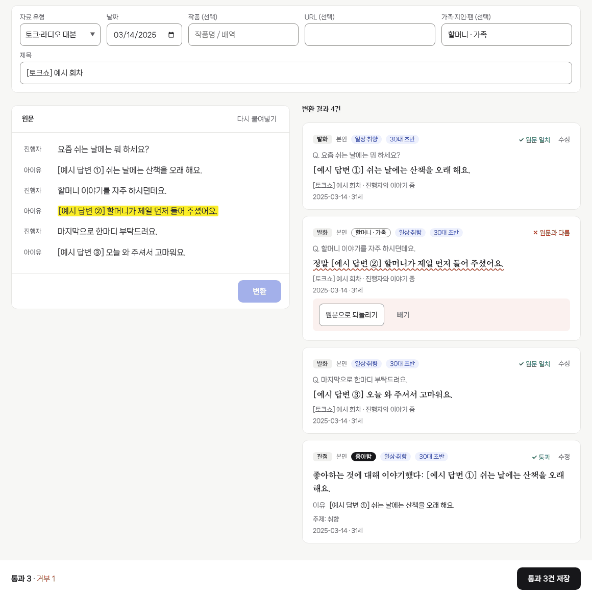
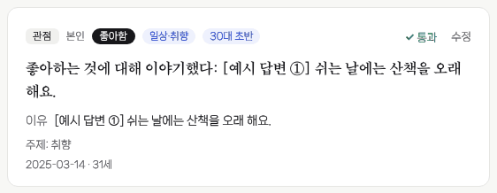
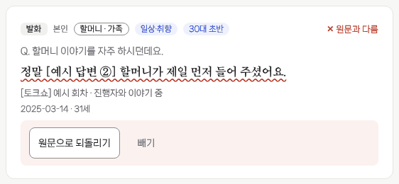
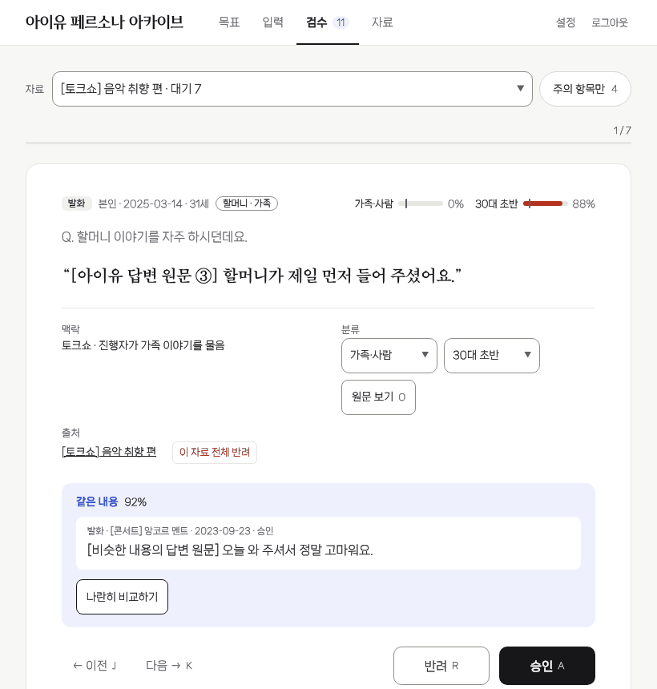
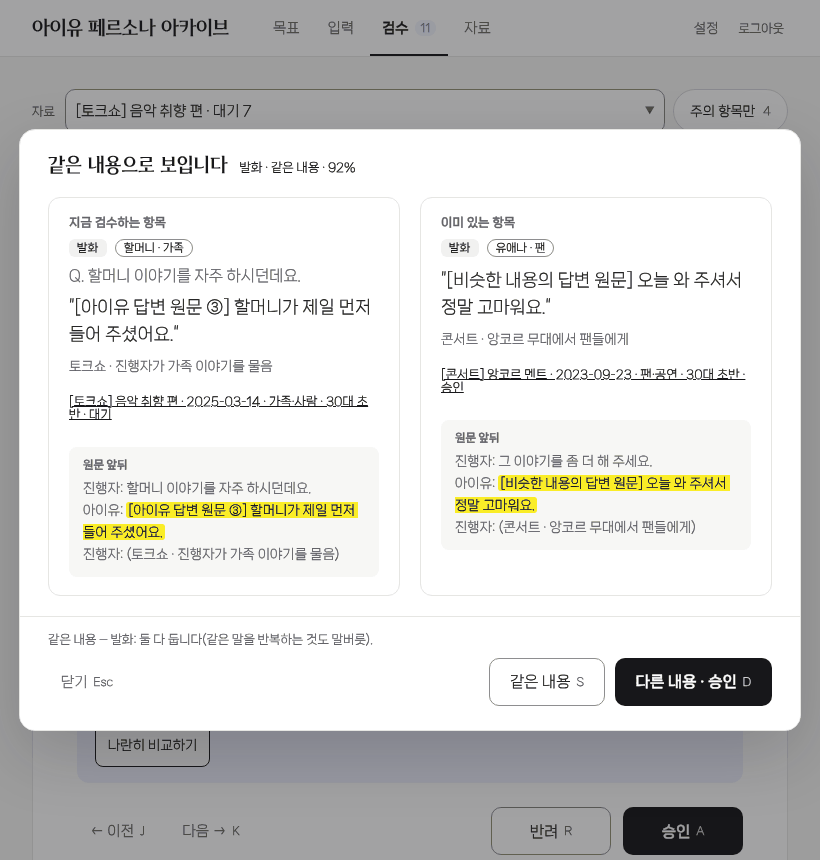
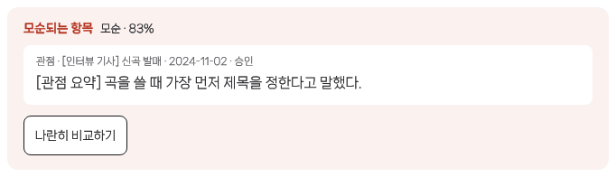
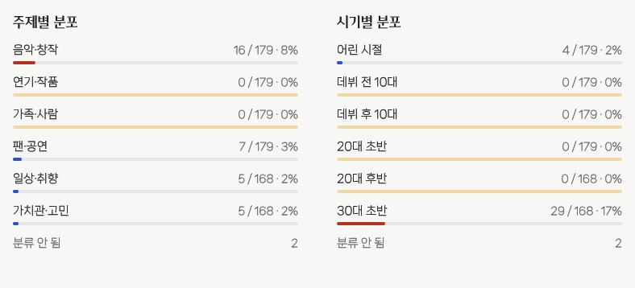
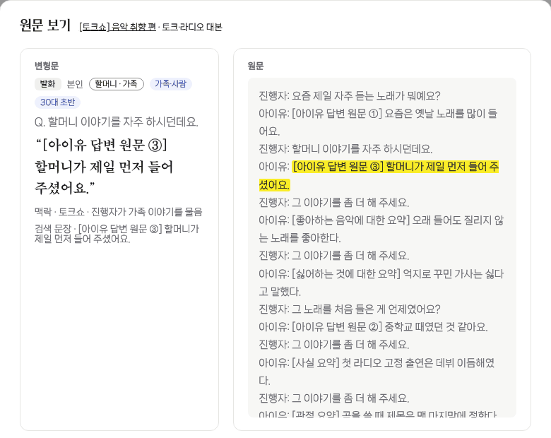

페르소나 아카이브는 한 사람의 말과 기억을 RAG와 파인튜닝에 쓸 수 있는 형태로 체계적으로 모으는 수집 플랫폼이다. 목표는 가족과 친구, 반려동물과 나눈 기억을 모아, 떠나보낸 뒤에도 그 사람다운 말을 다시 꺼내 볼 수 있게 하는 것이다. 지금은 대화형 모델을 만들기 전, 자료를 모으고 다듬는 프리프로덕션 단계의 연구다.

떠난 사람을 그럴듯하게 흉내 내는 일은 어렵지 않다. 어려운 것은 그 사람이 하지 않은 말을 만들지 않는 일이다. 남은 사람에게 지어낸 말은 위로가 아니라 상처가 된다. 그래서 생성보다 수집에 먼저 공을 들였다. 목표는 대체가 아니라 **보존**이다.

방법이 맞는지는 자료가 넉넉한 사람으로 먼저 확인하기로 했다. 첫 사례가 **아이유 페르소나 아카이브**다. 공개된 방송·인터뷰 자료가 많아 말투와 생각과 사실이 어떻게 섞여 있는지, 같은 이야기가 얼마나 되풀이되는지, 시기와 주제가 얼마나 쏠리는지가 숫자로 드러난다. 아이유 본인 및 소속사와는 관련 없는, 방법을 검증하기 위한 예시다. 이 글은 이 첫 사례로 만든 수집 도구의 구조를 정리한 것이다.

- 소개: [metaphr.dev/app.html?id=iu-archive](https://metaphr.dev/app.html?id=iu-archive)
- 운영 주소: iu.metaphr.dev — 관리자 한 명만 쓰는 비공개 도구라 로그인 화면만 보인다.

글에 실은 화면은 모두 목업 데이터로 찍었다. 대괄호로 표시한 문장(`[예시 답변 ①]`)은 실제 발언이 아니라 자리를 채운 예시다.


*입력 화면. 붙여 넣은 원문이 왼쪽에, LLM이 자른 항목 카드가 오른쪽에 온다. 카드에 마우스를 올리면 그 구간이 원문에 칠해진다.*

## 왜 수집 단계를 따로 두었나

아래 내용은 모두 아이유 사례에서 나왔지만, 가까운 사람의 기억을 모을 때도 그대로 적용된다.

인터넷에서 긁어 온 글을 그대로 임베딩하면 세 가지가 무너진다.

1. **말투가 흐려진다.** 기사와 요약문은 기자와 편집자의 문장이다. 본인의 말버릇·리듬·감탄사는 한 글자도 고치지 않은 받아쓰기에만 남아 있다.
2. **사실과 의견이 섞인다.** "산책을 좋아한다"는 본인이 말한 취향이고, "2008년에 데뷔했다"는 사실이다. 봇은 둘을 다르게 써야 하는데, 구분 없이 넣으면 의견을 사실처럼, 사실을 의견처럼 말한다.
3. **한쪽으로 쏠린다.** 구하기 쉬운 자료는 최근 활동과 음악 이야기다. 그대로 쌓으면 봇은 한 시기의 한 주제만 아는 사람이 된다.

그래서 임베딩 전에 단계를 하나 끼웠다. 원문을 의미 단위로 자르고, 유형을 나누고, 발화가 원문 그대로인지 기계로 대조하고, 겹치는지 검사하고, 사람이 한 건씩 승인한 것만 메타데이터를 붙여 내보낸다. 챗봇과 임베딩은 이 도구의 범위 밖이다.

```
입력 ─▶ LLM 변환 ─▶ 자동 검증 ─▶ 저장 전 중복 판정 ─▶ 저장(대기) ─▶ 저장 후 중복 판정 ─▶ 검수 ─▶ 내보내기
원문      항목으로       원문 대조·       이미 있는 내용은                       같이 저장한 항목끼리      승인/반려    JSONL
붙여넣기   자르기         규칙 검사        기본으로 제외                          비교
```

## 항목 모델: 발화·관점·사실

모든 자료는 세 유형의 항목으로 쪼개진다.

| 유형 | 코드 | 무엇 | 규칙 | 기본 목표 |
|---|---|---|---|---|
| 발화 | `style` | 실제로 한 말 그대로 | 원문의 이어진 한 구간. 맞춤법·감탄사·반복까지 그대로 | 800 |
| 관점 | `view` | 생각·가치관·좋고 싫음·본인이 말한 성향의 요약 | 원문에 없는 내용을 더하지 않음. 좋고 싫음은 직접 말한 것만 | 150 |
| 사실 | `fact` | 경력·작품·일화의 요약 | 원문에 근거한 것만 | 100 |

한 답에 셋이 섞여 있으면 같은 말에서 여러 항목이 나온다. "비 오는 날을 좋아해요. 데뷔 전 할머니랑 살 때…"는 발화(그대로) + 관점(비 오는 날을 좋아함) + 사실(데뷔 전 할머니와 삶)이 된다.


*관점 카드. 좋고 싫음(`stance`)과 그 이유(`because`)를 따로 적는다.*

항목마다 붙는 분류는 이렇다.

- `persona` — 본인(`self`)인지 드라마·영화 배역(`character`)인지. 배역의 대사를 본인 의견으로 쓰면 안 되니 가장 중요한 구분이다.
- `about` + `relation` — 등장한 지인과 관계(가족·친구·동료·팬). 공인이 아니면 실명 대신 "할머니", "중학교 친구"처럼 관계로 부른다.
- `stance` + `because` — 본인이 직접 밝힌 좋고 싫음과 이유. "○○의 팬이 됐어요"처럼 단어 없이 애정을 밝힌 것도 포함하지만, 그때의 기쁨·속상함 같은 감정만 말한 것은 제외한다.
- `topic` — 음악·창작, 연기·작품, 가족·사람, 팬·공연, 일상·취향, 가치관·고민.
- `period` — **내용이 다루는 때**의 생애 단계. 어린 시절(~12세)부터 30대 후반까지.
- `works` — 다루는 앨범·곡·드라마·영화·공연. 기준 목록 111개의 이름으로 맞춘다.

`period`를 말한 날짜가 아니라 내용의 시점으로 나눈 이유가 있다. 2024년 인터뷰에서 초등학생 때 이야기를 하면 그건 어린 시절 자료다. 말한 날짜로만 나누면 어린 시절은 영영 0건으로 보이고, 활동이 이어질수록 최근 구간만 부푼다.

## 말투는 받아쓰기에서만

자료 유형은 일곱 가지이고, 유형마다 변환 프롬프트가 따로 있다.

| 자료 유형 | 주로 나오는 항목 |
|---|---|
| 토크·라디오 대본 | 질문-답 형태의 발화, 취향·생각 |
| 콘서트 멘트 | 팬에게 하는 발화 |
| 제작발표회(현장 전사본만) | 발화, 작품·연기에 대한 관점 |
| 드라마·영화 본편 | 배역의 대사(`persona=character`) |
| 인터뷰 기사 | 관점, 사실 — **발화 없음** |
| 본인이 쓴 글 | 글로 쓴 발화, 관점 |
| 위키·프로필 | 사실 |

처음에는 기사의 따옴표 인용도 발화로 받았다. 11월 1일에 규칙을 바꿨다. 기사 속 따옴표는 기자가 "~다"체로 다듬어 옮긴 말이라, 말투 본보기에 기자 문체가 섞인다. 이제 기사에서는 관점과 사실만 뽑고, 기사 출처의 발화는 변환 프롬프트와 저장 검증 양쪽에서 막는다. 파인튜닝용 대화 쌍에서도 기사 출처를 한 번 더 뺀다.

같은 날 전사본 규칙도 바꿨다. 예전에는 "말투가 드러나는 구간"을 LLM이 골랐는데, 무엇이 말투인지 고르는 순간 쏠림이 생긴다. 지금은 아이유의 답과 멘트를 전부 발화 후보로 삼고, 가사·함성 표기·남의 말이 섞인 구간만 뺀다.

규칙을 바꾸면서 그때까지 넣은 자료는 예시 입력으로 보고 전부 비웠다. 규칙에 맞추어 옛 자료를 고치는 것보다, 새 규칙으로 처음부터 다시 모으는 편이 결과물이 깨끗하다.

## LLM 변환과 원문 대조

### 조각 나누기

긴 원문은 화자 차례를 끊지 않고 약 5천 자씩 나눈다. 짧은 질문이 조각 끝에 걸리면 다음 조각으로 넘겨 답과 함께 보낸다. 둘째 조각부터는 앞 조각의 끝부분을 맥락으로 함께 보내, "그 노래"가 무엇을 가리키는지 놓치지 않게 한다.

### 관점 누락 확인

LLM은 좋고 싫음을 자주 빠뜨린다. "팬이 됐다"처럼 단어 없는 취향은 사실로만 남기기 쉽다. 그래서 조각마다 변환이 끝나면 **관점 누락 확인**을 한 번 더 부른다. 좋고 싫음이나 생각을 말했는데 관점 항목이 빠진 곳만 다시 찾아 더하고, 이미 있는 관점과 문자 3-gram으로 0.5 이상 겹치면 버린다.

### 원문 대조

발화는 원문 그대로여야 한다. 그런데 LLM은 말을 다듬고 싶어 한다. "정말"을 덧붙이고, 반복을 지우고, 맞춤법을 고친다. 그래서 발화 항목은 저장 전에 원문과 기계로 대조한다. 공백과 문장부호 차이만 허용하고, 한 글자라도 다르면 저장 대상에서 뺀다.


*LLM이 "정말"을 덧붙인 발화. 원문과 다르다고 표시되고, 원문으로 되돌리거나 뺄 수 있다.*

### 원문 위치(`span`)

모든 항목은 원문 속 위치를 들고 있다. 발화는 그 구간 그대로다. 관점·사실은 요약문이라 원문에 같은 문장이 없으므로, 변환할 때 LLM에게 **근거로 삼은 원문 문장 1~3개**를 함께 내게 하고 그 문장들의 범위를 위치로 쓴다. 1,500자 넘게 벌어지면 가장 긴 문장 하나만, 근거를 못 찾으면 요약문과 가장 비슷한 구간을 쓴다.

좌표는 JavaScript 문자열 인덱스, 즉 UTF-16 코드 유닛 기준이다. 원문에 이모지가 있으면 Python의 `str` 인덱스와 어긋나므로, 다음 단계에서 Python으로 자를 때는 바이트로 바꿔 자른다.

```python
def slice_span(raw: str, start: int, end: int) -> str:
    b = raw.encode("utf-16-le")
    return b[start * 2 : end * 2].decode("utf-16-le")
```

## 겹침과 모순

같은 일화는 여러 방송과 기사에서 되풀이된다. 겹침은 네 겹으로 거른다.

| 단계 | 무엇을 | 결과 |
|---|---|---|
| 저장 | 공백·문장부호만 다른 같은 문장 | 저장을 막음 |
| 저장 전 | 이미 저장된 항목과 의미 판정 | 같은 내용이면 입력 카드에서 기본 제외 |
| 저장 후 | 함께 저장된 항목끼리도 포함해 판정 | 검수 화면에 "같은 내용 / 비슷한 항목 / 모순" 표시 |
| 검수 | 비교 팝업에서 사람이 판정 | 표시가 남아 있으면 승인 불가(모순은 예외) |

의미 판정은 판정 모델 Jev가 하고, Jev를 부를 수 없을 때만 문자 3-gram Jaccard로 대신한다. 후보는 같은 유형에서 ① 같은 지인이 나온 최근 20건 + ② 문장이 가장 비슷한 30건이다. 관점·사실은 같은 자료 안에서도 비교하고(긴 방송에서 같은 말을 되풀이하므로), 발화는 다른 자료끼리만 비교한다. Jev 확률 0.9 이상이면 "같은 내용", 0.7~0.9면 "비슷한 항목"이다.


*검수 카드. 이미 승인된 콘서트 멘트와 같은 내용으로 보인다는 표시가 붙었다.*

"같은 내용"으로 판정했을 때의 처리는 유형마다 다르다.

- **사실**: 새 항목을 반려한다. 같은 사실은 하나면 된다.
- **관점**: 같은 해에 한 말이면 반려하고, 해가 다르면 둘 다 둔다. 시간이 지나도 같은 생각이라는 것도 정보다.
- **발화**: 둘 다 둔다. 같은 말을 되풀이하는 것도 말버릇이다.


*비교 팝업. 두 항목을 질문·맥락·출처·원문 앞뒤와 함께 나란히 놓고 S(같은 내용)나 D(다른 내용)로 판정한다.*

### 모순은 막지 않는다

같은 대상에 대해 함께 참일 수 없는 말 — 다른 날짜나 숫자, 좋아함과 싫어함 — 은 빨간 상자로 알린다. 관점과 사실만 보고, 발화는 농담과 반어가 많아 뺐다.


*모순 표시. 곡 제목을 처음에 정한다는 말과 마지막에 정한다는 말.*

모순은 승인을 막지 않는다. 사실이 엇갈리면 틀린 쪽을 반려하면 되지만, 관점은 생각이 바뀐 것일 수 있다. 사람은 생각이 바뀐다. 그걸 오류로 지우면 봇은 한 시점에 굳은 사람이 된다. 날짜가 다른 두 관점은 둘 다 남기고, 봇이 "예전엔 ~, 요즘은 ~"으로 답하게 하는 것이 다음 단계의 일이다.

## 쏠림을 숫자로 본다

목표는 유형별 건수(발화 800·관점 150·사실 100)와 주제·시기별 **비율**로 정한다. 시기는 지금 생애 단계까지만 입력하고, 묶음마다 합이 100%여야 저장된다. 각 칸의 목표 건수는 (세 유형 목표의 합) × 비율이라, 유형 목표를 바꾸면 같이 따라간다.


*목표 화면의 분포. 음악·창작과 30대 초반이 빨갛다 — 쏠림.*

실제 비중이 목표 비율의 1.5배를 넘으면 빨간 막대(쏠림), 절반에 못 미치면 주황 막대(부족)로 칠한다. 승인 항목이 30건을 넘기 전에는 표시하지 않는다. 몇 건 안 될 때의 비율은 소음이다.

같은 막대를 검수 카드 위에도 작게 둔다. 지금 보는 항목의 주제가 이미 48%를 차지하고 있으면, 승인 버튼을 누르기 전에 한 번 더 생각하게 된다. 수집하는 사람의 손을 조금씩 덜 쏠린 쪽으로 미는 장치다.

## 검수는 키보드로

검수는 한 건씩이고, 손이 마우스로 가지 않게 했다.

| 키 | 동작 |
|---|---|
| `A` | 승인(비슷한 항목 표시가 있으면 먼저 비교 팝업) |
| `R` → `1`~`6` | 반려 사유(오전사·화자 혼입·맥락 부족·페르소나 부적합·좋고 싫음 틀림·기타) |
| `J` / `K` | 이전 / 다음 항목 |
| `O` | 원문 보기 |
| `S` / `D` | 비교 팝업에서 같은 내용 / 다른 내용 |

`O`를 누르면 왼쪽에 변형문, 오른쪽에 원문 전체가 뜨고 해당 구간에 형광펜이 칠해진다. 관점·사실을 검수할 때는 이 화면이 핵심이다. 요약이 원문에 없는 내용을 더했는지는 원문 옆에 놓고 봐야 보인다.


*원문 보기. 항목이 나온 구간이 원문에서 노랗게 칠해지고 그 위치로 스크롤된다.*

## 결과물: 파일 셋과 부모 문서

내보내기는 두 가지 zip이다. **결과물**은 승인 항목만 담아 다음 단계로 넘기고, **전체 백업**은 대기·반려까지 DB 행 그대로 담아 되돌리기에 쓴다.

결과물 zip(스키마 v4)의 구성:

| 파일 | 역할 |
|---|---|
| `style.jsonl` | 어떻게 말하는가 — 말투 본보기 |
| `view.jsonl` | 무엇을 생각하고 좋아하는가 — 의견의 근거 |
| `fact.jsonl` | 무엇이 사실인가 — 사실의 근거 |
| `sources.jsonl` | 부모 문서 — 위 항목이 나온 원문 |
| `chat.jsonl` | 질문이 있는 본인 발화를 `user → assistant` 쌍으로(파인튜닝용) |
| `manifest.json` | 스키마 버전과 파일별 건수 |

세 JSONL의 한 줄은 같은 형태다. 핵심은 `text`와 `embed_text`를 나눈 것이다.

```jsonc
{
  "type": "style",
  "question": "요즘 어떻게 지내세요?",
  "text": "저는 요즘에, 음… 진짜 잠을 많이 자요.",        // 원문 그대로 — 답의 재료
  "embed_text": "아이유는 요즘 잠을 많이 잔다고 말했다", // 검색용 자기완결 문장
  "context": "라디오 진행자에게, 근황에 대해",
  "spoken_at": "2025-03-14", "age_at_time": 31,
  "topic": "daily", "period": "early_30s", "works": [],
  "span": { "start": 120, "end": 141 },
  "source": { "id": "9f2e…", "source_type": "talk_radio" }
}
```
*형태를 보여 주는 예시 값이다.*

원문 그대로의 `text`는 "음…", 반복, 감탄사 때문에 검색어와 잘 맞지 않는다. 그래서 검색용 문장을 따로 두고, "그 노래"를 노래 제목으로 풀어 쓰듯 원문 없이도 뜻이 통하게 쓰도록 변환 규칙에 정해 두었다. **검색은 `embed_text`로, 답의 재료는 `text`로.**

## 다음 단계: RAG에서 어떻게 쓰나

결과물을 받는 쪽 설계도 문서로 먼저 써 두었다. 원칙은 세 가지다.

**내용은 근거에서, 말투는 본보기에서.** 사실과 관점은 검색된 `fact`·`view`에서만 가져오고, `style`은 어투와 리듬의 본보기로만 쓴다. 본보기 속 내용을 사실처럼 옮기지 않는다.

**작게 찾고 넓게 읽기.** 검색은 짧은 항목(자식)으로 하고, 생성에 넣을 때는 `span`으로 원문(부모)의 앞뒤 대화까지 넓힌다. 앞 2줄(대개 질문), 뒤 1줄, 최대 600자. 같은 자료에서 고른 항목들의 범위가 겹치면 유형이 달라도 한 덩어리로 합친다 — 한 답의 발화와 그 안을 요약한 관점이 함께 뽑히는 일이 흔하다.

**모르면 모른다고.** 근거가 없는 사실과 의견은 지어내지 않는다. 실존 인물의 페르소나이므로 이 원칙이 가장 무겁다. 봇은 사용자가 물으면 본인이 아니라 공개 자료로 만든 팬 페르소나임을 밝힌다.

검색 흐름은 이렇게 잡았다.

```
질문 분석(의도·시기·인물 단서)
 → 기본 필터: persona = self, 의견 검색에서는 profile 제외
 → 하이브리드 검색: 벡터 + 키워드, 유형별로, RRF로 합침
 → 재순위
 → 의도별 유형 할당 + 같은 자료 쏠림 방지
```

| 의도 | fact | view | style |
|---|---|---|---|
| 사실("데뷔곡이 뭐야?") | 5 | 1 | 2 |
| 의견·취향("비 오는 날 좋아해?") | 1 | 5 | 3 |
| 근황·잡담("요즘 뭐 해?") | 1 | 2 | 5 |
| 인물("할머니 얘기 해 줘") | 2 | 3 | 3 |

여기서 하나 정한 것이 있다. **LLM이 붙인 분류는 필터가 아니라 가산점으로 쓴다.** `topic`·`period`·`works`·`stance`는 틀리거나 빠질 수 있다. 필터로 쓰면 분류가 틀린 순간 그 항목은 영영 검색되지 않는다. 가산점으로 쓰면 분류가 틀려도 문장 검색으로 찾히고, 맞으면 순위가 오른다. 예외는 둘뿐이다. `persona`(배역의 말을 본인 말로 쓰면 안 됨)와 `source_type = profile`(본인의 말이 아님). 둘 다 LLM이 아니라 자료 유형에서 정해지는 값이라 믿을 만하다.

파인튜닝과 함께 쓸 때도 사실은 계속 RAG로 넣는다. **말투는 학습으로, 내용은 검색으로.** 학습시킨 사실 지식은 틀려도 드러나지 않는다.

## 부딪힌 문제: 196초짜리 변환

11월 2일, 긴 대본을 넣으면 변환 결과가 나오지 않았다. 서버 로그를 보니 약 1만 자 조각의 첫 LLM 호출이 **196초** 걸렸다. 항목 57건, 출력 26,047토큰이었다.

원인은 앞단이었다. iu.metaphr.dev는 Cloudflare 프록시 뒤에 있고, Cloudflare는 100초 동안 응답 바이트가 한 번도 오지 않으면 연결을 끊는다(524). 함수는 300초까지 돌 수 있지만 브라우저는 100초에서 이미 끊겨 있었다. 프록시는 보안 때문에 끌 수 없었다.

두 가지로 풀었다.

**연결 유지.** 변환·검증 응답을 스트림으로 바꾸고, 작업이 끝날 때까지 20초마다 공백 한 칸을 보낸다. 마지막에 JSON을 보낸다. JSON 앞의 공백은 파싱에 문제가 없다. 대가는 상태 코드다. 첫 바이트를 보내는 순간 상태 코드가 정해지므로 항상 200이고, 실패는 본문의 `{ error }`로 알린다. 중간에서 압축하느라 공백을 모아 두지 않게 `no-transform`도 붙였다.

```ts
const space = () => controller.enqueue(encoder.encode(" "));
space();
timer = setInterval(space, 20_000);
body = await work();
clearInterval(timer);
controller.enqueue(encoder.encode(JSON.stringify(body)));
```

**조각을 줄이고 동시에.** 조각을 1만 자에서 5천 자로 줄이고, 최대 4개를 동시에 변환한다. 카드는 원문 순서로 놓는다. 일부 조각이 실패하면 나머지 결과는 그대로 두고, 다시 변환하면 실패한 조각만 보낸다.

이 일로 변환 진단 로그도 붙었다. 조각마다 모델이 낸 항목 수, 검증을 통과한 수, 종료 이유, 걸린 시간, 버린 항목의 필드가 남는다. 변환이 0건으로 끝나면 화면에 알리고 다시 변환할 수 있게 했다.

## 하나 더: 빈 자료

다음 날 자료 화면에 "항목 0 · 승인 0 · 대기 0"인 자료들이 보였다. 변환을 시작할 때 자료를 먼저 등록했기 때문이다. 변환이 실패하거나 하나도 저장하지 않고 나가면 빈 자료가 남고, 같은 URL은 다시 넣을 수 없었다.

순서를 뒤집었다. 변환 전에는 URL 중복과 원문 겹침만 확인하고 아무것도 기록하지 않는다. 변환·검증 API는 자료 정보와 원문을 요청으로 받는다. **통과한 항목을 저장할 때 비로소 자료를 기록하고**, 항목 저장이 실패하면 방금 만든 자료를 지운다. 대신 변환을 시작한 뒤 폼을 고쳐도 반영되지 않는다. 날짜나 유형이 항목과 어긋나지 않게 하려는 것이고, 바꾸려면 다시 변환한다.

## 만드는 방식: 계약을 먼저 쓰고 넷으로 나눴다

구현은 Claude Code 에이전트 넷이 나눠 했다. 커밋 앞의 `[A]`·`[B]`·`[C]`·`[D]`가 각 에이전트다.

- **A** — 골격·계약·DB 마이그레이션·인증, 이후 통합과 규칙 정비
- **B** — 파이프라인: 변환·검증·저장·중복 검사·검수 API, 통합 테스트
- **C** — 화면: 목표·입력·검수·자료
- **D** — 목록·목표 집계·내보내기·불러오기

나누기 전에 `lib/contract.ts` 하나를 먼저 썼다. 코드값, Zod 스키마, API의 요청·응답 형태가 전부 이 파일에만 있다. 화면을 맡은 C는 실제 API 대신 같은 계약을 따르는 목업 구현으로 먼저 화면을 그렸고, `NEXT_PUBLIC_USE_MOCK=1` 하나로 목업과 실제 API를 오간다. B가 계약에 필드를 더해야 할 때는 직접 고치지 않고 A에게 계약 변경을 요청했다. 그래서 세 브랜치가 첫날 하루 안에 합쳐졌다. 이 글의 화면도 그 목업 모드로 찍었다.

첫 커밋이 10월 30일, 지금까지 86개 커밋이다. 10월 30일 하루에 58개가 몰려 있다.

## 기술 구성

| | |
|---|---|
| 웹 | Next.js 16(App Router) · TypeScript · Vercel(서울 리전) |
| 백엔드 | 라즈베리파이에 셀프 호스팅한 Supabase(인증·Postgres). Cloudflare Tunnel로 API만 공개 |
| 변환 | Claude API(AI SDK). 자료 유형별 프롬프트 7개 + 공통 규칙 |
| 판정 | Jev로 같은 내용·모순 판정, 실패하면 3-gram 폴백 |
| 계약 | Zod. 타입·코드값·API 형태를 한 파일에만 |
| 키 | 설정 화면에서 넣은 API 키는 정책 없는 표에 두고 서버의 시크릿 키로만 읽음. 화면에는 끝 4자리만 |

## 지키는 선

실존 인물을 다루므로 수집 단계에서부터 선을 그었다. 가족과 친구, 반려동물로 넓힐 때는 이 선을 더 엄격하게 다시 그어야 한다.

- 공인이 아닌 사람은 실명 대신 관계로 부르고, 직업·사는 곳·학교 같은 신상과 본인의 현재 거주지는 저장하지 않는다. 팬은 집단으로 다룬다.
- 영상과 음성 원본은 두지 않고 텍스트만 다룬다.
- 손으로 넣는 기본 프로필 시드(80건)에도 받은 자료에 있는 것만 적는다. 남의 평판("성실했다고 한다"), 시점에 따라 틀려지는 표현("2026년 기준"), 기관마다 다른 수치(시청률)는 넣지 않았다.
- 원문에 없는 관계·사건·좋고 싫음을 만들지 않는다.

## 다음은 가까운 사람의 기억

첫 사례가 끝나면 대상은 가족과 친구, 반려동물로 옮겨 간다. 여기서는 사정이 완전히 다르다. 공개 자료가 거의 없고, 기억은 남은 사람들에게 흩어져 있다. 풀어야 할 질문도 새로 생긴다.

- **동의.** 누가 수집을 허락하는가. 남은 가족끼리 생각이 다르면 어떻게 하는가.
- **사생활.** 지금 아카이브는 공인이 아닌 사람의 신상을 저장하지 않는다. 가까운 사람의 기억은 대상 자체가 공인이 아니다. 무엇을 남기고 무엇을 지킬지 다시 정해야 한다.
- **받아쓴 말과 기억한 말.** 음성 메시지를 받아 적은 말과, 가족이 기억해서 옮긴 말은 같은 무게가 아니다. 아이유 사례에서 전사본과 기사를 나눈 것처럼 따로 다뤄야 한다.
- **말이 없는 기억.** 반려동물에게는 발화가 없다. 무엇을 항목으로 삼을지부터 새로 설계해야 한다.

원문을 고치지 않고, 없는 기억을 만들지 않고, 근거가 없으면 모른다고 하게 하는 원칙은 그대로 가져간다. 이 질문들을 그 원칙 위에서 푸는 것이 지금의 연구다.

## 남은 것

첫 사례의 수집 기간은 12월 16일까지다. 그동안 목표 건수를 채우고 쏠림을 줄이는 것이 남은 일이고, 그 뒤에야 봇을 만든다. 봇 쪽에서 남은 숙제는 위에 적은 검색 흐름을 실제로 세우고, 시드 사실을 묻는 고정 질문 세트와 "모른다고 하는가"를 재는 평가 세트를 만드는 일이다. 평가 세트를 아카이브와 같은 항목 id로 묶어 두면, 자료가 늘 때마다 같은 기준으로 다시 잴 수 있다.

챗봇은 결국 넣은 말을 되풀이한다. 그래서 무엇을 넣지 않을지부터 정했다. 한 사람을 보존한다는 것은, 그 사람이 하지 않은 말을 끝까지 만들지 않는 일이기도 하다.
