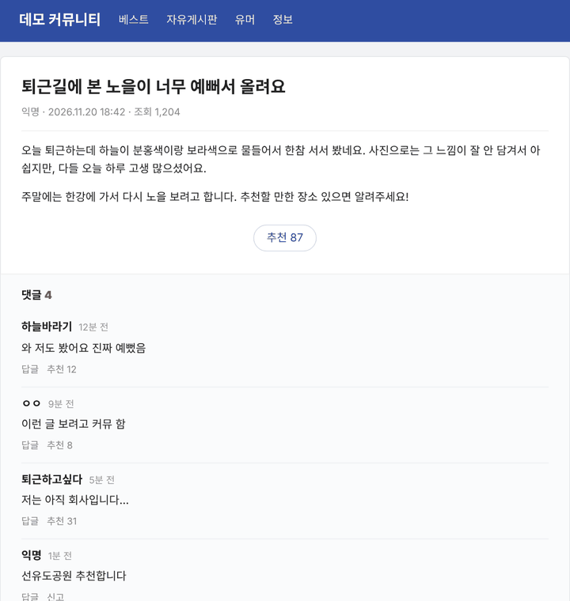
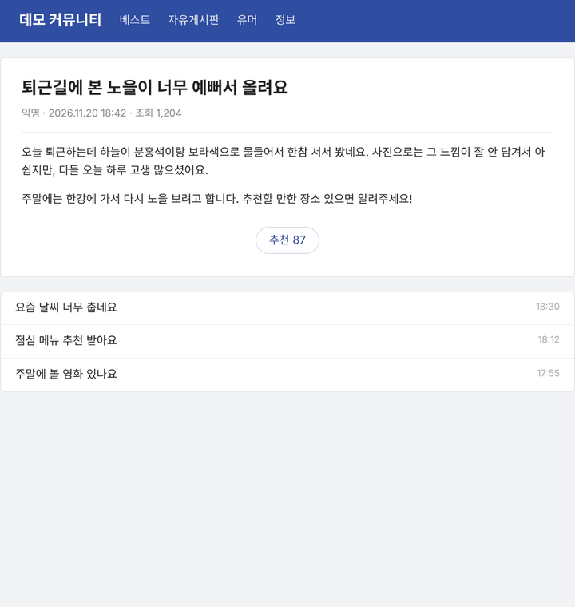
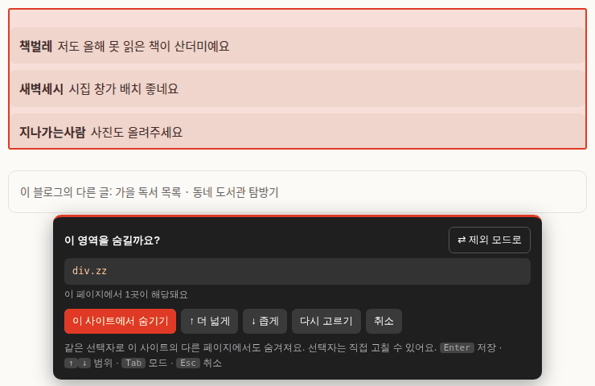
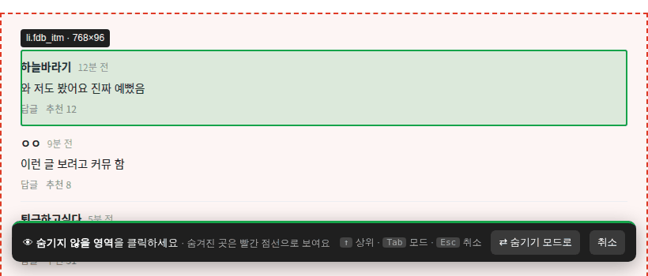
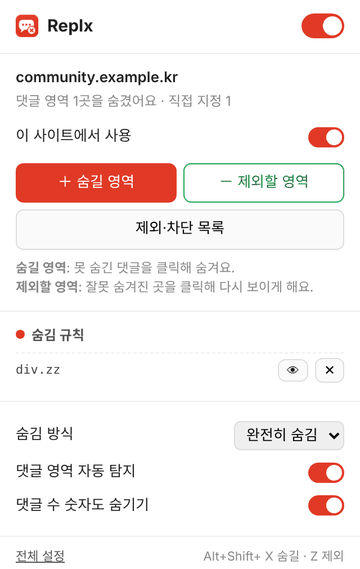
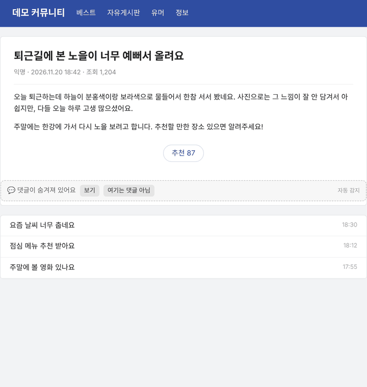
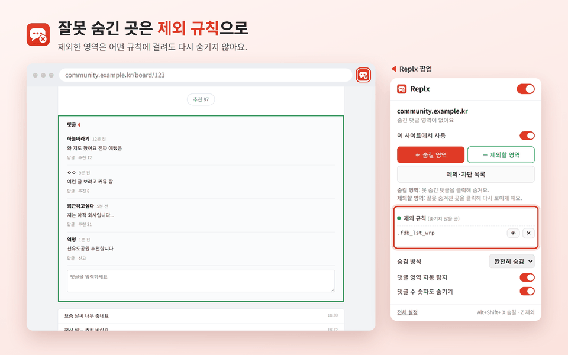

글을 읽으러 들어갔다가 댓글을 읽고 나오는 날이 많다. 본문은 3분이면 끝나는데 아래로 이어지는 댓글이 기분을 정한다. Replx는 그 아래쪽만 비우는 크롬 확장 프로그램이다. 커뮤니티·뉴스·유튜브에서 글은 그대로 두고 댓글 자리만 숨긴다.

- 소개: [metaphr.dev/app.html?id=replx](https://metaphr.dev/app.html?id=replx)
- 저장소: [github.com/ksthink/replx](https://github.com/ksthink/replx)
- 지금은 Chrome 웹 스토어 심사 중이다. 그동안은 [릴리스의 zip](https://github.com/ksthink/replx/releases/latest/download/replx.zip)을 받아 직접 설치할 수 있다.

이틀 동안 만들었고, 그 사이에 방향이 한 번 크게 바뀌었다. 이 글은 그 기록이다.

*끄기 전. 본문 아래로 댓글 넷이 이어진다.*

*켠 뒤. 댓글 자리가 비고, 글 목록 옆의 댓글 수 숫자도 같이 사라진다.*

## 출발점: 이미 있는 규칙 모음

비슷한 확장은 이미 있다. 그중 [hide-comments-everywhere](https://github.com/grantwinney/hide-comments-everywhere)는 사이트별로 댓글 영역의 CSS 선택자를 모아 둔 MIT 프로젝트다. 바탕을 여기서 가져오고, 국내 사이트 규칙을 따로 더했다.

문제는 규칙이 없는 사이트였다. 한국 커뮤니티는 수가 많고, 같은 게시판 엔진을 써도 테마마다 클래스 이름이 다르다. 그래서 첫 버전에는 규칙이 없을 때 **페이지 구조를 읽어 댓글 영역을 추정하는 탐지기**를 넣었다.

탐지기는 점수제다.

| 근거 | 점수 |
|---|---|
| id·class에 comment·reply·댓글 같은 말이 있음 | +3 |
| "댓글"이라는 제목이나 레이블이 붙어 있음 | +3 |
| 안에 입력창(textarea)이 있음 | +3 |
| 같은 모양의 항목이 되풀이되는 목록 | +4~5 |
| 댓글용 iframe | +4 |
| 안에 h1이 있음 | −6 |
| 기사 본문을 품고 있음 | −8 |
| 댓글과 무관한 긴 글이 400자 넘게 섞여 있음 | −6 |

5점을 넘은 후보 가운데 가장 바깥 것을 고른다. 판단은 전부 브라우저 안에서 끝나고, 확장은 네트워크 요청을 하나도 하지 않는다.

## 본문까지 지운 날

아래쪽 감점 규칙들은 처음부터 있던 게 아니다. 첫 버전을 다음 뉴스에 켜 보니 댓글과 함께 **기사 본문까지** 사라졌다.

원인은 "가장 바깥 후보를 고른다"는 규칙이었다. 댓글 목록을 감싼 상자를 또 감싼 상자가 있었고, 그 상자는 기사 본문까지 품고 있었다. 키워드 점수와 반복 목록 점수를 그대로 물려받아 문턱을 넘은 것이다.

고친 방법은 세 가지다.

1. 기사 본문이나 h1을 품은 상자는 큰 감점을 준다.
2. 안쪽 후보에 댓글 키워드가 있으면, 키워드 없는 바깥 후보는 버린다.
3. 숨김 CSS 자체에도 안전장치를 건다. `:not(:has(h1, article))`처럼, 본문을 품은 요소는 어떤 규칙에 걸려도 숨기지 않는다.

3번이 제일 중요했다. 탐지기가 틀려도 본문은 지켜진다. 틀린 확신으로 본문을 지우는 것보다, 댓글 하나를 놓치는 편이 덜 나쁘다.

## 방향을 틀다: 자동보다 고르기

고치고 나니 다른 사이트에서 또 다른 경우가 나왔다. 댓글을 iframe에 넣는 곳, 무한 스크롤로 나중에 붙이는 곳, 댓글과 추천 글을 한 목록에 섞는 곳. 점수표를 계속 다듬을 수는 있지만 끝이 없다.

그래서 자동 탐지를 키우는 대신 **사용자가 직접 고르는 기능**에 힘을 실었다. 자동은 기본값이고, 틀린 곳은 사람이 바로잡는다.

*숨길 영역 고르기. 누르기 전에 선택자와 이 페이지에서 몇 곳이 걸리는지를 먼저 보여 준다.*

숨길 영역 모드에서 화면을 누르면 그 요소의 선택자가 만들어진다. 위·아래 화살표로 부모나 자식으로 범위를 옮길 수 있고, 선택자를 직접 고치면 해당 개수가 바로 다시 계산된다. 저장하면 그 사이트의 다른 페이지에도 적용된다.

반대 방향도 필요했다. 잘못 숨긴 곳을 되살리는 **제외 모드**다.

*제외 모드. 숨겨진 자리가 빨간 점선으로 드러나고, 남길 곳을 누르면 초록으로 표시된다.*

제외 규칙은 숨김 규칙보다 늘 이긴다. 숨김 CSS에 `:not(제외)`, `:not(제외 *)`, `:not(:has(제외))`를 붙여서, 제외한 요소와 그 안팎이 어떤 숨김 규칙에도 걸리지 않게 했다.

고르기 화면은 페이지 위에 겹쳐 띄우는데, 닫힌 Shadow DOM 안에 만들었다. 페이지의 CSS가 고르기 화면을 망가뜨리지 않고, 페이지의 스크립트가 들여다보거나 가짜 클릭으로 규칙을 저장시키지 못하게 하려는 것이다. 클릭은 `isTrusted`인 것만 받는다.

*팝업. 이 사이트에서 몇 곳을 숨겼는지, 그게 자동 탐지인지 직접 지정인지를 적는다.*

## 지우지 않고 접어 두기

완전히 지우는 게 늘 정답은 아니다. 공지 댓글이나 질문 글의 답처럼 가끔은 봐야 할 때가 있다. 숨김 방식을 **접어두기**로 바꾸면 댓글 자리에 한 줄만 남고, 보기를 누르면 펼쳐진다. Alt+Shift+C로 페이지 전체를 잠깐 보고 다시 숨길 수도 있다.

*접어두기. 댓글 자리에 "댓글이 숨겨져 있어요" 한 줄과 보기 단추가 남는다.*

## 조용히 실패하던 저장

규칙은 `chrome.storage.sync`에 둔다. 컴퓨터를 바꿔도 따라오게 하려는 선택인데, 이 저장소는 **항목 하나에 8KB**라는 한도가 있다. 처음에는 모든 사이트의 규칙을 한 항목에 담았고, 규칙이 쌓이자 저장이 실패했다. 더 나쁜 건 실패해도 아무 표시가 없었다는 점이다. 누른 영역이 숨겨지지 않는데 이유를 알 수 없었다.

지금은 사이트마다 항목을 나눈다(`uh:사이트`, `ua:사이트`). 예전 형식은 업데이트 때 자동으로 옮긴다. 사이트당 규칙은 50개, 선택자는 500자로 묶었고, 그래도 저장에 실패하면 화면에 이유를 띄운다.

## 테스트는 진짜 크롬으로

확장은 브라우저 밖에서 단위 테스트를 해도 믿기 어렵다. 그래서 Playwright로 Chrome for Testing을 띄우고, 확장을 실제로 올린 채 테스트용 페이지 열 몇 개를 돌린다. 커뮤니티, 뉴스, 다음 뉴스 구조를 흉내 낸 페이지, 댓글이 나중에 붙는 페이지, iframe 댓글 페이지 같은 것들이다. 지금 35가지를 확인하고, GitHub Actions에서 푸시마다 돈다.

걸림돌은 앞에서 말한 닫힌 Shadow DOM이었다. 닫혀 있으니 테스트도 들여다볼 수 없다. 테스트용으로 확장을 복사할 때만 `mode: 'closed'`를 `'open'`으로 바꿔 올리는 방법으로 풀었다. 배포본은 닫힌 채 그대로다.

README와 스토어에 쓰는 스크린샷도 같은 장치로 찍는다. 화면이 바뀌면 Actions가 다시 찍어서 커밋한다. 손으로 찍은 스크린샷은 금방 낡는다.

## 스토어에 올리기까지

Chrome 웹 스토어는 권한을 하나하나 묻는다. Replx가 요청하는 권한은 `storage`와 `contextMenus` 둘뿐이고, 처음에 넣었던 `activeTab`은 쓰지 않아서 뺐다.

어려운 건 호스트 권한이었다. 콘텐츠 스크립트가 모든 http/https 페이지에서 돌기 때문에 대시보드가 "광범위한 호스트 권한"이라며 activeTab을 쓰라고 권한다. 하지만 activeTab은 사용자가 아이콘을 누른 뒤에야 권한을 준다. Replx는 페이지가 열리는 순간(`document_start`) 댓글이 보이기 전에 숨겨야 하니, 페이지마다 누르게 하면 확장의 목적이 사라진다. 그 이유와 함께, 네트워크 요청이 없고 페이지 내용을 수집하지 않는다는 점을 적어 제출했다. 심사가 며칠 더 걸릴 수 있다는 안내를 받았다.

*스토어 스크린샷. 팝업에서 바꾼 설정을 빨간 테두리로 표시하고, 왼쪽 페이지에 그 결과를 보인다.*

함께 준비한 것들:

- 한국어·영어 개인정보처리방침. 요지는 한 줄이다 — 아무것도 밖으로 보내지 않는다.
- GitHub Pages 소개 페이지. 스크롤에 따라 장면이 바뀌는 쇼케이스로 만들었다.
- 30초 소개 영상. 장면을 HTML·CSS·JS로 짜고, 시간 t를 넣으면 같은 화면이 나오도록 만든 뒤 Playwright로 프레임을 찍어 ffmpeg로 묶었다. 배경음과 효과음은 ElevenLabs로 만들어 -14 LUFS에 맞췄다.
- 릴리스 자동화. `manifest.json`의 버전이 바뀐 채 main에 올라가면 Actions가 태그와 릴리스를 만들고 zip을 붙인다. "최신 버전 받기" 링크는 늘 그 zip을 가리킨다.

## 남은 것

자동 탐지는 여전히 모든 사이트를 맞히지 못한다. 그게 고르기 기능을 만든 이유지만, 자주 가는 사이트에서는 처음부터 맞는 게 좋다. 사용자들이 직접 만든 규칙 가운데 여러 사람이 겹치는 것을 기본 규칙으로 올리는 방법을 생각하고 있다. 물론 그 규칙을 모으는 순간 "아무것도 밖으로 보내지 않는다"는 원칙과 부딪히니, 하게 되더라도 사용자가 직접 내보내서 제보하는 방식이어야 한다.

댓글을 막는 도구를 만들면서 댓글을 가장 많이 본 이틀이었다. 테스트 페이지의 가짜 댓글까지 포함해서.
