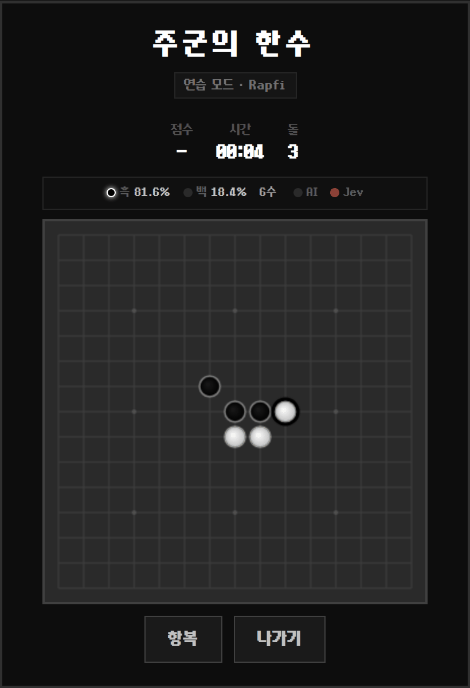
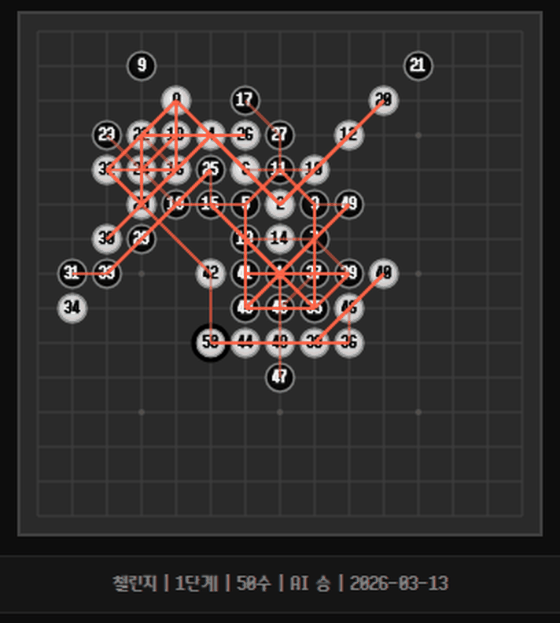
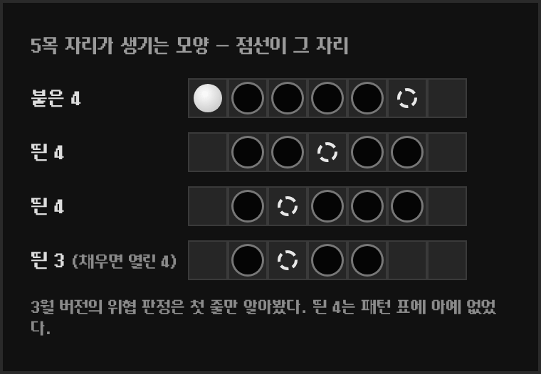
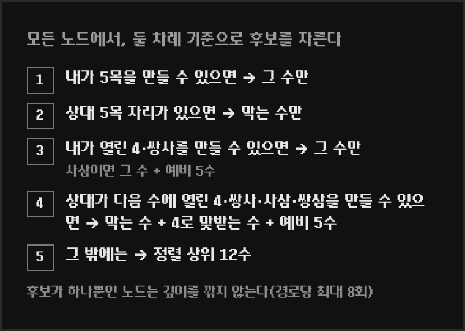
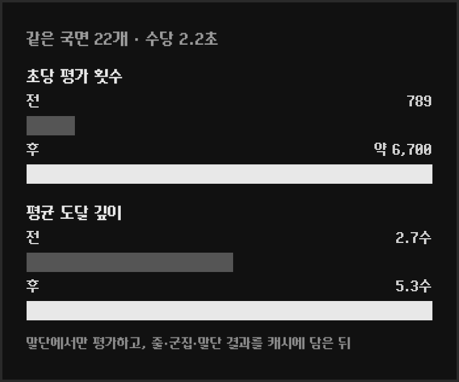
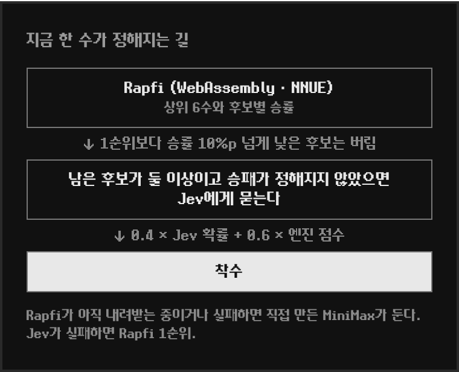
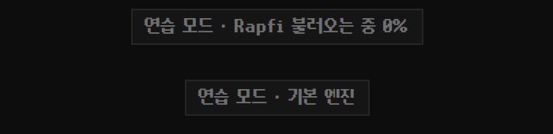
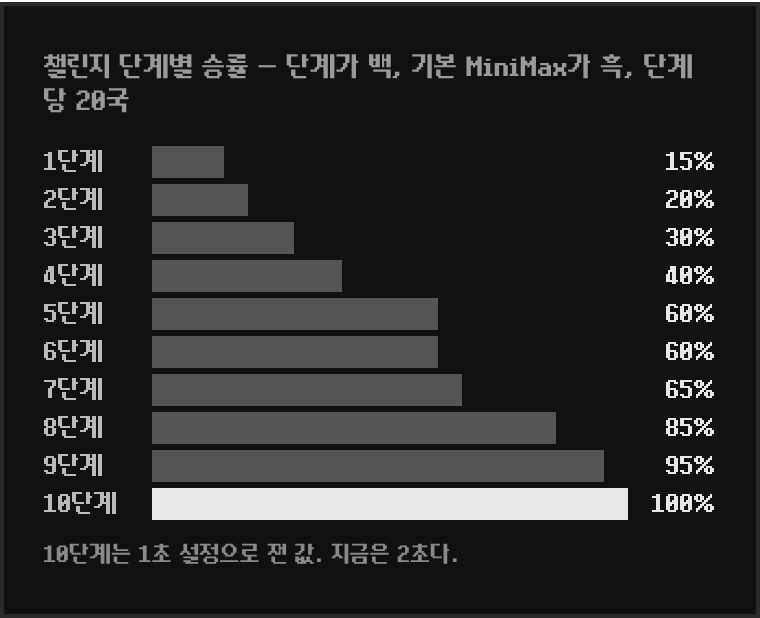

주군의 한수는 브라우저에서 오목 AI와 두는 레트로 웹 게임이다. 연습 모드에서 자유롭게 두고, 챌린지 모드에서 10단계 AI를 차례로 넘으며 점수를 쌓는다.

- 소개: [metaphr.dev/app.html?id=joo-s-omok](https://metaphr.dev/app.html?id=joo-s-omok)
- 게임: [omok.ksthink.com](https://omok.ksthink.com)
- 저장소: [github.com/ksthink/joo-s-omok](https://github.com/ksthink/joo-s-omok)

게임 화면보다 오래 붙잡고 있던 건 AI였다. 3월에 250줄짜리 MiniMax로 시작해서, 대국 기록으로 가중치를 배우게 했다가, 10월에 엔진을 처음부터 다시 짰고, 그다음 날 그 엔진을 예비로 돌렸다. 지금 실제로 수를 두는 건 공개 엔진 Rapfi다. 이 글은 그 순서대로의 기록이다. 결론부터 적으면, 가장 오래 헤맨 이유는 알고리즘이 아니라 **잴 방법이 없었던 것**이었다.


*연습 모드. 지금은 Rapfi가 두고, 상태 칸의 흑·백 불빛 옆에 엔진이 평가한 승률이 뜬다.*

## 1. 첫 AI: 250줄짜리 MiniMax

오목 AI의 교과서적인 시작은 MiniMax다. 내가 둘 수 있는 수를 하나씩 놓아 보고, 상대가 그에 맞서 가장 좋은 수를 둔다고 가정하고, 몇 수 앞까지 내려간 뒤 판을 점수로 매겨 거꾸로 올라온다. 알파베타 가지치기를 붙이면 볼 필요 없는 가지를 잘라 같은 시간에 더 깊이 본다.

첫 버전은 이랬다.

```js
function getAIMove(board, depth) {
    if (isEmpty(board)) return { row: 7, col: 7 };
    const move = findImmediateWin(board, 2);      // 내가 바로 이기는 수
    if (move) return move;
    const blockMove = findImmediateWin(board, 1); // 상대가 바로 이기는 수를 막기
    if (blockMove) return blockMove;
    return minimax(board, depth, -Infinity, Infinity, true).move;
}
```

후보는 이미 놓인 돌 주변 두 칸 안의 빈칸이다. 15×15 판 전체를 보면 가지가 200개를 넘지만, 돌 근처만 보면 수십 개로 줄어든다. 판 평가는 가로·세로·대각선 줄마다 `_OOO_`(열린 3), `OOOO_`(닫힌 4) 같은 문자열 패턴을 찾아 점수를 더하는 방식이었다.

| 패턴 | 가중치 |
|---|---|
| `OOOOO` 오목 | 100,000 |
| `_OOOO_` 열린 4 | 50,000 |
| `OOOO_` 닫힌 4 | 10,000 |
| `_OOO_` 열린 3 | 5,000 |
| `_O_OO_` 띄운 3 | 1,000 |
| `_OO_` 2 | 100 |

같은 날 GitHub Copilot과 함께 탐색 쪽을 손봤다. **Zobrist 해시**(판을 64비트 수 하나로 요약해 같은 국면을 알아보는 방법)와 **트랜스포지션 테이블**(한 번 본 국면의 결과를 저장), **반복 심화**(1수, 2수, 3수… 순서로 깊이를 늘려 가다 시간이 다 되면 마지막으로 끝낸 깊이의 답을 쓰기), **킬러 무브**(다른 가지에서 가지치기를 일으킨 수를 먼저 보기)를 넣었다. 쌍삼·사삼·쌍사 같은 복합 위협에도 점수를 줬다.

여기까지는 책에 나오는 대로였다.

## 2. 대국 기록으로 배우게 하자

사람이 AI를 이기면, 이긴 쪽 돌에 어떤 모양이 있었는지 뽑아 둔다. 패턴마다 "이긴 판에 나온 횟수 / 나온 판 수"를 세고, 30판이 쌓이면 가중치를 조금씩 옮긴다.

```python
if total_count >= 30:
    raw_weight = (win_count / total_count) * base_weight * 1.5
    new_weight = current_weight * 0.9 + raw_weight * 0.1   # 지수 이동 평균
    new_weight = max(base_weight * 0.5, min(new_weight, base_weight * 2.0))
```

게임을 할수록 AI가 사람의 수를 배워 강해진다는 그림이었다. 다음 날에는 욕심이 커졌다. 공격 가중치와 방어 가중치를 나누고, 위치(가운데·가장자리)와 대국 단계(초반·중반·후반)별로 패턴을 따로 셌다. 한 줄짜리 패턴만으로는 부족해 보여서 ㅗ·+·X·L자 같은 **2차원 군집 모양**과, 돌마다 주변에 미치는 영향력 지도를 그려 두 패턴이 한 수로 이어질 수 있는지 보는 **연결 평가**까지 넣었다. ai.js는 253줄에서 859줄이 됐다.

대시보드도 만들었다. 저장된 기보를 재생하면서 AI가 인식한 패턴을 선으로 그려 준다.


*3월의 기보 재생 화면. 빨간 선이 AI가 인식한 패턴이다. 선이 많을수록 뭔가 많이 보고 있는 것 같았다.*

이때 AI가 강해졌는지는 사실 알 수 없었다. 대시보드에는 가중치가 움직이는 그래프가 있었지만, 가중치가 움직이는 것과 AI가 강해지는 것은 다른 이야기다.

## 3. 반년 뒤: 문제는 가중치가 아니었다

10월에 다시 열었다. 직접 두어 보면 AI는 가끔 이상하게 졌다. 막아야 할 4를 그냥 두는 장면이 있었다.

코드를 따라가 보니 이유가 단순했다. 수 정렬과 위협 판정을 맡던 `countThreats`는 이렇게 생겼다.

```js
if (line.includes('_OOOO_')) openFour++;
else if (line.includes('OOOO')) blockedFour++;
if (line.includes('_OOO_')) openThree++;
```

붙어 있는 네 개와 `_OOO_`만 본다. 그런데 오목의 4는 붙어 있지 않아도 4다. `OO_OO`는 가운데 한 칸만 채우면 5목이다. `O_OOO`, `OOO_O`도 마찬가지다. 이 띈 4들은 패턴 표에 아예 없었다. 띈 3(`_O_OO_`)은 표에 있긴 했지만 1,000점짜리 평범한 모양으로 취급됐고, 한 수 더 두면 열린 4가 되는 위협으로는 인식되지 않았다.


*점선이 5목(또는 열린 4)이 되는 자리다. 3월 버전의 위협 판정은 첫 줄만 알아봤다.*

막아야 할 4를 **볼 수 없는** AI에게 학습으로 가중치를 아무리 옮겨도 그 수를 막지 않는다. 학습이 고칠 수 있는 건 "본 것에 얼마를 줄지"이지 "무엇을 볼지"가 아니다. 배울 재료보다 볼 눈이 먼저였다.

## 4. 고치기 전에 잴 상대부터

이번에는 순서를 바꿨다. 엔진을 손대기 전에 **세기를 잴 장치**부터 만들었다.

상대는 공개된 오목 엔진 [Gomoku-MiniMax](https://github.com/yups1199/Gomoku-MiniMax)다. Node에서 ai.js를 그대로 불러 표준 입출력으로 수를 주고받는 래퍼를 만들고, Python 스크립트가 두 엔진을 붙인다. 정해 둔 시작 국면마다 흑백을 바꿔 두 판씩 두고, 결과를 한 줄씩 JSONL로 남긴다. 요약 스크립트는 승·패·무와 신뢰구간, 색깔별 승률, 같은 기보가 반복됐는지까지 보여 준다.

```bash
python3 tools/match/match.py 50 2200 3       # 시작 국면 50개 × 흑백 = 100판
python3 tools/match/summary.py tools/match/*.jsonl
node tools/match/bench.js ai.js 2200         # 초당 평가 횟수와 도달 깊이
```

여기에 하나를 더 붙였다. 상대에게 열린 3이 있을 때(다음 수에 열린 4를 만들 수 있을 때) 그 수에 제대로 응했는지를 기보에서 세는 스크립트다. "가끔 이상하게 진다"를 숫자로 바꾸는 도구다.

이 장치가 생기고 나서야 이후의 결정들이 감이 아니라 측정 위에 올라갔다.

## 5. 전술 계층: 가중치와 상관없는 눈

새 엔진의 바닥에는 학습과 무관한 **전술 계층**을 깔았다. 한 수를 가정하고, 그 점을 가운데 둔 4방향 9칸 창을 읽어 모양을 판정한다.

- **5목**: 5목 이상 완성
- **열린 4**: 한 방향에 5목 자리가 2개 이상 (띈 모양 포함)
- **4**: 5목 자리가 1개 (`XOOOO_`, `OO_OO`, `O_OOO`, `OOO_O`)
- **열린 3**: 한 수 더 두면 열린 4가 되는 모양 (`_OOO_`, `_O_OO_`, `_OO_O_`)

판정은 "이 창에서 어느 칸을 채우면 5목이 되는가"를 비트마스크로 구하는 방식이라, 문자열 패턴을 하나하나 늘어놓지 않아도 띈 모양이 자연스럽게 잡힌다. 등급은 5목 > 열린 4·쌍사 > 사삼 > 쌍삼 > 4 > 열린 3 순이다. 이 규칙은 고정이고, 학습 가중치는 위치 평가에만 쓴다. 전술 계층에는 `node --test`로 도는 테스트를 붙였다.

위협 등급, 띈 모양을 구간으로 읽는 방법, 아래에 나올 후보 제한과 외길 연장, 깊이를 더한 승리 점수는 Gomoku-MiniMax(MIT)의 구현을 참고해 다시 짰다. 상대로 삼은 엔진에게서 배운 셈이다.

## 6. 모든 노드에서 후보를 자른다

예전 엔진은 "바로 이기는 수 / 바로 막는 수"를 **맨 위에서만** 찾았다. 탐색 트리 안쪽에서는 그런 검사가 없었다. 그래서 세 수 앞에서 상대가 4를 만들었는데도, 그 아래에서 막는 수 대신 엉뚱한 수 열두 개를 성실하게 읽느라 시간을 썼다.

지금은 탐색의 **모든 노드**에서, 그 노드에서 둘 차례를 기준으로 같은 규칙을 적용한다.


*위에서부터 먼저 걸리는 규칙 하나로 후보를 정한다.*

오목은 강제 수순이 많은 게임이다. 상대가 4를 만들면 막는 수는 사실상 하나다. 그런 노드에서 후보 12개를 읽는 것은 순수한 낭비고, 반대로 그 하나만 읽으면 같은 시간에 훨씬 깊이 내려간다.

여기에 **외길 연장**을 붙였다. 후보가 하나뿐인 노드는 깊이를 깎지 않는다. 4 → 막기 → 4 → 막기로 이어지는 수순은 깊이 제한에 걸려 중간에 끊기기 쉬운데, 외길에서 깊이를 아끼면 그 수순을 끝까지 따라가 결말을 본다. 무한히 늘어나지 않게 한 경로에서 최대 8번까지만 허용한다.

## 7. 점수 10만을 승리로 읽던 버그

옛 코드에는 이런 줄이 있었다.

```js
const score = fullEvaluateBoard(board);
if (depth === 0 || Math.abs(score) >= 100000) {
    return { score, move: null };
}
```

판 점수가 10만을 넘으면 "누군가 이겼다"고 보고 탐색을 멈춘다. 5목 패턴이 10만 점이니 그럴듯해 보이지만, 판 점수는 여러 패턴의 **합**이다. 5목이 없어도 열린 4 두 개면 10만이고, 학습이 가중치를 옮기면 이 선도 같이 흔들린다. 게다가 이 줄 때문에 **모든 노드에서** 판 전체를 평가하고 있었다.

바꾼 방식은 이렇다.

- **종료 판정은 직전 수로만.** 방금 둔 돌이 5목을 만들었는지만 본다. 판 전체를 볼 필요가 없다.
- **승리 점수는 `1e9 + 남은 깊이`.** 같은 승리라도 빨리 이기는 쪽이 점수가 높아, 이길 수 있는 판에서 시간을 끌지 않는다. 증명된 결과가 나오면 반복 심화도 거기서 멈춘다.
- **말단은 차례를 안다.** 판을 평가할 때 지금 둘 차례가 누구인지 본다. 둘 차례에게 5목 자리가 있으면 이긴 것이고, 상대에게 5목 자리가 두 개 이상이면 진 것이다. 둘 차례가 열린 4·쌍사·사삼을 만들 수 있고 상대에게 4가 없으면 승리에 가까운 점수를 준다. 같은 모양이라도 누구 차례냐에 따라 의미가 정반대이기 때문이다.

## 8. 평가는 말단에서만, 결과는 캐시에

이제 판 평가는 말단(깊이 0)에서만 한다. 그래도 말단은 많다. 그래서 담아 둘 수 있는 건 전부 담았다.

- **줄 점수**는 줄의 내용(3진 코드 + 길이 + 관점)을 키로 저장한다. 한 수를 두면 바뀌는 줄은 네 개뿐이고 나머지 줄은 그대로다.
- **군집 모양**은 플레이어별 Zobrist 해시로 저장한다.
- **말단 결과 전체**는 국면 해시 + 둘 차례로 저장한다.
- **연결 평가**는 판 전체가 아니라 후보 칸에서만 한다. 3이나 4를 만들 수 있는 칸은 언제나 자기 돌에서 두 칸 안에 있기 때문이다.
- 판 둘레에 여백을 둔 1차원 배열을 따로 둬서, 9칸 창을 읽을 때 경계 검사를 없앴다.

이름만 "증분 평가"였던 코드도 지웠다. 3월 계획서에는 수를 둘 때마다 점수의 차이만 더하는 증분 평가가 있었는데, 실제 코드는 주석으로 "말단에서 다시 계산하니 차이는 필요 없다"고 적어 둔 채 해시만 갱신하고 있었다.

엉뚱한 곳에서 시간이 새기도 했다. 벤치마크는 Node의 `vm` 컨텍스트에서 ai.js를 불러 도는데, 그 안에서는 전역 함수 선언을 부르는 비용이 몇 배 비쌌다. 내부 함수를 스크립트 범위의 `const`로 바꾸고, 게임이 부르는 공개 함수만 전역에 남겼다.


*같은 국면 22개를 수당 2.2초로 돌린 벤치마크.*

| | 전 | 후 |
|---|---|---|
| 초당 평가 횟수 | 789 | 약 6,700 |
| 평균 도달 깊이 | 2.7수 | 5.3수 |

깊이가 두 배가 됐다. 오목에서 쌍삼이나 사삼을 준비하는 수는 몇 수 뒤에야 위협으로 드러나기 때문에, 두세 수와 다섯 수의 차이는 숫자보다 크다.

## 9. 조용한 국면은 Jev에게

전술 계층과 깊어진 탐색 덕분에, 4나 열린 3이 오가는 **강제 국면**에서는 엔진이 꽤 정확해졌다. 남은 약점은 반대쪽이었다. 아무 위협도 없는 **조용한 국면**에서 엔진이 고른 상위 후보 몇 개는 점수가 비슷비슷했고, 그중 무엇이 좋은지는 손으로 짠 패턴 점수가 가르기 어려웠다.

그래서 실험을 하나 했다. 조용한 국면에서만 상위 후보 8개를 같은 깊이로 다시 점수 매기고, 판과 함께 언어 모델 [Jev](https://docs.typesafe.ai)에게 보여 주며 어느 수가 좋은지 고르게 했다. "코드가 계산하고 Jev가 판단한다"는 구조다.

```js
// 최종 선택: Jev 확률과 정규화한 엔진 점수를 섞는다
const value = alpha * pOf(c) + (1 - alpha) * norm(c.score);   // alpha = 0.4
```

안전장치를 세 겹 걸었다. 엔진 최선보다 열린 3 하나만큼 넘게 나쁜 후보는 처음부터 Jev에게 보이지 않는다. 강제 국면에서는 Jev를 부르지 않는다. Jev가 2.5초 안에 답하지 않거나 실패하면 엔진 수를 그대로 둔다. 판단이 틀려도 큰 실수로는 이어지지 않게, 고를 수 있는 범위를 엔진이 먼저 좁혀 두는 것이다.

연습 모드 화면에는 AI가 생각하는 동안 후보 자리에 점선 고리와 확률을 띄워, Jev가 어디를 보고 있는지 보이게 했다.

## 10. 다음 날, Rapfi에게 수를 넘겼다

다음 날 [Rapfi](https://github.com/dhbloo/rapfi)를 붙였다. 오목 AI 대회 Gomocup에서 우승한 엔진이고, 판 평가를 손으로 짠 패턴이 아니라 NNUE라는 작은 신경망으로 한다. WebAssembly 빌드가 있어서 브라우저의 Web Worker 안에서 돌릴 수 있다. 게임은 Gomocup/Yixin 텍스트 프로토콜로만 엔진과 대화한다.

두어 보면 차이가 바로 느껴진다. 하루 동안 다시 짠 엔진이 평균 5수 앞을 읽는 데 2.2초를 쓰는 동안, Rapfi는 수당 0.7초 안에 상위 6수와 후보마다 승률까지 알려 줬다. 손으로 짠 패턴 점수와 신경망 평가는 같은 줄에 세울 상대가 아니었다. 연습 모드의 수는 Rapfi가 계산하고, Jev는 이제 Rapfi의 상위 후보 가운데서 고른다. 기준도 패턴 점수에서 승률로 바뀌었다. 1순위보다 승률이 10%p 넘게 낮은 후보는 버린다.


*지금 연습 모드에서 한 수가 정해지는 길.*

붙이자마자 버그가 하나 나왔다. 두 수 만에 화면에 백 승률 99.9%가 떴다. Rapfi는 판을 받을 때 돌을 받은 순서대로 다시 놓아 보며 누구 차례인지 알아내는데, 나는 돌을 판의 위에서 아래 순서로 넘기고 있었다. 엔진은 차례를 거꾸로 알고, 상대 입장의 최선수를 두고 있었다. 흑과 백을 번갈아 끼워 상대의 마지막 돌로 끝나게 넘기도록 고치고, 실제 엔진을 띄워 승률을 확인하는 회귀 테스트를 붙였다.

직접 만든 MiniMax는 버리지 않았다. Rapfi는 신경망 가중치를 포함해 약 41MB다. 첫 접속에서 다 받기 전까지, WebAssembly를 못 쓰는 브라우저에서, 그리고 Rapfi가 계산 중 오류를 낼 때는 MiniMax가 대신 둔다.


*위는 Rapfi를 받는 중(그동안 MiniMax가 둔다), 아래는 받지 못해 기본 엔진으로 두는 상태.*

## 11. 약하게 두는 것도 설계다

챌린지 모드는 10단계다. 가장 센 엔진을 그대로 쓰면 1단계부터 아무도 이기지 못한다. 그렇다고 탐색 시간만 줄이면 이상하게 약해진다. 사람은 "생각을 덜 한" 수와 "말이 안 되는" 수를 구분한다.

그래서 단계마다 다섯 가지를 따로 정했다.

| 단계 | 최대 깊이 | 수당 시간 | 보고받을 후보 | 허용 승률 차 | 실수 확률 |
|---|---|---|---|---|---|
| 1 | 1 | 0.15초 | 8 | 35%p | 35% |
| 3 | 2 | 0.2초 | 7 | 20%p | 18% |
| 5 | 4 | 0.3초 | 6 | 12%p | 8% |
| 7 | 6 | 0.4초 | 4 | 5%p | 3% |
| 9 | 10 | 0.7초 | 2 | 1%p | 0% |
| 10 | 제한 없음 | 2초 | 1 | 0%p | 0% |

평소에는 1순위와의 승률 차가 허용 범위 안인 후보 가운데 무작위로 고른다. 실수 확률에 걸리면 보고받은 후보 아무거나 둔다. 대신 **바로 5목이 되는 수**(내가 이기는 수, 상대의 5목을 막는 수)는 어느 단계에서도 놓치지 않는다. 1단계 AI가 다 이긴 판에서 5목을 안 두면 사람은 봐줬다고 느끼지, 약하다고 느끼지 않는다.

세기가 계단처럼 오르는지는 다시 대국으로 확인했다. 각 단계를 백으로, 기본 MiniMax를 흑으로 두고 단계당 20판씩 둔 결과다.


*자체 대국 측정, 단계당 20국, 첫 두 수는 무작위. 사람의 체감과는 다를 수 있다.*

5단계와 6단계가 같은 60%로 나온 건 20판이라는 작은 표본 탓일 수 있다. 10단계를 8단계와 붙여 보니, 10단계가 흑일 때는 20전 20승, 백일 때는 20전 6승이었다. 자유룰 오목에서 흑의 선공 이점이 그만큼 크다는 뜻이다.

## 12. 학습은 지웠다

마지막으로 3월의 학습을 지웠다.

수를 거의 Rapfi가 두니 MiniMax의 학습 가중치는 실제 대국에 영향이 없었다. 남은 건 부작용이었다. 판마다 그 판에 나오지 않은 패턴의 가중치가 조금씩 깎이고 있었다. 학습 테이블 다섯 개와 학습 코드를 지우고, 예비 엔진은 고정 가중치로 둔다. 기보와 랭킹은 계속 모은다. 데이터는 SQLite에서 Supabase로, 다시 자체 서버 Supabase로 옮겼고, 서버는 REST API로만 읽고 쓴다.

## 남은 것

돌아보면 가장 많은 시간을 쓴 3월의 작업, 즉 학습과 2차원 군집과 영향력 지도는 결과적으로 가장 적게 남았다. 반대로 10월 첫날 가장 먼저 만든 대국 장치와 벤치마크는 그 뒤의 모든 결정에 쓰였다. 띈 4를 못 본다는 것도, 깊이가 2.7에서 5.3이 됐다는 것도, Rapfi와 비교할 이유가 없다는 것도, 단계별 세기가 오른다는 것도 그 장치가 알려 줬다.

직접 만든 엔진이 주인공 자리에서 내려온 게 아쉽지는 않다. 그 엔진을 다시 짜면서 오목의 위협이 어떤 구조인지, 탐색이 어디서 시간을 버리는지 알게 됐고, 그걸 알았기 때문에 Rapfi를 붙일 때 무엇을 맡기고 무엇을 지켜야 하는지(바로 5목이 되는 수, 엔진이 없을 때의 대국)도 정할 수 있었다.

다음에 손볼 곳은 챌린지 단계표다. 지금 숫자는 엔진끼리 붙여 맞춘 것이라, 사람이 실제로 몇 단계에서 막히는지는 랭킹 기록이 더 쌓여야 알 수 있다.

---

*Rapfi는 이 프로젝트의 코드가 아니며 GPL-3.0으로 배포된다. 전술 계층과 후보 제한 일부는 Gomoku-MiniMax(MIT License, Copyright (c) 2026 JeongYupKim)를 참고해 다시 구현했다.*
