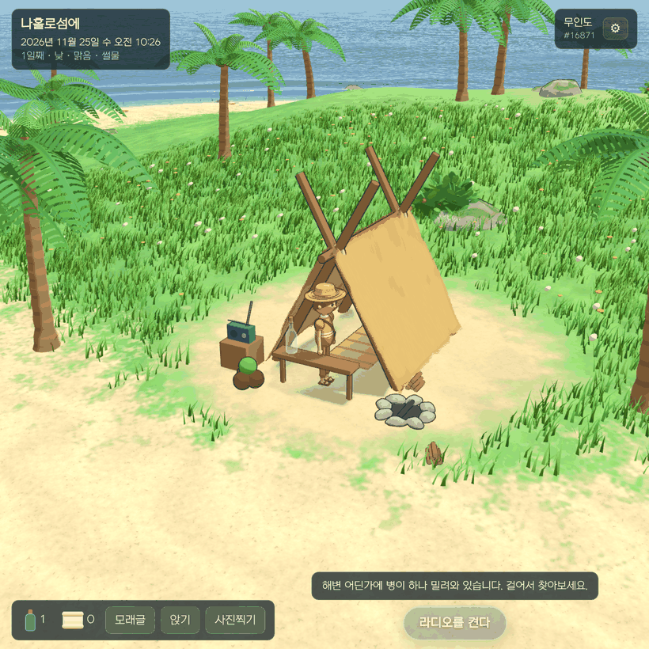
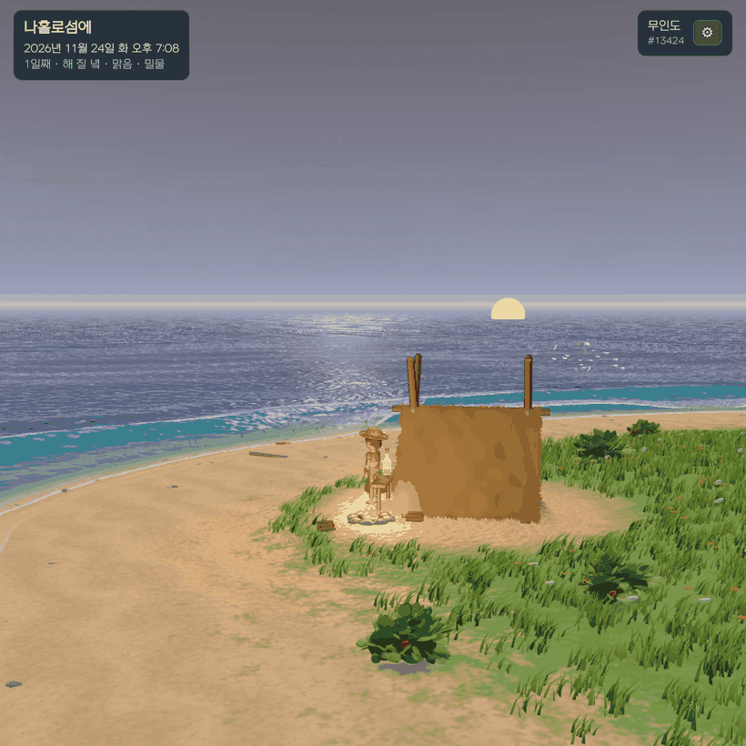
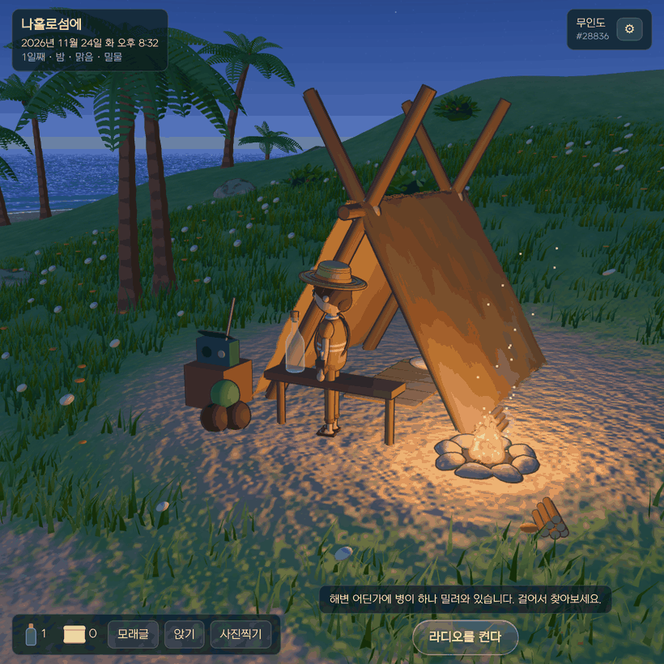
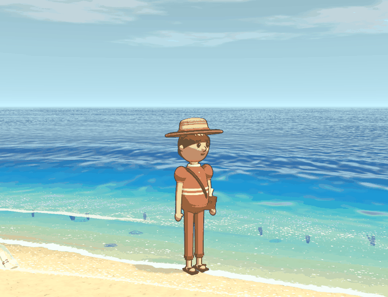
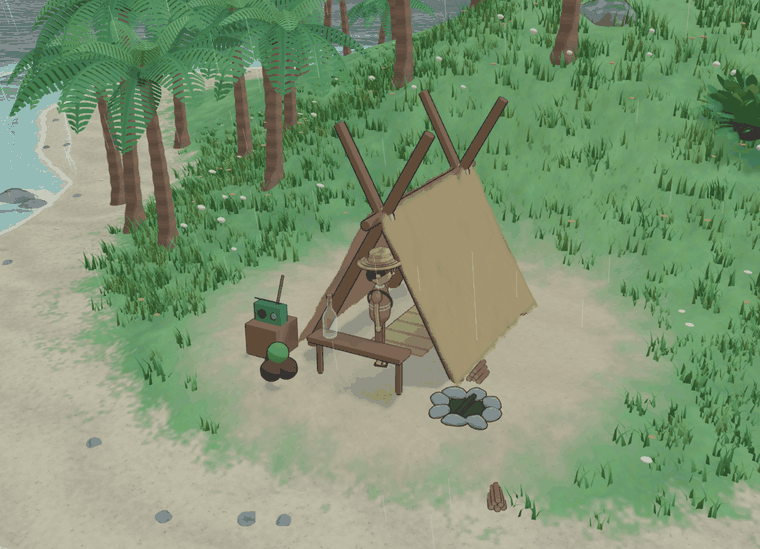
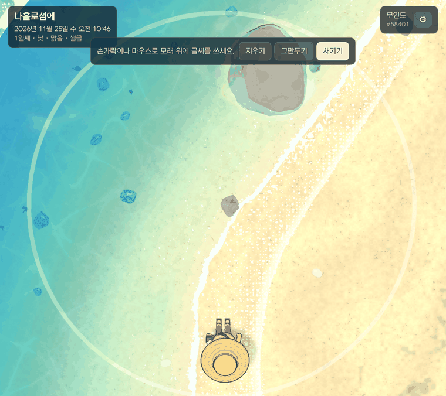

나홀로섬에는 브라우저에서 여는 3D 무인도다. 섬에는 나 혼자 살고, 다른 사람은 파도에 밀려온 유리병 편지로만 만난다. 병을 주워 읽고, 회원이면 편지를 써서 바다에 띄운다. 편지는 반드시 누군가에게 닿지만 읽혔는지는 알 수 없고 답장도 없다.

- 소개: [metaphr.dev/app.html?id=bottle](https://metaphr.dev/app.html?id=bottle)
- 서비스: [bottle.metaphr.dev](https://bottle.metaphr.dev) (공개 준비 중)
- 저장소: [github.com/ksthink/bottle](https://github.com/ksthink/bottle)

규칙은 단순한데, 섬을 "가만히 띄워 두고 싶은 곳"으로 만드는 데 대부분의 코드가 들어갔다. 엔진 파일 `lib/island/game.js` 하나가 약 290KB다. 이 글은 그 안에서 바다·하늘·바람·동물·소리가 어떻게 돌아가는지, 그리고 병이 섬과 섬 사이를 오가는 서버 쪽 구조를 정리한 기록이다.


*낮. 움막 곁에 라디오와 병 선반이 있고, 앞에 돌로 두른 모닥불 자리가 있다.*

## 1. 시제품 한 장에서 Next.js로

처음에는 `prototype/index.html` 한 장이었다. three.js r128을 불러 섬과 바다를 그리는 단일 파일 시제품으로 규칙과 화면을 먼저 맞췄고, 사흘 뒤 Next.js 16(App Router)으로 옮겼다.

옮기면서 정한 원칙은 **React가 3D를 다시 그리지 않는다**는 것이다. `components/Island.tsx`는 HUD 버튼과 창의 틀만 만들고, 엔진이 그 요소들을 `id`로 찾아 채운다. 매 프레임 바뀌는 시계·병 개수·안내 문장을 React 상태로 올리면 렌더가 프레임마다 돈다. 편지함(`Letterbox.tsx`)과 계정 창처럼 상태가 정말 필요한 곳만 React로 두었다.

## 2. 모든 것은 시드와 시각에서 나온다

서버에 저장하는 섬 정보는 다섯 자리 시드 하나다. 지형, 나무, 바위, 게 무리 구성까지 이 숫자로 정해진다. 날씨·물때·바람은 시드와 **실제 시각**으로 정한다(`env.js`). 그래서 새로고침해도 같은 섬, 같은 날씨가 나온다.

- **난수**: `mulberry32(seed)`를 정해진 순서로 소비한다. 나중에 더한 요소(암초, 게 무리, 셋째 새끼 갈매기)는 `seed*13+777`처럼 **따로 난수 흐름**을 쓴다. 주 난수에 끼워 넣으면 그 뒤 순서가 밀려 이미 있는 섬의 나무 자리가 전부 바뀐다.
- **해안선**: `radiusAt(θ) = R·(1 + Σ amp[k]·sin((k+2)θ + ph[k]))`. 기본 반경 34~60m에 2~5차 고조파 넷. 같은 계수를 물 셰이더에도 넘긴다.
- **해변 기울기는 일정하게**: 해안에서 내륙 방향 22% 구간은 높이 0→0.9m를 직선으로 올린다. 그래서 높이만 알면 해안까지의 거리를 역산할 수 있고, 젖은 모래·바위 배치·병 위치가 이 성질을 쓴다.
- **하루**: 길이 86400초, 기기 현지 시각 그대로. 해 높이는 `sunE() = sin(위상·2π) + 0.3`.
- **물때**: 반일주조 44712초(12시간 25분 12초). 섬마다 위상이 `frac(seed × 0.618…)`로 다르다.
- **바람**: 6시간 블록마다 방향과 세기를 해시로 뽑아 부드럽게 잇는다. **날씨**는 3시간 블록마다.

## 3. 하루의 빛

해 높이 `e` 하나에서 두 값을 만든다. `light = clamp((e+.25)/.5)`(0 밤 ~ 1 낮), `dusk = clamp(1 − |e|/.35)`(노을). 대략 18시 11분부터 낮이 끝나기 시작해 19시 10분 무렵 노을이 가장 짙고, 20시 13분이면 완전한 밤이다.


*노을. 하늘 그라데이션과 바다 반사가 같은 uniform 객체를 공유해, 한 번 갱신하면 둘이 함께 물든다.*

- **해와 달은 광원 하나**: 낮에는 해, 밤에는 달 방향을 섞는다. 그림자가 키의 1.3배보다 길어지지 않게 고도를 제한했다. 저녁 그림자가 섬 끝까지 늘어나면 화면이 지저분해진다.
- **그림자는 차폐물에서 멀수록 옅게**: 그림자 픽셀 주변 5×5에서 차폐물 깊이를 평균 내(PCSS의 blocker search 발상) 4m 떨어지면 최대 90%까지 옅게 한다. 밤에는 72% 옅게. 낮밤 신호는 `PCFSoft`에서 원래 안 쓰는 `shadow.radius`에 실어 보냈다.
- **화면 색 보정**: 0.25초마다 "노을+맑은 낮 − 밤 − 흐림 − 비"를 계산해, 화면 위 막을 주황 또는 파랑으로 칠해 soft-light로 얹는다. 캔버스에는 CSS `saturate`·`contrast`를 건다. 기념사진도 이 두 보정을 그대로 입혀 보이는 그대로 담는다.
- **카툰 셰이딩**: three.js의 `ShaderChunk` 문자열을 전역으로 고쳐 모든 재질에 한 번에 적용했다. 확산광은 `smoothstep(0,.14,N·L)·.74 + N·L·.26`으로 띠를 나누고, 모닥불 같은 점광원만 원래 램버트로 둔다 — 안 그러면 불 둘레 땅에 둥근 빛 테두리가 생긴다. 외곽선은 법선 방향으로 부풀린 뒷면을 한 번 더 그리는 inverted hull.

## 4. 하늘: 실제 별자리와 은하수


*밤. 해가 지면 모닥불이 저절로 붙는다. 불빛이 물에도 호박색으로 비친다.*

- **별 155개는 진짜 자리에**: 베가, 알타이르, 북두칠성, 오리온, 시리우스, 플레이아데스 등 밝은 별을 실제 적경·적위·등급·색으로 넣었다. 섬은 북위 약 24°에 있다고 보고, 지방항성시가 현지 자정에 18h가 되도록 하루에 한 바퀴 돌린다. 밝기는 포그슨 비 `2.512^(−등급)`을 .42제곱으로 눌러 차이를 줄였다. 수평선 근처에서는 사라지고 더 깜빡인다.
- **희미한 별 4600개**: 55%는 고르게, 45%는 은하면 쪽에 몰았다. 은하 좌표는 J2000 적도→은하 회전행렬로 바꾼다.
- **은하수**: 시선 방향을 은경·은위로 바꿔 띠(`exp(−(b/폭)²)`), 팽대부, 노이즈로 군데군데 92%까지 어두운 암흑 띠를 그린다. 노이즈를 적도 좌표에서 계산하므로 무늬가 하늘과 함께 돈다.
- **구름**: 높이 150m의 3200m 판 한 장. 도메인 워프한 fbm(PC 6옥타브, 휴대폰 4옥타브)으로 모양을 바꾸고, 해 방향으로 조금 옮긴 자리의 밀도를 한 번 더 재서 자기 그림자를 낸다(1탭 방향 미분). 시선이 비스듬할수록 구름층을 길게 지나므로 알파를 Beer–Lambert 꼴로 두껍게 한다. 바람 쪽으로 흐른다.

## 5. 바다: 셰이더가 섬의 모양을 안다

이 프로젝트에서 가장 오래 만진 곳이다. 물결 모양, 부서지는 파도, 거품, 물빛을 전부 셰이더가 계산한다.


*물가. 얕은 물은 옥색, 깊어질수록 남색. 물이 빠진 모래가 젖은 색으로 남는다.*

**판 두 장.** 가까운 물은 320m 판을 255칸으로 나눠 정점 셰이더가 수면 높이를 계산하고, 먼바다는 반경 140~1600m 고리를 평평하게 깔아 법선만 흔든다. 먼바다 고리를 섬 둘레까지 덮으면 얕은 바닥이 가려져 물가에서 바다가 갑자기 깊어 보였다. 그래서 바깥에만 둔다.

**물가까지 거리를 식으로.** 물 셰이더가 해안선 계수를 받아 `sd = 거리 − 해안반경·(1 − 해수면·.2444)`를 픽셀마다 계산한다(.2444는 해변 기울기의 역수, 물때 반영). 해저 높이도 섬 높이 함수와 같은 식이라, `깊이 = 수면 − 해저`가 0보다 작으면 버린다. 물가선이 메시 해상도와 상관없이 픽셀 단위로 정확하다.

**밀려오는 파도.** 위상 `.5712·sd + 2π(t/5.5 + 해안오프셋)` — 파장 약 11m, 주기 5.5초. 마루 모양은 `(.5 + .5·sin(ph + .45cos ph))^2.6`으로, 위상을 비틀어 앞뒤를 비대칭으로 만들고 제곱으로 마루를 뾰족하게, 골을 평평하게 한다. 해안 방향마다 위상을 사인 넷으로 어긋나게 해서 파도가 해안을 따라 비스듬히 엇갈려 온다. 16~40초마다 12초짜리 큰 파도가 한 번.

**GPU와 JS가 같은 값을 내야 한다.** 파도가 해변을 타고 오르는 높이는 셰이더만 아는 값이 아니다. 발자국이 지워지고, 게가 비켜나고, 앉을 수 있는지 판정하고, 파도 소리가 커지는 데 JS도 같은 값을 쓴다. 그래서 같은 식을 GLSL과 JS 두 곳에 둔다. 파도마다 크기를 0.55~1.35배로 다르게 하는 데 해시 노이즈를 쓰면 32비트(GPU)와 64비트(JS)가 다른 값을 낸다. **사인 수열**로 바꿔 두 쪽이 같은 값을 내게 했다.

**젖은 모래는 텍스처 한 장.** 해안을 220칸으로 나눠 칸마다 물이 오른 높이, 젖은 높이(물이 빠지면 초당 1.2cm씩 마름), 최근 최고 높이(초당 2cm씩 내려옴)를 220×1 RGBA 텍스처에 담아 매 프레임 올린다. 880바이트다. 모래 셰이더가 이걸 읽어 젖은 띠와 윤기, 물이 빠진 자리의 거품을 그린다.

여기서 한 번 걸렸다. 지금 물가 높이를 220칸 텍스처에서 보간해 읽었더니, 비스듬히 밀려오는 파도 앞머리에서 실제 물보다 앞서 나가 거품이 **해안에 수직인 직선으로 잘렸다**. 모래 셰이더도 물 셰이더와 같은 식으로 픽셀마다 직접 계산하게 바꿔 끝냈다. 텍스처에서는 "최근 최고 높이"만 읽는다.

**물빛.** 깊이 구간별로 옥색 `#8FF3E4` → 청록 → 파랑 → 남색. 빛 흡수는 Beer–Lambert `exp(−(2.5, 1, .65)·깊이/N·V)`로 빨강이 가장 빨리 준다. 알파 하나로만 섞이므로, 모래가 채널마다 덜 비쳐야 할 만큼을 물색에서 미리 빼서 채널별 투과를 흉내 냈다. 그 위에 Schlick 프레넬 하늘 반사, GGX 해·달 빛길, 역광 파도 마루(VictorZakharov/beautiful-water 참고), 모닥불 반사, 빗방울 동심원, 발 둘레 잔물결.

**거품은 기포 점으로.** 0.16m·0.09m 셀 두 겹에 셀마다 기포 확률과 반경을 거품 양에 맞춘다. 원 가장자리를 한 픽셀 폭(`거리/uPx`)으로 부드럽게 하고, 픽셀이 셀보다 커지는 먼 곳에서는 셀의 기대 덮임(확률×원 면적)으로 바꿔 지글거림을 없앴다.

**수평선.** 처음엔 안개로 바다와 하늘을 섞었는데 번진 띠가 생겼다. 지금은 200m 밖 바다를 수평선 하늘보다 7% 어두운 색으로 덮는다. 바다가 하늘보다 밝아지지 않아 깔끔한 단차가 선다.

## 6. 바람: 한 값이 섬 전체에

바람 방향과 세기는 한 곳에서만 정하고, 그 값이 풀·꽃·덤불·야자 잎의 휨, 천막 펄럭임, 바람 줄기, 구름 흐름, 비 날림, 연기, 모닥불 기울기, 파도 크기, 갈매기 휘청임, 바람 소리에 함께 들어간다.

- **돌풍 무늬**: 바람 방향으로 흐르는 sin 세 항의 합(`windGustAt`). 여기도 GPU와 JS가 같아야 해서 해시 대신 사인이다. 흐르는 위치는 매 프레임 세기만큼 **쌓는다**. 시간×세기로 계산하면 날씨가 바뀌어 세기가 변하는 순간 무늬가 튄다.
- **`windify(material, kind)`**: 재질의 `project_vertex`를 바꿔 월드 좌표에서 바람 쪽으로 휜다. 휘는 만큼 내려앉혀(`H − sqrt(H² − d²)`) 길이를 지킨다. 풀은 각도로 눕고(폭풍 때 25~82°), 야자 잎은 잎 밑동을 축으로 Rodrigues 회전, 덤불은 덩어리째 밀린다.
- **바람 줄기**: 공중에 흰 물결선이 그려졌다 지워진다(brunosimon/folio-2025의 WindLines를 옮김). 리본 8줄을 메시 하나로 그리고, 사람 앞 후보 여섯 곳 중 돌풍이 가장 센 곳에 띄운다. 줄의 속도를 돌풍 무늬가 흐르는 속도와 같게 해서, 줄기가 지나가는 자리의 풀이 실제로 함께 눕는다. 야자 줄기·덤불·바위는 비켜 간다.
- **천막**: 판 두 장(31×17 꼭짓점)을 CPU에서 직접 움직이고 법선을 다시 계산한다. 그래서 그림자도 함께 펄럭인다. 지주대 근처는 1.5cm보다 깊이 꺼지지 못하게 막았다 — 천이 지주대를 뚫고 들어가 보였다.

## 7. 날씨: 비가 절반이던 버그


*소나기. 구름이 내려오고, 빗줄기가 바람에 비스듬히 날리고, 땅이 젖어 어두워진다.*

| 종류 | 구름 | 어두움 | 비 | 바람 | 폭풍 |
| --- | --- | --- | --- | --- | --- |
| 맑음 | .34 | 0 | 0 | .18 | 0 |
| 흐림 | .72 | .28 | 0 | .35 | 0 |
| 이슬비 | .86 | .36 | .18 | .28 | 0 |
| 비 | .95 | .52 | .55 | .48 | .15 |
| 소나기 | .9 | .58 | .9 | .55 | .25 |
| 폭풍우 | 1 | .82 | 1 | 1 | 1 |

다섯 값은 목표를 향해 시정수 약 17초로 천천히 따라간다. 비율은 맑음 .62 … 폭풍우 .02로, 비 안 오는 날과 오는 날이 8:2쯤이 되게 정했다.

그런데 써 보니 비가 너무 자주 왔다. '날씨 자동 변경'이 5~10분마다 새 날씨를 뽑을 때 **지금 날씨를 빼고** 뽑고 있었다. 그러면 맑음이 맑음으로 이어질 수 없어서, 맑음에서는 반드시 다른 날씨로 넘어간다. 계산해 보면 비 오는 시간이 약 49%까지 늘어난다. 지금 날씨도 다시 뽑힐 수 있게 바꿔 비율대로 돌아왔다.

빗줄기는 `LineSegments` 5200개(휴대폰 2600). 카메라 둘레 70m 상자에 `x = cam.x + mod(seed − cam.x + 35, 70) − 35`로 감아서, 빗방울은 월드에 고정된 채 카메라 둘레에만 보인다. 폭풍이면 3~12초마다 먼바다에 꺾인 번개가 치고, 0.5~2.3초 뒤 천둥이 난다.

## 8. 동물

동물은 이 섬에서 유일하게 "다른 누군가"처럼 보이는 것들이다. 그래서 피하고, 쉬고, 잠드는 것까지 넣었다.

**게.** 어른 여섯에 짝·새끼 무리를 따로 난수로 구성한다. 몸의 x축이 이동 방향이 되도록 돌아 옆으로 걷는다. 새끼는 어미에게 딱 붙지 않는다 — 게마다 거리와 줄 길이가 달라, 멈춰 놀다가 줄보다 멀어지면 종종걸음으로 쫓아간다. 사람이 3.4m 안이면 집게를 들고 달아나되 풀밭이나 물로는 가지 않는다.

**갈매기.** 날개는 세 장을 어깨·손목 관절로 잇고, 내리치기가 주기의 55%로 조금 길다. 활동성은 `smoothstep(.02,.3,해높이)·(1−비×1.5)·(1−.5·폭풍)`. 맑은 낮이면 한 바퀴 돈 뒤 열에 하나만 내려앉는다. 내려앉을 때 착지점을 지나쳤으면 그 위에서 작게 맴돌지 않고, 6.5m 원을 크게 돌며 고도를 낮춘 뒤 다시 들어온다. 처음엔 착지 직전에 작은 원을 그리며 오르내려서 어색했다. 쉬는 동안 두리번거리고, 땅을 쪼고, 깃을 다듬는다. 밤에는 고개를 등 깃털에 묻고 자다가 사람이 6.5m 안으로 오면 고개를 든다.

**피하기는 히스테리시스로.** 비·폭풍·센 바람이면 게는 물이 30cm 넘게 깊어질 때까지 바다로 걸어 들어가 사라지고, 갈매기는 덤불 하나에 두 마리까지, 바람이 가려지는 쪽 잎 속에 몸을 낮춰 앉는다. 켜는 기준(비 .35)과 끄는 기준(비 .2)을 다르게 두었다. 같은 기준이면 비가 경계에서 오르내릴 때 동물이 숨었다 나왔다를 반복한다. 날이 개면 게마다 2~16초 뒤 따로 걸어 나온다.

**새끼 갈매기 셋.** 낮에는 저마다 좋아하는 방향으로 흩어져 놀고, 밤이나 비에만 둥지 둘레 19cm에 모여 몸을 붙이고 눈을 감는다.

**고래와 돌고래.** 고래는 22m짜리 `LatheGeometry`에 정점색으로 등·배 경계와 배 주름을 칠했다. 뒤쪽 절반이 정점 셰이더에서 물결치고, 같은 식을 CPU에서도 계산해 지느러미를 몸에 맞춘다. 위아래 움직임은 키프레임이 아니라 **임계 감쇠 스프링**(`vy += (ω²(목표−y) − 2ω·vy)dt`)이다. 키프레임으로 했을 때는 떠오르다 중간에 멈칫했다. 두세 번 물을 뿜은 뒤 절반은 꼬리를 세워 잠수하고, 절반은 깊이 내려갔다가 포물선으로 솟구쳐 옆으로 쓰러진다. 떨어질 때 몸 길이를 따라 11곳에서 물벽이 솟고, 바다 셰이더에 거품 고리를 넘긴다. 고래는 섬에 들어온 지 15~40분 뒤 처음, 이후 45~90분마다.

돌고래는 4~9마리가 떼 중심을 따라 굽이치며 지나가고, 60%는 짝을 지어 앞 개체가 뛰면 0.1~0.25초 뒤 같은 동작으로 뛴다. 높은 도약의 35%는 공중회전을 하는데, 회전 속도를 체공 시간에 맞춰 **정확히 그 바퀴 수만큼** 돈다. 물보라는 고래·돌고래·발 첨벙이 1600개 입자 링버퍼 하나를 같이 쓴다.

그 밖에 먼바다 갈매기 실루엣, 4~8분마다 물가를 낮게 지나는 도요새 떼(앞 새의 방향을 0~21프레임 늦게 따라 물결치듯 돌고, 한꺼번에 몸을 뒤집으면 흰 배가 반짝인다), 그리고 밤 수평선 1km 밖을 3~4분에 걸쳐 가로지르는 불 켠 배가 있다. 배는 형체 없이 불빛 17개와 물에 비친 기둥만 보이는데, 좌현등은 왼쪽에서만 붉게, 우현등은 오른쪽에서만 녹색으로 보이게 했다.

## 9. 모닥불

상자 하나 안을 광선으로 20번(휴대폰 14번) 훑으며 밀도를 쌓는 입체 불길이다(mattatz/THREE.Fire 계열 셰이더를 옮김). 3D simplex 노이즈로 높이를 비틀어 혀처럼 갈라지고, 위로 갈수록 좁아지며, 바람 쪽으로 기운다. 더하지 않고 반투명하게 덮어 그려서 눈부시지 않고, 앞의 사람·천막에 가려진다.

섬 사람은 불 곁에 앉아 있으면 12~26초마다 장작을 집어 밑던지기로 불에 놓는다. 장작은 반 바퀴 뒤집히며 날아가 11초 동안 그을려 검게 변하고 노이즈를 따라 부서져 사라진다. 그동안 불이 더 높이 탄다.

한 가지 함정. 불 위의 빛 번짐 스프라이트가 땅에 반쯤 묻혀, 카메라 쪽 땅에 가려지며 화면에 **가로줄**이 생겼다. 스프라이트를 매 프레임 카메라 쪽으로 최대 3.5m 당기고, 당긴 만큼 줄여 화면 크기는 그대로 두는 식으로 고쳤다.

## 10. 모래글


*모래글. 시점이 하늘로 올라가 해변을 내려다본다. 흰 원 안에 손가락으로 획을 긋는다.*

모래글을 누르면 카메라가 쓸 자리 15m 위로 올라간다. 화면 위쪽이 캐릭터가 바라보는 쪽이 되도록 카메라의 위 방향을 돌리고, 내려다보는 동안 야자나무를 숨긴다. 획을 긋고 '새기기'를 누르면 캐릭터가 각 획의 첫 점으로 걸어가, 막대 끝을 1.5m/s로 획을 따라 옮긴다. 관절 IK 대신 막대 끝이 획 위에 오도록 몸 전체를 옮겼다.

- **높이 지도**: 쓸 자리마다 11m 사방에 512px 캔버스. 막대가 지나간 자리에 굵기와 밝기가 다른 둥근 획 다섯 겹을 `lighten`으로 겹쳐, 손가락으로 판 듯한 둥근 홈 단면을 만든다.
- **음영**: 높이 지도의 중앙 차분으로 법선을 구해 해·달 방향과 비교한다. 빛 받는 벽은 밝게, 반대 벽과 바닥은 그늘지게, 가장자리에 부스러진 모래알.
- **두 패스 합성**: 그늘은 곱하기, 밝은 벽은 `dst·(1+src)`로 더한다. 모래 색 자체를 곱하거나 더하는 방식이라, 젖은 모래든 마른 모래든 낮이든 밤이든 그 자리 색을 따른다.
- **지워짐**: 0.25초마다 24×24칸 중 파도가 닿은 칸을 7%씩 지우고, 2초마다 전체를 아주 조금 풍화시킨다.

## 11. 앉기, 눕기, 사람

아무것도 하지 않고 3분이면 그 자리에 앉는다. 엉덩이를 빼며 무릎을 굽히고, 중간에 손을 뒤로 내려 땅을 짚었다가 다리를 내민다. 5분이 더 지나면 가방을 벗어 베고 눕는다. 다리는 쭉 뻗거나 한쪽 무릎을 세우는데, 처음엔 무릎을 세울 때 다리가 모래에 파묻혔다. 허벅지를 들고 무릎을 접어 발바닥을 모래에 대게 고쳤다. 누워서는 15~45초 눈을 감았다가 6~15초 뜬다. 서 있을 때도 2~7초마다 불규칙하게 깜빡이고, 다섯 번에 한 번쯤은 두 번 연달아 깜빡인다.

걸으면 1.05m마다 발자국이 찍힌다. 140개 링버퍼를 곱하기 합성으로 그려서 흰색이면 안 보이고 갈색일수록 짙다. 젖은 모래의 발자국이 더 짙고, 파도가 덮을 때마다 빠르게 옅어진다.

## 12. 소리

- **귀는 캐릭터 머리에**: 카메라가 보는 쪽(수평)을 앞으로 삼고, 소리를 HRTF `PannerNode`로 공간에 놓는다.
- **합성 환경음**: 녹음 파일이 없어도 소리가 나게 했다. 6초짜리 백색·갈색 노이즈를 무작위 위치에서 반복 재생한다. 가까운 파도는 갈색 노이즈 lowpass(몸통) + 백색 노이즈 bandpass 2600Hz(거품)를 사람이 선 각도의 해안점에 놓고, **물이 밀려 올라오는 속도**로 크기와 필터를 올린다. 먼바다는 lowpass 380Hz, 바람은 세기의 제곱으로, 비는 highpass 2200Hz.
- **녹음 파일**: `public/sounds/`에 정해진 이름의 mp3가 있으면 그걸 쓰고, 효과음은 테이크 여러 개를 섞어 피치를 ±6% 흔든다.
- **라디오**: 움막 곁 라디오를 켜면 나홀로섬에 라디오(radio.metaphr.dev) 방송을 오디오 요소로 받아 Web Audio로 넘긴다. highpass 180Hz → 1.6kHz +4.5dB → lowpass 4.8kHz → `tanh`로 살짝 찌그러뜨린 모노 — 작은 플라스틱 스피커 소리다. 라디오에서 멀어질수록 lowpass가 `9000/(1 + .09·거리)`Hz까지 내려가 고음부터 흐려지고, 센 바람에 크기가 흔들린다. iPhone·iPad는 방송 스트림을 Web Audio로 넘기지 않아서 이 효과 없이 그대로 나온다. 화면에도 그렇다고 적는다.

## 13. 병이 오가는 길 (Supabase)

화면 밖에서는 편지와 병이 Postgres 함수로 돈다. 표는 `islands`(계정마다 시드 하나), `letters`(본문), `bottles`(어느 편지가 어느 섬에 언제 닿는지), `reports`, `blocked_ips`.

```
던지기 ─ /api/throw (IP 기록) ─ throw_bottle() ─ letters + _assign()
                                                     │
                       pg_cron 5분마다 assign_drifting() ─┤ 받을 섬을 못 찾은 편지
                                                     ▼
                         bottles(arrive_at = 1시간~7일 뒤, angle = 해변 위치)
                                                     │
열기 ─ /api/open (IP 기록) ─ 본문은 이때 처음 내려 준다    │
                       pg_cron 매시 20분 reclaim_unfound() ─ 못 찾은 병은 밀물이 회수
                       pg_cron 매시 40분 ensure_arrivals() ─ 7일 보장
```

- **받을 섬 고르기(`_assign`)**: 회원 섬만. 쓴 사람과 그 편지를 받은 적 있는 섬은 빼고, 병이 3개 미만이고 최근 7일 안에 들어온 섬 중 **가장 오래 못 받은 섬**부터. `for update skip locked`로 동시에 같은 섬을 고르지 않게 한다. 손님(익명) 섬에 사람 편지를 보내지 않는 이유는 단순하다 — 1시간 뒤면 대개 떠나고 없다.
- **도착 시각(`_arrival`)**: 보낸 때부터 1시간~7일 사이 무작위. 받을 섬을 늦게 찾아 7일이 지났으면 1시간 안에 닿게 한다. 조수와 바람은 도착에 영향을 주지 않는다. 화면 연출로만 쓴다.
- **회수**: 회원 섬에 닿은 지 2일, 손님은 떠난 지 30분이 지나도록 못 찾은 병은 밀물이 가져가 다른 섬으로 다시 보낸다.
- **상한과 보장**: 손에 든 병, 해변에 닿았지만 못 찾은 병, 오는 중인 병을 합쳐 3개. 가득 찼다가 자리가 나는 순간(`last_full_at`)부터 7일을 센다.
- **편지가 모자랄 때**: 이미 읽힌 편지를 다시 떠돌게 한다. 사용자에게는 알리지 않는다. 사용자가 거의 없는 처음에는 운영자 편지 — 서비스 규칙을 담은 세 통이 튜토리얼 대신 병으로 온다.

**편지는 회원만 보낸다.** 이 원칙을 화면(`CAN_WRITE`), 서버(`/api/throw`가 익명 계정을 403으로), DB(`throw_bottle`) **세 곳**에서 막는다. 한 곳만 막으면 다른 길로 새기 때문이다. 덕분에 신고된 편지에는 늘 보낸 사람의 이메일이 있고, 신고 메일(Resend)에 함께 간다.

**차단은 조용히.** 금칙어나 연락처가 걸리거나 차단 IP에서 던진 편지는 `blocked`가 되지만 보낸 사람에게는 정상으로 보인다. 걸렸다고 알려 주면 단어만 바꿔 다시 보낼 수 있다. IP는 던질 때와 열 때 서버 함수가 요청에서 직접 읽어 남기고, 1개월 뒤 `pg_cron`이 지운다. 화면에서 부르는 함수는 로그인한 본인 것만 다루고, IP를 남기는 일은 secret 키를 쓰는 서버 함수만 부를 수 있다.

Supabase 환경 변수가 없거나 서버에 닿지 않으면 **오프라인**으로 돈다. 섬과 규칙 편지, 시연용 편지는 보이지만 보낼 수 없고 남는 것도 없다.

## 14. 성능

- **픽셀 비율은 1.5배까지.** 레티나에서 2배로 그리면 물·하늘 셰이더 비용이 픽셀 수만큼 늘어 30fps 아래로 떨어졌다.
- **모닥불이 꺼져 있으면 큐브 그림자 지도를 다시 그리지 않는다**(`shadow.autoUpdate = false`). `castShadow`를 끄고 켜는 쪽이 직관적이지만, 그러면 모든 재질이 다시 컴파일돼 한 번 크게 멈춘다.
- **풀은 사람 둘레만.** 66m 타일에 풀 13000포기를 고정 자리로 두고, 사람에게 가장 가까운 주기 복사본에 놓는다(토로이달 재활용). 타일 번호가 바뀐 인스턴스만 행렬을 다시 쓴다. 구역 끝은 셰이더에서 원형으로 줄여 사라지게.
- 덤불 잎, 야자 잎, 해초, 조개, 발자국, 먼 새는 모두 `InstancedMesh`.
- 휴대폰(`pointer: coarse`)에서는 그림자 해상도, 모닥불 그림자, 별, 구름 옥타브, 빗줄기, 풀, 덤불 잎, 불꽃 광선 걸음을 줄인다.

## 남은 것

공개 전 남은 일은 운영 쪽이다. 인증 메일을 자체 SMTP로 옮기고, 녹음한 환경음과 효과음을 채워야 한다. 지금 저장소에는 mp3가 없어서 환경음은 합성음만 나고 효과음은 나지 않는다.

만들면서 가장 많이 한 일은 "같은 값을 두 곳에서 같게" 맞추는 일이었다. 물가 높이, 돌풍 무늬, 고래의 몸 휨이 모두 셰이더와 게임 코드에 같은 식으로 들어 있고, 한쪽만 고치면 거품이 직선으로 잘리거나 풀이 바람 줄기와 따로 논다. 섬이 "그럴듯하게" 보이는 건 결국 화면에 그리는 것과 판정하는 것이 같은 세계를 보고 있을 때였다.

출처: 모닥불 입체 불길과 불꽃 텍스처는 mattatz/THREE.Fire·typeWolffo/THREE.Fire(MIT), 바람 줄기는 brunosimon/folio-2025(MIT), 테두리 빛은 mayacoda/toon-shader(MIT), 역광 파도 마루는 VictorZakharov/beautiful-water(MIT)를 참고하거나 옮겼다.
