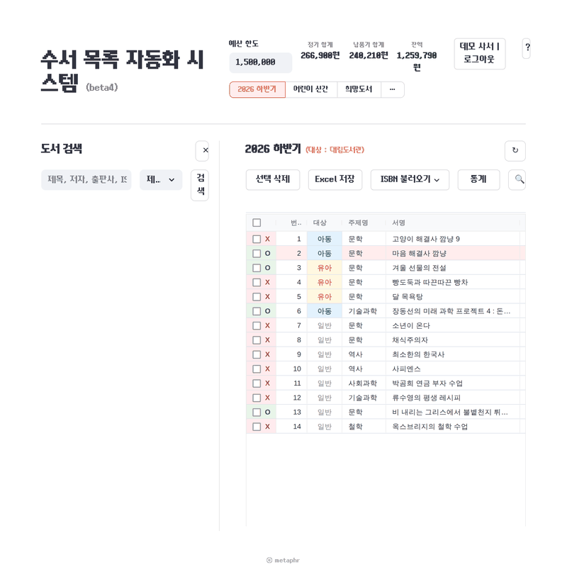
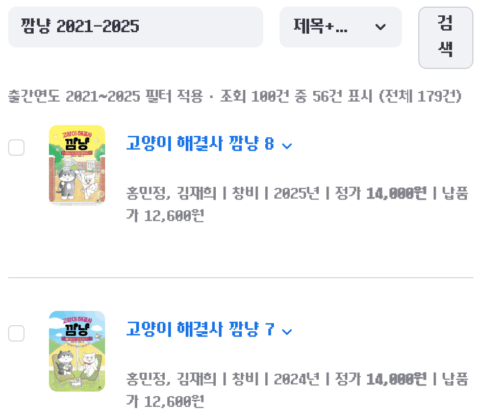
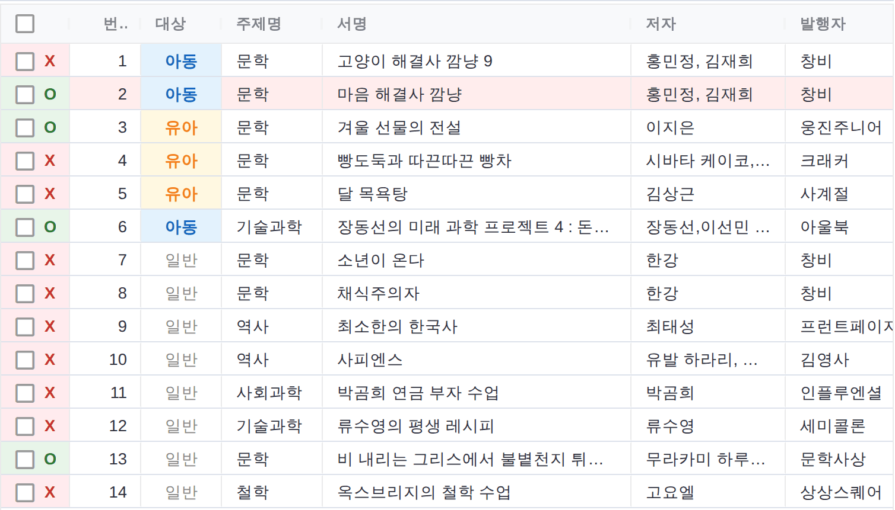
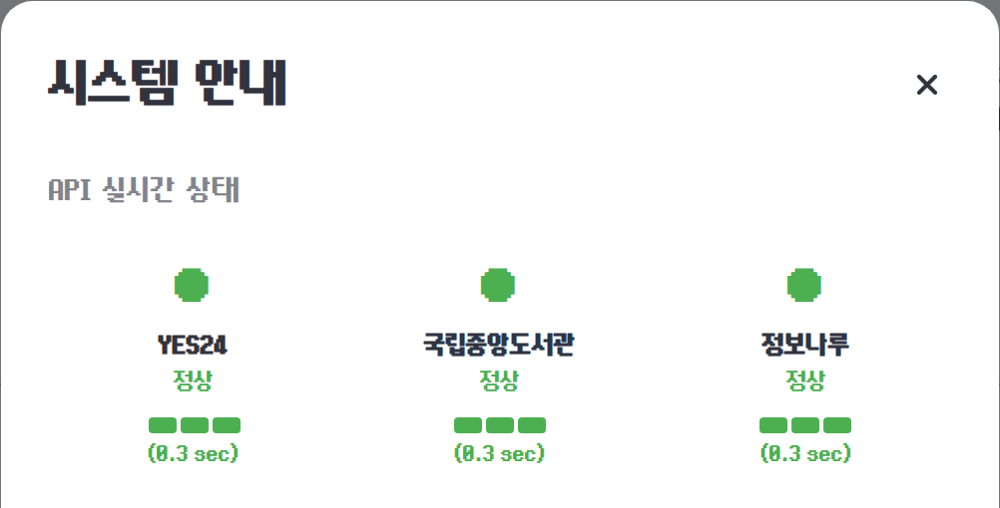
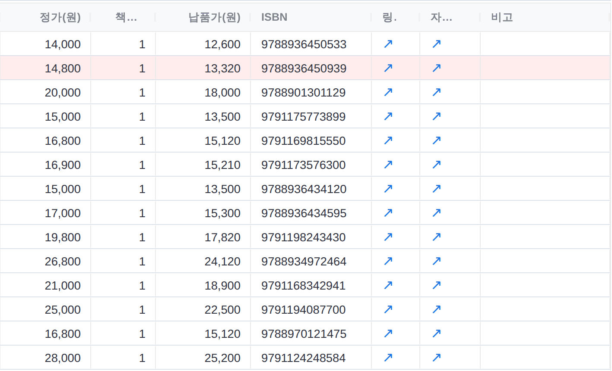
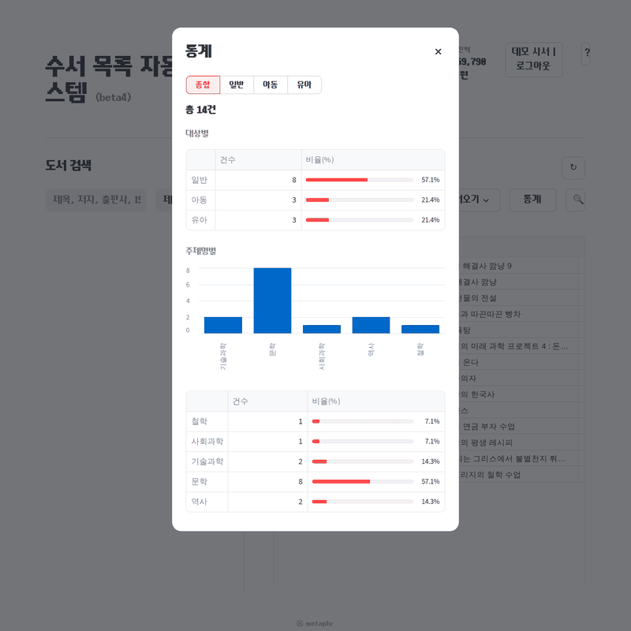

수서(收書)는 도서관이 살 책을 고르는 일이다. 담당 사서는 신간을 찾아 목록에 옮겨 적고, 책마다 주제(KDC 대분류)와 대상(유아·아동·일반)을 붙이고, 우리 도서관에 이미 있는 책인지 확인하고, 예산에 맞춰 덜어 낸 뒤 Excel 파일로 발주한다. 수서 목록 자동화 시스템은 이 가운데 손으로 옮겨 적고 찾아보던 부분을 대신한다.

- 소개: [metaphr.dev/app.html?id=bind](https://metaphr.dev/app.html?id=bind)


*수서 목록 화면. 위에는 예산과 시트, 왼쪽은 검색, 오른쪽은 담은 책의 표다.*

화면은 단순하지만 책 한 권을 채우려면 외부 API 세 곳을 거쳐야 하고, 그중 하나는 한 번 묻는 데 10초가 걸린다. 이 글은 그 API들을 어떤 순서로 믿고, 실패를 어떻게 다루고, 느린 응답을 어떻게 덜 기다리게 했는지 정리한 기록이다.

## 1. 구조

Streamlit 앱 하나와 SQLite 파일 하나가 전부다. AWS Lightsail 인스턴스에서 systemd 서비스로 돈다.

| 구성 | 쓰는 것 |
|---|---|
| 화면 | Streamlit, 표는 streamlit-aggrid(AgGrid) — 셀을 바로 고친다 |
| 저장 | SQLite — 계정, 시트, 수서 목록, 소장 여부 캐시 |
| 서지 | YES24 Open API — 검색, ISBN 상세 조회 |
| 주제명 | 국립중앙도서관 SEOJI(부가기호), 도서관정보나루(KDC 번호) |
| 소장 여부 | 도서관정보나루 `bookExist` |
| 내보내기 | openpyxl |

외부 API의 성격이 제각각이다. YES24는 빠르고(한 번에 100건), SEOJI는 대체로 1초 안쪽이지만 가끔 멈추고, 정보나루는 붐비는 날 건당 10초를 넘긴다. 그래서 코드의 상당 부분이 "어느 값을 먼저 믿을지"와 "못 받았을 때 무엇을 보여 줄지"에 들어 있다.

## 2. 검색: 100건을 받아 앱에서 거른다

YES24 `itemList`는 필드를 고를 수 없는 단일 키워드 검색이다. 그래서 제목·저자·출판사 검색은 결과를 받은 뒤 그 필드에 검색어가 들어 있는 것만 남긴다. 걸러 내면 수가 줄어드니, 필드를 고른 검색은 최대치인 100건을 받는다. `pageSize`가 100까지 허용돼서 호출은 한 번이다.

출간 연도 범위도 같은 방식이다. 검색어 뒤에 `2021-2025`(또는 `2021~2025`)를 붙이면 정규식으로 떼어 낸다.

```python
_YEAR_RANGE_RE = re.compile(r"^(.+?)\s+(\d{4})\s*[-~]\s*(\d{4})$")
```

API에 기간 검색이 없으니 100건을 받아 출간 연도로 거른다. 검색 결과가 많은 검색어는 100건 밖의 책이 빠질 수 있다. 숨기지 않고 화면에 "조회 100건 중 56건 표시 (전체 179건)"처럼 적어 둔다.


*`깜냥 2021-2025`. 전체 179건 가운데 100건을 받아, 그 기간에 나온 56건을 남겼다.*

## 3. 주제명: 세 곳을 차례로 묻는다

주제명은 KDC 첫 자리(0 총류 ~ 9 역사)다. 세 출처를 순서대로 묻고 처음 얻은 값으로 정한다.

```python
def get_subject_by_isbn(isbn13, category_name=""):
    # 1) SEOJI — 출판사가 ISBN 발급 때 신고한 부가기호의 내용분류
    # 2) 정보나루 — 도서관에서 실제로 매긴 KDC 번호(class_no)
    # 3) YES24 카테고리명 키워드 매칭
```

처음에는 정보나루를 1순위로 두었다. 실제 목록화된 번호라 가장 정확해 보였다. 그런데 신간은 아직 목록화되기 전이라 `class_no`가 비어 있는 경우가 많았다. 수서는 신간을 다루는 일이라 이 빈칸이 자주 나온다. SEOJI는 출판사가 ISBN을 받을 때 신고하는 값이라 신간에도 거의 항상 있다. 국립중앙도서관 서지를 기준으로 삼는다는 운영 방침도 있어 SEOJI를 1순위로 올렸다.

이후 기존 목록 398권을 전부 다시 판정해 보니 393권(98.7%)이 1순위에서 정해졌다. 3순위는 사실상 안전망이다. YES24 카테고리는 `국내도서-인문`처럼 한 단계뿐이라 키워드 표(`_CATEGORY_RULES`)를 앞에서부터 대조한다. `경제`·`경영`·`교육`은 사회과학, `심리학`은 철학으로 보낸다.

## 4. 대상: 더 좁은 범주를 먼저 본다

대상(유아·아동·일반)은 YES24 카테고리(`goodsSortNm`) 하나로 정한다.

```python
for name in names:
    if "유아" in name:
        return "유아"
for name in names:
    if "어린이" in name:
        return "아동"
return "일반"
```

유아를 먼저 보는 것은 더 좁은 연령 범주가 우선이라서다. YES24는 `어린이`라고 부르지만 표와 Excel에는 `아동`으로 쓴다. 어디에도 걸리지 않으면 `일반`이다. 서점이 카테고리 형식을 바꾸더라도 엉뚱한 분류 대신 일반으로 떨어진다.

서지 출처를 알라딘에서 YES24로 바꿀 때 이 규칙으로 398권을 다시 판정해 알라딘 시절 값과 비교했다. 397권 중 387권(97.5%)이 같았고, 일반 147권은 전부 일치했다. 어긋난 10권은 36쪽짜리 그림책을 유아로 볼지 아동으로 볼지 같은, 두 서점의 진열 기준이 다른 경계 사례였다.

## 5. 소장 여부: 실패는 미소장이 아니다

담은 책마다 대상 도서관이 이미 가지고 있는지 정보나루 `bookExist`에 묻는다. 표에는 세 가지로 찍힌다.

| 표시 | 뜻 |
|---|---|
| `O` | 미소장 — 구입 대상 |
| `X` | 이미 소장 중 |
| `-` | 확인하지 못함 |


*왼쪽 끝 열이 소장 여부다. O는 초록, X는 빨강 바탕으로 칠한다.*

처음에는 `-`가 없었다. 함수가 `bool`을 돌려주었고, 예외가 나면 `False`였다. 정보나루 응답은 건당 5~9초인데 타임아웃은 5초였다. 시간을 넘긴 조회는 `False`, 곧 "미소장"이 됐고 그 값이 30일 동안 캐시됐다. 이미 가진 책이 구입 대상 `O`로 표시되고 있었던 것이다. 그대로 발주하면 중복 구입이다.

지금은 반환형이 `bool | None`이다.

```python
def check_holdings(isbn13, lib_code) -> bool | None:
    """True = 소장 중, False = 미소장, None = 조회 실패(타임아웃 등)"""
```

`None`은 캐시에 쓰지 않고 `-`로 표시한다. 다만 캐시에 남지 않으니 화면을 다시 그릴 때마다(Streamlit은 버튼 하나에도 스크립트 전체를 다시 돈다) 30초 타임아웃을 또 기다리게 된다. 그래서 실패한 ISBN은 세션의 `_holdings_failed` 집합에 넣어 그 세션 동안은 다시 묻지 않는다. ↻ 버튼을 누르면 비워지고 새로 조회한다. 표 위에는 "N건은 정보나루 응답 지연으로 확인하지 못했습니다"라고 띄운다. 알리지 않으면 사용자는 `-`를 미소장으로 읽는다.

대상 도서관은 계정마다 고른다. 후보는 정보나루 코드표에서 뽑은 전국 2,092관이고, 이름이 같은 도서관이 있어 주소를 함께 보여 준다. 소장 여부는 도서관마다 다르니 캐시 테이블의 기본키도 `(isbn, lib_code)` 복합키다. 처음에는 ISBN 하나였는데, 도서관을 고를 수 있게 하면서 마이그레이션했다.


*대상 도서관. 이름으로 찾고 주소로 가린다.*

## 6. 느린 API를 덜 기다리게 하기

책 한 권을 담을 때 걸리는 시간을 단계별로 쟀다.

| 단계 | 호출 | 실측 |
|---|---|---|
| ① | 서지 상세 조회 | 0.3초 (알라딘 시절) |
| ② | SEOJI 부가기호 | 0.4~1.0초, 가끔 15초 타임아웃 |
| ③ | 정보나루 `class_no` | 10.2~10.8초 (②가 실패했을 때만) |
| ④ | 정보나루 `bookExist` | 9.8~11.1초 |

④가 매번 붙고, ②가 실패한 날에는 ③까지 붙는다. 최악이면 23초다. 정보나루는 동시에 여러 건을 넣어도 건당 지연이 같았다(1·4·8건 동시 모두 약 10초). 서버가 요청을 줄 세우는 게 아니라 한 건 한 건이 원래 느린 것이다. 그래서 할 수 있는 일은 근본 해결이 아니라 덜 기다리게 하는 것뿐이다. 네 가지를 했다.

**표를 먼저 그린다.** 소장 여부를 다 받은 뒤 표를 그리면, 정보나루가 느린 날에는 표 자체가 안 뜨는 셈이다. 지금은 캐시에 있는 값으로 표를 먼저 그리고, 빈칸만 진행률 막대와 함께 8건씩 동시에 묻는다. 하나라도 받으면 다시 그려 채운다.

**캐시를 길게 둔다.** 소장 상태는 자주 바뀌지 않는다. 30일로 두었더니 시트 하나가 통째로 만료돼 접속할 때마다 100건 넘게 다시 묻는 일이 생겼다. 90일로 늘리고, 최신값이 필요하면 ↻로 다시 묻게 했다.

**둘을 동시에 묻는다.** 주제명(②③)과 소장 여부(④)는 서로 상관이 없는데, 예전 구조에서는 주제명을 받아 목록에 넣은 뒤 표를 다시 그리면서 소장 여부를 물었다. 두 단계로 갈라져 있어 겹칠 수가 없었다. 지금은 책을 담는 순간 두 조회를 스레드 둘에 나눠 동시에 돌리고, 소장 결과를 그 자리에서 캐시에 넣는다. 표를 다시 그릴 때는 이미 캐시에 있으니 "소장 여부 확인 중" 단계가 사라진다. 최악 23초가 정보나루 한 번 분량인 12초 안팎으로 줄었다. 캐시에 이미 있는 책은 소장 조회를 아예 건너뛴다.

여기에는 Streamlit 특유의 함정이 둘 있었다. 하나는 `@st.cache_data`로 감싼 함수를 워커 스레드에서 부르면 실행 문맥(ScriptRunContext)이 없어 깨진다는 것이다. 그래서 상세 조회는 메인 스레드에서 먼저 하고, 스레드에는 `requests`만 쓰는 함수만 보낸다. 캐시 쓰기도 스레드가 끝난 뒤 메인에서 한다. 다른 하나는 세션 캐시다. 표는 세션에 캐시가 **없을 때만** DB에서 통째로 읽어 온다. 책을 담으면서 캐시를 새로 만들고 한 건만 넣으면, DB를 읽는 단계가 건너뛰어져 나머지 모든 행이 캐시 미스가 되고 전부 다시 조회된다. 그래서 세션 캐시에 손대는 곳은 모두 한 함수(`holdings_session`)를 거쳐, 언제나 DB에서 전체를 먼저 읽게 했다.

**상태를 보여 준다.** 헤더의 `?`를 누르면 세 API의 상태와 응답 시간이 뜬다. 느린 날에 사용자가 "앱이 고장 났나" 대신 "정보나루가 느리구나"를 알 수 있다.


*세 API의 상태와 응답 시간.*

## 7. 알라딘 API 서비스 종료와 YES24 이전

처음 서지 출처는 알라딘 TTB API였다. 알라딘이 OpenAPI 서비스를 종료하면서, 모든 호출이 HTTP 200과 함께 이런 본문을 돌려주게 됐다.

```json
{"errorCode": 999, "errorMessage": "www.aladin.co.kr 도메인을 통한 OpenAPI서비스는 종료되었습니다."}
```

검색도, 담기도, 새로고침도 멈췄다. 서비스 자체가 끝났으니 서지 출처를 YES24 Open API로 옮겼다. 바꾸면서 생긴 차이를 하나씩 메웠다.

- **카테고리 경로가 없다.** 알라딘은 `categoryIdList`로 카테고리 경로 전체를 주었고 대상 판정이 그걸 봤다. YES24에는 그런 목록이 없다. 문서에 "관리분류명"이라고만 적힌 `goodsSortNm`에 실제로는 `국내도서-유아`가 들어온다는 걸 응답을 보고 확인해 판정 규칙을 그 위로 옮겼다. 그 결과가 4절의 97.5%다.
- **전자책이 잡힌다.** ISBN 상세 조회(`itemDetail`)에는 검색과 달리 카테고리 조건이 없어서, 같은 ISBN의 전자책이나 DVD가 나오기도 한다. 수서 목록은 실물 도서용이라 `goodsType`이 `도서`가 아니면 못 찾은 것으로 처리한다.
- **상품 주소를 만들 수 없다.** YES24 상품 URL은 내부 번호(`itemId`) 기반이라 ISBN만으로는 조립할 수 없다. DB에 열을 더하고 기존 401건을 옮기는 대신, 링크를 ISBN 검색 페이지로 보내 스키마를 건드리지 않았다.

외부 API 하나에 기대는 구조의 위험을 그대로 겪은 셈이다. 이후로 판정 규칙을 바꿀 때는 기존 목록 전체를 새 규칙으로 다시 돌려 일치율을 재고, 그 결과를 규칙 문서(`RULE.md`)의 변경 이력에 남긴다.

## 8. 조회되지 않은 책도 자리를 지킨다

ISBN을 줄마다 적은 텍스트 파일을 올리면 한 번에 담긴다. 처음에는 서점에서 찾지 못한 ISBN을 조용히 건너뛰었다. 절판본, 정부 간행물, 학술서가 그렇게 빠졌고, 어떤 ISBN이 빠졌는지 알 길이 없어 곧 발주 누락이 됐다.

지금은 못 찾은 ISBN도 파일에 적힌 순서 그대로 ISBN만 채운 빈 행으로 넣고, 비고에 `정보없음`이라고 적는다. 나중에 서점에 등재되면 ↻ 새로고침이 ISBN이 있는 행을 다시 조회해 채운다. 빈 행이 생기니 오타가 빈 행으로 흘러들지 않게 먼저 걸러야 한다. 하이픈과 공백을 지운 뒤 13자리, 978·979 접두, 체크섬을 본다.

```python
total = sum(int(d) * (1 if i % 2 == 0 else 3) for i, d in enumerate(isbn))
return total % 10 == 0
```

일괄 등록에서도 소장 여부를 서지 조회와 같은 시간대에 묻는다. 서지 조회는 동시 5건, 소장 조회는 YES24 호출이 아니니 별도 풀에서 동시 8건으로 돌린다.

## 9. 시트와 예산

한 사람이 예산 항목이나 발주 차수별로 목록을 나눠 써야 해서 계정당 시트를 세 개까지 둔다. 시트마다 예산 한도가 있고, 정가 합계·납품가 합계·잔액이 바로 계산된다. 납품가는 정가의 90%다.

시트를 들이면서 중복 판정의 단위가 바뀌었다. 예전에는 `(isbn, user_id)`로 같은 계정 안의 중복을 막았는데, 지금은 `UNIQUE(isbn, sheet_id)`다. 같은 책을 다른 차수에 다시 담을 수 있어야 해서다. 기존 245건은 계정마다 만든 기본 시트로 옮겼고, 옮기기 전에 DB 파일을 통째로 백업해 두었다.

표에서는 필터를 건 채로 셀을 고치거나 행을 지우면 엉뚱한 행이 바뀌는 문제가 있었다. AgGrid가 돌려주는 행 순서를 화면 순서로 믿은 탓이다. 행마다 숨긴 `id` 열을 두고 그 값으로 맞추게 고쳤다.

## 10. 원본과 대조할 길

자동으로 채운 값은 틀릴 수 있다. 행마다 YES24 검색과 자관 소장 검색으로 가는 링크를 두 개 달았다. 의심스러운 행은 한 번에 원본을 열어 본다. Excel로 내보낼 때도 두 링크를 하이퍼링크로 넣고, 파일 이름과 워크시트 이름, 제목 줄에 시트 이름을 쓴다.


*표의 오른쪽. 정가와 납품가, ISBN, YES24·자관 링크.*

담은 책은 대상별·주제명별로 권수와 비율을 볼 수 있다. 목록이 어느 쪽으로 쏠려 있는지 한눈에 보인다.


*통계. 대상별 비율과 주제명별 권수.*

## 남은 것

- **오염된 캐시.** 타임아웃을 미소장으로 처리하던 시절의 값이 캐시에 남아 있다. 진짜 미소장인지 타임아웃 결과인지 구분할 방법이 없어서, 그 기간에 쓰인 미소장 기록을 지우고 다시 묻는 정리가 필요하다.
- **YES24 초당 한도.** 새로고침과 일괄 등록은 서지 조회를 동시 5건으로 돌린다. 응답이 건당 0.5초보다 빠르면 초당 10회를 넘는다. 지금은 실패를 모두 같은 예외로 삼켜서 한도 초과(HTTP 429)를 따로 알아보지 못한다.
- **한 번에 한 권.** 체크박스를 누르면 그 한 권의 처리가 끝날 때까지 화면이 멈춘다. 대기는 줄었지만 정보나루가 건당 10초인 한 구조적인 대기는 남는다. 체크만 해 두고 마지막에 한꺼번에 보내는 흐름으로 바꾸는 게 다음 일이다.
