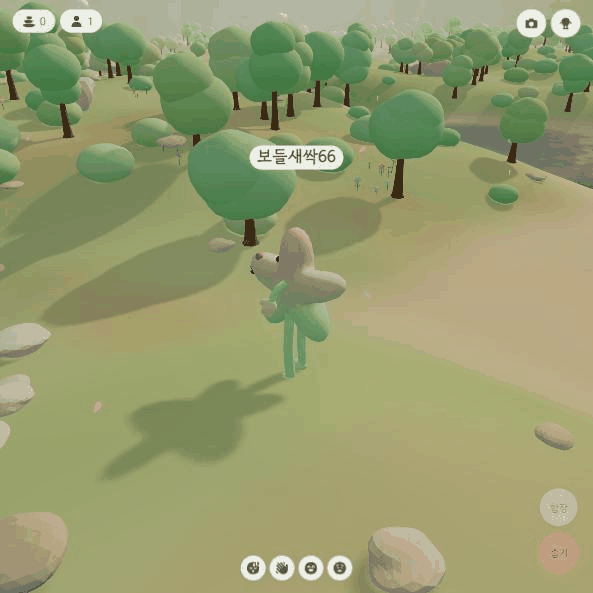
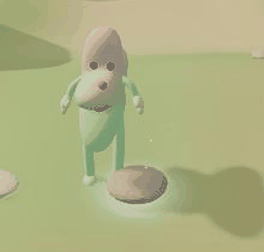
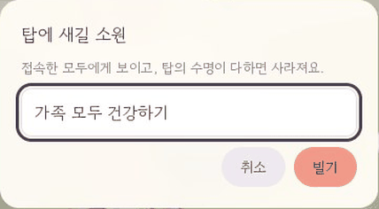
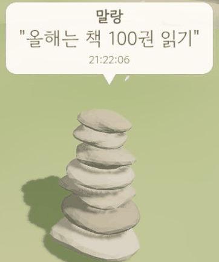
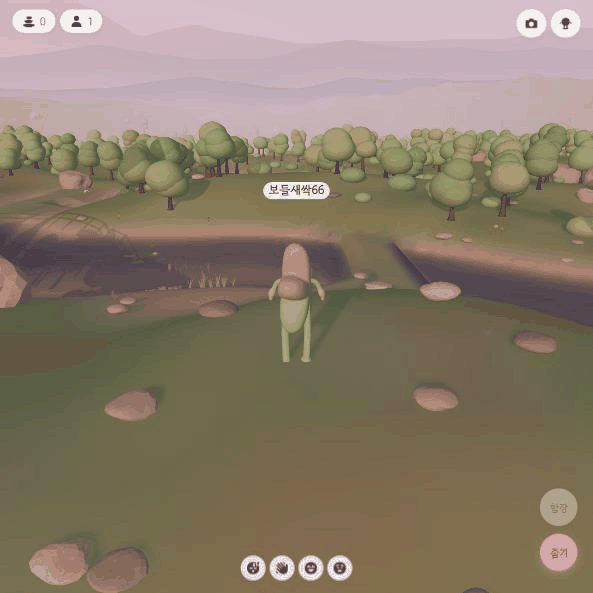
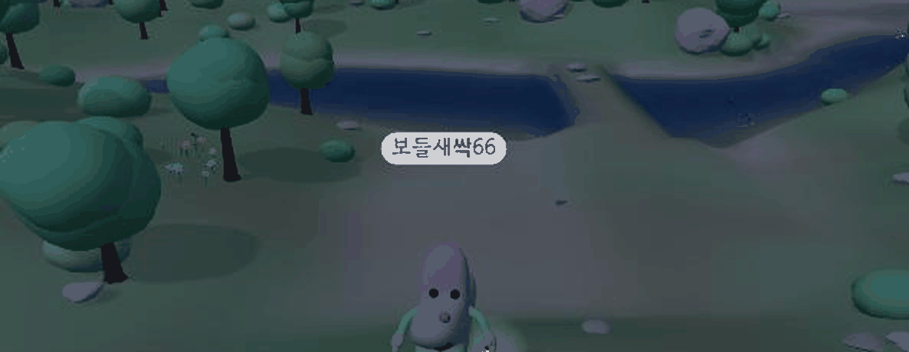
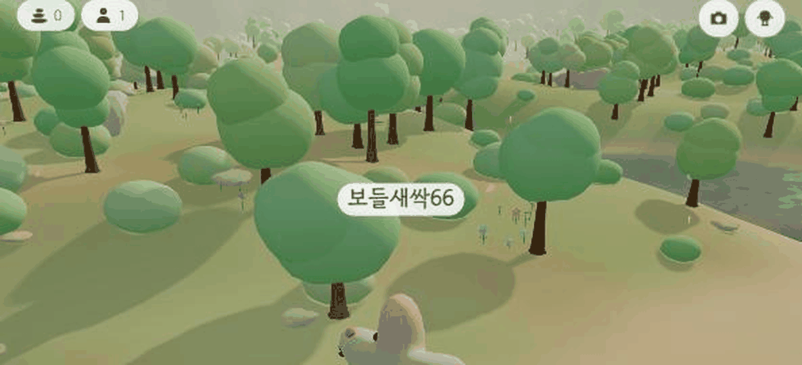
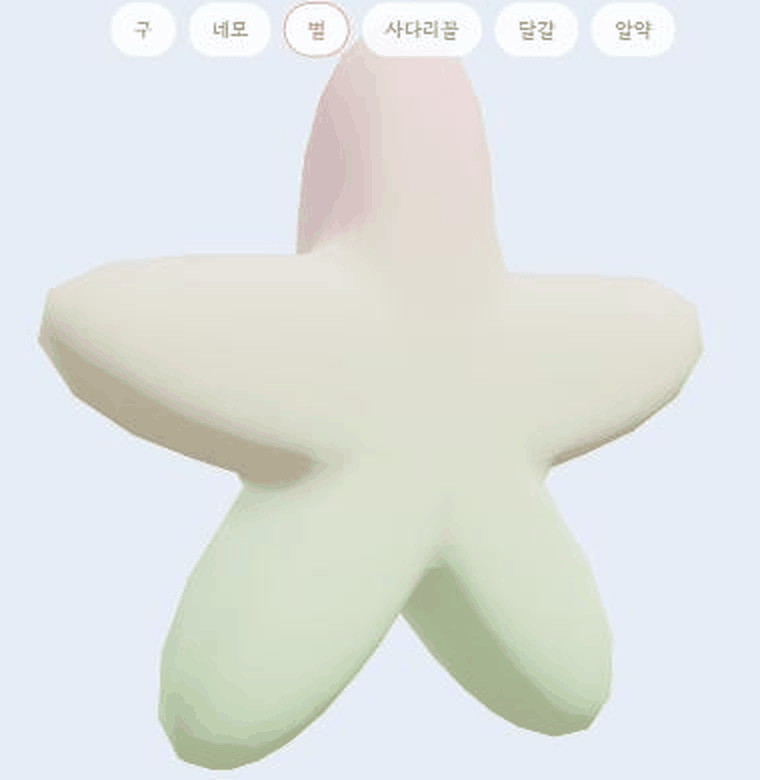

산길을 걷다 보면 누군가 쌓아 둔 작은 돌탑을 만난다. 쌓은 사람은 없고 탑만 남아 있는데, 그 위에 돌 하나를 얹고 가는 사람이 또 있다. 「이뤄져요, 돌탑의 숲」은 그 장면을 브라우저 안으로 옮긴 실시간 3D 웹 게임이다. 말랑한 캐릭터를 손으로 빚어 숲에 들어가고, 돌을 주워 탑을 쌓고, 다섯 층이 넘으면 소원을 적는다. 다른 사람의 걸음과 탑과 소원이 그대로 보이고, 지나가는 사람의 합장이 탑을 조금 더 오래 남긴다.

- 소개: [metaphr.dev/app.html?id=stone](https://metaphr.dev/app.html?id=stone)
- 게임: [stone.ksthink.com](https://stone.ksthink.com)
- 메타모아: [metamoa.com/s/stone-ksthink-com-mw79rqk1](https://metamoa.com/s/stone-ksthink-com-mw79rqk1)
- 저장소: [github.com/ksthink/realtime](https://github.com/ksthink/realtime)

11월 4일 첫 커밋부터 11월 9일까지 엿새, 커밋은 107개였다. 돌아보면 더한 것만큼 덜어 낸 것이 많았다. 이 글은 그 순서대로의 기록이다.


*한낮의 숲. 가운데 말랑이가 이번에 빚은 「보들새싹66」이다.*

## 1. 규칙은 서버에 둔다

첫날 정한 것 가운데 끝까지 바뀌지 않은 것이 하나 있다. **판정은 전부 서버가 한다.** 돌을 줍는 것, 탑에 올리는 것, 탑이 무너지는 것, 합장, 소원까지 모두 Postgres 함수(RPC)가 결정한다. 브라우저는 결과를 받아 그릴 뿐이다.

로그인 없는 게임이라 더 그래야 했다. 누구나 개발자 도구를 열 수 있고, 클라이언트 코드를 고치면 남의 탑을 무너뜨리거나 열한 번째 돌을 올릴 수 있다. 규칙이 서버에 있으면 그런 시도는 그냥 거절된다. 클라이언트에도 `rules.ts`라는 파일이 있지만, 첫 줄 주석이 "화면 표시용 규칙 값. 판정은 RPC가 내린다"이다.

통신은 성격에 따라 셋으로 나눴다.

| 무엇 | 어떻게 |
|---|---|
| 돌과 탑의 변화 | Supabase Realtime의 테이블 변경 이벤트 |
| 캐릭터 위치 | Broadcast (저장하지 않고 흘려보냄) |
| 지금 누가 있나 | Presence |

돌과 탑은 DB에 남아야 하므로 테이블을 바꾸고 그 변경을 모두에게 알린다. 캐릭터 위치는 초당 몇 번씩 바뀌는데 남길 이유가 없으니 Broadcast로 흘린다. 계정은 Supabase 익명 인증이다. 같은 브라우저로 다시 오면 캐릭터와 탑이 이어지고, 다른 기기에서는 새 사람이 된다. 소원 하나 적으러 온 사람에게 가입을 받느니 그쪽이 낫다고 봤다.


*줍게 될 돌 아래에 은빛 표시가 뜬다. 대상은 화면이 미리 보여 주지만, 정말 주울 수 있는지는 서버가 정한다.*

서버 규칙에는 테스트를 따로 붙였다. 로컬 Supabase를 상대로 줍기·쌓기·붕괴·합장 쿨다운을 직접 호출해 보는 300줄 남짓의 테스트와, 실제 브라우저로 입장부터 소원, 붕괴, 새로고침까지 따라가는 브라우저 테스트다.

## 2. 탑은 무너져야 한다

돌탑이 재미있는 건 무너질 수 있어서다. 처음 구상부터 "크기와 면적을 고려해 무너진다"는 조건이 있었다. 진짜 물리 엔진을 돌릴 수도 있었지만, 그러면 판정이 클라이언트로 넘어간다. 그래서 쌓는 순간 서버가 한 번 계산하는 단순한 모형을 만들었다.

먼저 돌을 올리면 아래 돌에서 조금 비껴 앉는다. 비껴가는 폭은 접촉면 크기에 비례하고, **위 돌이 아래 돌보다 클수록** 커진다.

```sql
v_contact := least(v_stone.radius, v_below.radius);
v_ratio   := greatest(0, v_stone.radius / v_below.radius - 1);
v_wob     := v_contact * (0.35 + v_ratio * 0.9);
```

그다음 아래층부터 차례로, 그 층 위에 얹힌 돌 전체의 무게중심을 구한다. 무게는 면적 × 높이로 친다. 무게중심이 받침 범위를 벗어나면 탑이 무너진다. 받침 범위도 위 돌이 클수록 좁아진다.

무너지면 탑과 소원은 지워지고, 돌은 둘레 0.8~3m에 흩어져 다시 주울 수 있는 바닥 돌이 된다. 작은 돌 위에 큰 돌을 올리는 욕심이 벌을 받는 구조다. 이번에 화면을 찍으려고 두 번째 돌을 올렸다가 곧바로 「와르르… 탑이 무너졌어요」를 봤다. 두 번째 돌이 첫 돌보다 컸다.

## 3. 소원과 수명: 숲이 쌓다 만 탑으로 가득 찼다

규칙의 뼈대는 이렇다. 탑은 한 사람당 하나, 최대 열 층. 다섯 층이 되면 소원을 지금 빌지 나중에 빌지 묻는다. 나중을 고르면 열 층까지 더 쌓을 수 있고, 열 층에서는 소원을 적어야 한다. 소원은 24자까지다.


*다섯 층이 되면 나오는 물음. 지금, 아니면 나중.*


*소원은 접속한 모두에게 보이고, 탑의 수명이 다하면 사라진다.*

처음에는 소원을 빌어도 탑이 계속 그 사람 것이었다. 그러면 한 사람이 탑 하나에 묶인다. 둘째 날 **소원을 빌면 탑을 놓아주게** 바꿨다. 탑은 숲에 남고, 사람은 곧바로 새 탑을 시작할 수 있다.

수명은 더 여러 번 바뀌었다.

| 언제 | 소원 없는 탑 | 소원 탑 | 합장 한 번 |
|---|---|---|---|
| 11/4 | 1시간 | 1시간 | +10분 |
| 11/5 | 하루 | 하루 | +1시간 |
| 11/8 | 마지막 돌 뒤 10분 | 3일 | +3시간 |

모든 탑이 하루를 살면 두세 층 올리다 떠난 탑도 하루 동안 자리를 차지한다. 다른 탑과 2m 이상 떨어져야 첫 돌을 놓을 수 있으니, 빈 탑이 많을수록 새 탑을 놓을 자리도 줄어든다. 그래서 소원을 빌지 않은 탑은 마지막 돌을 올리고 10분이 지나면 돌과 함께 사라지게 했다. 돌을 올릴 때마다 10분이 다시 시작되니, 쌓고 있는 동안에는 사라지지 않는다. 대신 소원을 빈 탑은 3일로 늘렸다. 숲에 남는 것은 소원이 적힌 탑뿐이다.

합장은 같은 탑에 10분에 한 번, 3.2m 안에서만 된다. 받은 합장 수는 푯말에 ♥ (N)으로 붙는다.


*초기의 소원 푯말. 남은 시간을 `21:22:06`처럼 초까지 셌는데, 지금은 "2일 23시간"처럼 단위별로 줄이고 곧 사라질 10분 안에서만 초를 센다. 긴 시간은 대략만 보여 푯말이 매초 바뀌지 않게 했다.*

## 4. 숲을 넓히고, 하늘을 서울에 맞추다

셋째 날 숲을 반경 120m로 넓히고, 가운데에 동산과 나무 계단을 놓았다. 게임 이름도 이날 정해졌다. 첫 커밋은 「돌탑 마을」, 둘째 날은 「어서 놔요, 소원 돌탑」, 셋째 날부터 「이뤄져요, 돌탑의 숲」이다. 마을보다 숲이 맞았다.

지형을 넓히자 물과의 싸움이 시작됐다. 다리 옆 흙둑과 습지를 메우고, 벽에 막히면 멈추는 대신 벽을 따라 미끄러지게 하고, 깊이 25cm가 안 되는 얕은 물은 강에 붙어 있어도 걸어 지나가며 물이 튀게 했다. 그래도 다리 옆에서는 물에 빠졌다. 보이는 땅이 물 밑으로 꺼진 자리였다. 그런 곳은 걸어 들어가거나 돌을 놓지 못하게 막았다.

넷째 날에는 하늘을 한국 시간에 맞췄다. 게임 시간을 따로 두지 않고, 해와 달은 서울에서 실제로 보이는 자리에 뜨고 진다. 계절에 따라 해 뜨는 시각이 달라지고, 달은 실제 모양대로 차고 기운다. 밤하늘에는 실제 밝은 별들이 제자리에 뜨고, 가끔 별똥별이 산 너머로 떨어진다. 모든 접속자가 같은 하늘을 본다.


*해 질 녘. 먼 산맥이 분홍빛으로 물들고, 그림자가 길어진다.*

시간대마다 빛을 다르게 칠하면서 규칙 하나를 세웠다. **어느 때도 한낮보다 밝지 않게.** 노을과 꽃잎도 시간대 빛에 물들지만, 한낮의 밝기를 넘지는 않는다. 그림자는 옅고 부드럽게, 길이는 실제와 보기 편한 각도 사이로 두었다. 숲을 켜 두고 오래 머무는 게임이라 눈이 먼저였다.

어두워지면 캐릭터가 저절로 랜턴을 든다. 돌을 나를 때는 허리에 걸고, 합장하거나 앉을 때는 옆에 세워 둔다. 풀숲과 물가에 반딧불이가 나와 랜턴 둘레로 모인다.


*밤에 드는 랜턴. 땅을 비추는 진짜 빛은 PC에서 내 랜턴 하나에만 달고, 다른 사람의 랜턴과 휴대폰에서는 빛 번짐만 그린다.*


*밤의 강과 숲. 마지막 날 밤하늘을 한 번 더 짙게 칠했다.*

## 5. 하루 만에 만들고 하루 만에 걷어 낸 것

이 프로젝트에서 가장 많이 배운 건 넷째 날 아침부터 저녁까지다.

숲을 가꾸는 NPC를 넣고 싶었다. 이름은 「나무지기」. 처음에는 역삼각형 몸에 팔다리가 달린 열한 마리가 세계 곳곳의 나무를 찾아다녔다. 캐릭터와 어울리지 않아서 발 없이 떠다니고 정수리에 새싹이 난 정령으로 바꿨다. 그다음 반투명한 물방울 슬라임이 됐고, 몸 모양을 물방울에서 구로 바꿨고, 가까이서 보면 뒤쪽의 눈코입과 팔이 몸을 지나며 굴절되어 보이는 진짜 빛 투과를 넣었다. 휴대폰에서는 그 굴절을 껐다. 반짝임을 줄여 무광에 가깝게 다듬고, 꽃에 물을 주고 물고기에게 먹이를 주게 했다. 먹이를 주면 물고기가 모여 맴돌고 자주 뛰어올랐다.

그리고 같은 날, 나무지기와 관련 코드를 모두 걷어 냈다. 커밋 메시지는 "게임이 무거워져서"였다.

전날에도 비슷한 일이 있었다. 캐릭터 팔다리에 휘는 뼈대와 관절(IK)을 넣고 동작을 전부 다시 만들었다가, 손목과 어깨를 맞추는 커밋을 몇 개 더 쌓은 뒤 이전 상태로 되돌렸다.

둘 다 보기에는 좋았다. 하지만 이 숲은 휴대폰으로도 들어오는 곳이고, 열 명이 동시에 돌을 나르는 곳이다. 열한 마리 NPC의 경로와 굴절 렌더링은 그 비용을 모든 접속자에게 매 프레임 청구한다. 그 뒤로 기준이 생겼다. 나비와 물고기는 수를 3분의 1로 줄이고, 세계 곳곳의 정해진 자리에만 살게 했다. 꽃은 그림자를 끄고, 40m 안에서만 그리고, 꽃잎과 잎은 얇은 판으로 만들었다. 남은 동물은 나비, 작은 새, 물고기와 피라미떼, 반딧불이다. 새는 해 질 녘이면 나무 위로 가서 잔다.


*1,398그루의 나무. 이 가운데 238그루는 한동안 잎덩이가 줄기 위에 떠 있었다.*

## 6. 조이스틱을 버리다

처음 휴대폰 조작은 왼쪽 아래 조이스틱과 오른쪽 버튼이었다. 둘째 날에만 조이스틱을 두 번 손봤다. 20% 키웠다가, 다시 줄이고 오른쪽 버튼을 키워 재배치했다.

다섯째 날 조이스틱을 없앴다. 대신 **누른 곳으로 걷고, 돌을 누르면 걸어가서 줍는다.** 그러려면 길찾기가 필요했다. 강과 동산 비탈, 물가의 꺼진 땅을 피해 돌아가는 경로를 찾게 했다. 누른 자리에 뜨는 파동 고리도 땅 굴곡에 맞춰 휘게 했다. 비탈에서 평평한 고리를 그리면 반쯤 땅에 묻힌다.

탭 하나에 걷기와 줍기와 놓기를 다 맡기지는 않았다. 돌을 든 동안의 탭은 걷기만 하고, 내려놓기는 놓기 버튼으로만 한다. 내 탑 위의 빛기둥을 누르면 "내 돌탑 위치로 이동할까요?"를 묻는다. 반경 120m 숲에서 내 탑으로 돌아가는 길을 한 번의 탭으로 줄였다.

캐릭터 빚기도 손을 봤다. 끄는 동안 브러시 둘레를 저절로 살짝 다듬어 폴리곤이 뾰족하게 튀지 않게 하고, 이름 칸 옆에 「이름짓기」 버튼을 달았다. 귀여운 꾸밈말에 이름과 두 자리 숫자를 붙인다. 「보들새싹66」은 이 버튼이 지었다.


*별 모양에서 시작해 윗자락을 끌어 올린 말랑이. 입장을 누르는 순간 보이는 쪽이 얼굴이 된다.*

## 7. 메타모아에 올리다

숲은 [메타모아](https://metamoa.com)에도 올라 있다. 설치 없이 돌아다니는 메타버스 공간을 모아 두는 곳이고, 이 숲은 「마음」 분류에 있다. 메타모아는 공간마다 지금 몇 명이 있는지 보여 준다. 그 숫자를 보내는 일을 마지막에 붙였다.

흐름은 이렇다. 10분마다 `pg_cron`이 Edge Function을 깨우고, 함수가 게임의 `world` 채널에 들어가 Presence를 **지켜보기만** 하며 인원을 센 다음 메타모아 API로 보낸다. 지켜보기만 하므로 함수 자신은 인원에 들어가지 않는다. 인트로 화면에 머문 사람은 아직 채널에 없으니 빠지고, 같은 사람이 탭을 여러 개 열어도 한 명이다. 함수 주소는 공개이므로 Vault에 둔 비밀값을 헤더로 보낸 호출만 받는다.

하나 고민한 것이 있다. 인원을 세다 실패하면 무엇을 보낼까. 0을 보내면 목록에서는 빈 숲으로 보인다. 그건 거짓말이다. 그래서 세지 못한 회차는 아무것도 보내지 않고 건너뛴다. 틀린 0보다는 아무것도 보내지 않는 편이 낫다.

정원은 50명이다. 다만 서버가 막지는 않고, 인트로에서만 막는다. 인트로에 접속 인원과 정원을 보여 주던 표시는 뺐고, 제한은 그대로 두었다.

## 남은 것

엿새의 기록을 다시 읽어 보면, 숲에 남은 것보다 숲에서 나간 것이 더 선명하다. 나무지기 열한 마리, 휘는 팔다리, 조이스틱, 초까지 세는 푯말, 하루를 사는 빈 탑, 인트로의 정원 숫자. 모두 그날은 좋아 보였고, 다음 날의 기준에 걸려 나갔다.

남은 기준은 셋 정도다. 규칙은 서버에 둔다. 모든 사람의 휴대폰에서 같은 숲이 돌아가야 한다. 오래 켜 두어도 눈이 편해야 한다.

숲에 들어가면 돌이 흩어져 있다. 작은 돌부터 주워 쌓으면 된다. 큰 돌은 맨 아래에.
