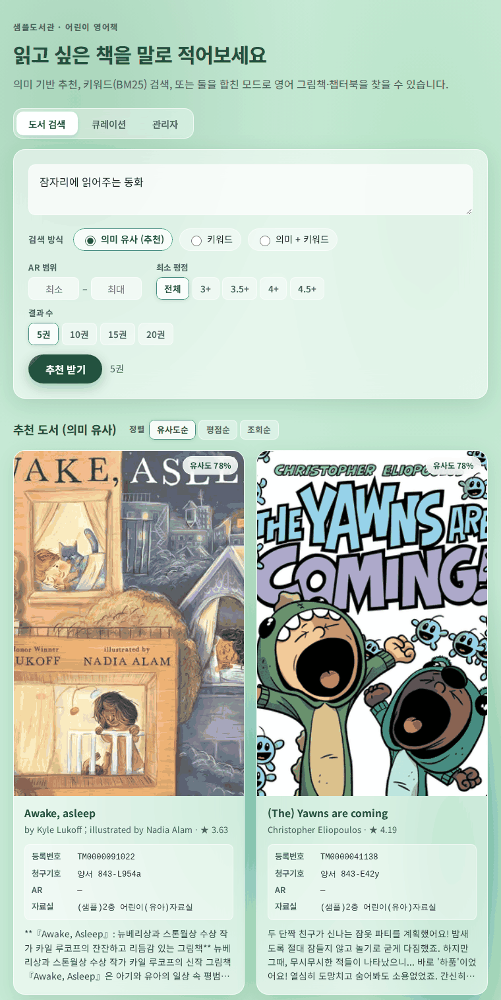

대림도서관 어린이 영어 원서 3,061권을 문장으로 찾는 검색 서비스다. "잠자리에 읽어주는 동화"처럼 한국어로 적으면 뜻이 가까운 영어 그림책을 돌려준다. 검색은 의미·키워드(BM25)·혼합 세 방식이고, AR 지수 범위와 평점으로 거를 수 있다.

- 소개: [metaphr.dev/app.html?id=childbook](https://metaphr.dev/app.html?id=childbook)
- 데모: [engbook.metaphr.dev](https://engbook.metaphr.dev/) (2026-11-26 기준 데이터로 고정)

*한국어로 "잠자리에 읽어주는 동화"를 의미 모드로 찾은 결과. Awake, asleep과 The Yawns are coming이 위에 온다.*

이 글은 화면보다 그 아래, 데이터를 어디서 모았고 어떻게 다듬었고 어떻게 벡터로 만들었는지를 정리한다. 특히 임베딩은 한 번 잘못 만들었다가 고쳤는데, 그 과정이 이 글의 중심이다.

## 1. 데이터는 어디서 왔나

한 권의 행은 다섯 곳에서 온 값을 이어 붙인 것이다.

| 출처 | 들어온 값 |
|---|---|
| 도서관 소장 목록(시스템 내보내기 엑셀) | 등록번호, 청구기호, 자료실, 서명, 저작자, 권서명, 발행자, 발행년, ISBN, 쪽수, 부록 등 |
| Goodreads | 평점, 표지, 영문 소개, 독자 리뷰 3편 |
| AR | AR 지수(독서 난이도) |
| 알라딘 | 국내 번역서의 서명·ISBN·표지·링크 |
| 생성 | 영문 소개의 한국어 번역, 리뷰의 한국어 요약 |

등록번호를 열쇠로 소장 목록과 맞춰 보면 3,061권 중 3,060권이 일치한다. 남은 1건은 테스트 행이다. 다만 Goodreads·알라딘 수집 스크립트와 번역 스크립트는 남아 있지 않다. 서버에도 저장소에도 없고, 도서관 PC에서 돌린 것으로 보인다. 그래서 수집 방법은 여기 적지 않고, 남은 데이터가 무엇을 담고 있는지만 적는다.

채움률은 고르지 않다.

| 값 | 채워진 권수 | 비율 |
|---|---|---|
| ISBN, 쪽수 | 3,061 | 100% |
| 평점, 표지 | 2,765 / 2,764 | 90% |
| 영문 소개 / 한국어 소개 | 2,711 / 2,704 | 89% / 88% |
| 리뷰 1~3 | 2,608 / 2,558 / 2,519 | 82~85% |
| AR 지수 | 1,739 | 57% |
| 리뷰 한국어 요약 | 183 / 173 / 172 | 약 6% |
| 국내 번역서 | 87 | 3% |

AR 지수가 절반 남짓이라는 점은 필터 설계에 그대로 이어진다(2절). 리뷰 한국어 요약은 6%뿐이고, 원문 리뷰 중앙값 426자를 145자 안팎으로 줄인 것이다.

## 2. 전처리

엑셀과 웹에서 온 값이 섞이면 같은 글자도 다르게 저장된다. `scripts/clean_book_data.py`가 다음 일곱 가지를 한 번에 정리한다.

1. 첫 열 이름에 붙은 BOM을 뗀다.
2. `&#8217;` 같은 HTML 엔티티를 글자로 되돌린다.
3. 유니코드를 NFC로 맞추고, 폭 없는 문자(zero-width)와 앞뒤 공백을 지운다.
4. 필드 안의 줄바꿈 `\r\n`, `\r`을 `\n`으로 통일한다.
5. 발행년 `c2001`을 `2001`로.
6. ISBN의 하이픈과 공백을 지운다.
7. AR·쪽수·평점의 숫자 형식을 맞춘다. 정수는 소수점 없이 쓰고 평점은 반올림한다.

저장은 Excel에서 한글이 깨지지 않도록 UTF-8 BOM으로 한다.

번역서 서명에는 `[절판]` 37건, `[구판절판]` 36건, `[품절]` 13건, `[미출간]` 1건처럼 상태가 접두어로 붙어 있었다. 화면에서는 접두어를 떼어 제목 옆 상태 배지로 따로 보여 준다.

AR 값은 단일 숫자 1,738건, 빈 값 1,322건, 그리고 `4.0-5.1` 같은 범위 1건이었다. 이 한 건이 숫자로 바뀌지 못해서 AR 필터를 무엇으로 걸든 항상 통과하던 버그가 있었다. 지금은 범위를 (4.0, 5.1)로 읽고 필터 구간과 겹칠 때만 통과시킨다. 빈 값은 필터와 상관없이 통과시킨다. 1,322권을 AR이 없다는 이유로 빼면 원서의 43%가 보이지 않게 되니, 이쪽은 의도한 동작이다.

## 3. 임베딩: 한 문서로 넣었더니 뒤가 잘렸다

모델은 sentence-transformers의 `paraphrase-multilingual-MiniLM-L12-v2`다. 384차원이고 다국어를 같은 공간에 놓아서, 한국어 질의로 영어 책을 찾을 수 있다.

처음에는 한 권의 모든 정보를 `라벨: 값` 줄로 이어 문서 하나로 임베딩했다. 제목, 저자, 시리즈, 출판사, 영문 소개, 한국어 소개, 리뷰 세 편과 그 한국어 요약까지. 리뷰는 1,000자에서 잘랐다. 정보가 많을수록 좋으리라 생각했다.

그런데 이 모델의 입력 상한(`max_seq_length`)은 128토큰이다. 표본 300권을 재 보니 98.7%가 128토큰을 넘었고 중앙값은 약 715토큰이었다. 넘치는 부분은 말없이 버려진다. 실제로 의미 벡터에 들어간 것은 제목·저자·출판사와 영문 소개의 앞부분뿐이었다. 두 번째 책은 영문 소개 중간, "Four-leaf clovers are supposed"에서 끊겼다. 한국어 소개와 리뷰는 의미 검색에 한 글자도 반영되지 않고 키워드 검색에서만 쓰이고 있었다.

그래서 필드별로 따로 임베딩한 뒤 합치는 방식(`fields-v1`)으로 바꿨다.

| 종류 | 텍스트 | 가중치 |
|---|---|---|
| en | 제목·저자·시리즈·출판사·영문 소개 | 1.0 |
| ko | `Title: 서명` + 한국어 소개 | 1.0 |
| rev | 리뷰 1~3 (종류 안에서 평균) | 0 |
| revko | 리뷰 한국어 요약 1~3 | 0 |

종류별 벡터를 가중합한 뒤 L2 정규화한다. 가중치가 0인 종류는 인코딩 자체를 건너뛴다.

## 4. 평가: 한국어 번역 제목으로 원서 찾기

바꾸기 전과 후를 숫자로 비교할 질의가 필요했다. 국내 번역서가 있는 87권이 그 역할을 했다. 번역서의 한국어 제목을 질의로 넣고 원서가 몇 위에 나오는지 본다. 한국어 번역 제목은 어떤 임베딩 입력에도 들어 있지 않으니, 제목 글자를 맞히는 게 아니라 뜻으로 건너가야 하는 교차언어 테스트가 된다. 다만 5건은 번역 제목이 한국어 소개 안에 우연히 들어 있어서 빼고 82건으로 쟀다.

| 방식 | MRR | hit@1 | hit@5 | hit@10 | 중앙 순위 |
|---|---|---|---|---|---|
| 이전(한 문서) | 0.267 | 20.7% | 30.5% | 34.1% | 43 |
| en+ko (채택) | **0.316** | **25.6%** | 36.6% | 43.9% | 16 |
| en+ko+리뷰 0.25 | 0.296 | 23.2% | 35.4% | 43.9% | 14 |
| en+ko+리뷰 0.5 | 0.292 | 23.2% | 34.1% | 45.1% | 19 |

중앙 순위가 43위에서 16위로 올라왔다. en만 쓴 경우(87건 기준 MRR 0.264)는 이전과 거의 같아서, 차이는 한국어 소개를 따로 넣은 데서 나온다.

리뷰는 섞을수록 MRR이 떨어졌다. 그래서 가중치를 0으로 두고, 리뷰는 BM25 키워드 검색에서만 쓴다. 덤으로 인코딩할 텍스트가 약 14,000건에서 약 5,800건으로 줄어, 2코어 CPU에서 전체 재계산이 약 6분(367초)에 끝난다.

87건은 작은 표본이다. 한 질의가 MRR에서 약 0.011을 차지하니, 0.02 미만 차이는 잡음으로 보았다.

숫자 밖에서도 차이가 보였다. 주제 질의로 상위 5권을 비교했다.

| 질의 | 이전 | 이후 |
|---|---|---|
| 잠자리에 읽어주는 동화 | あつかったら ぬげばいい, 如果的世界, 森林里的七重奏 | Awake, asleep · The Yawns are coming · Abiyoyo |
| 친구와의 우정 이야기 | Elephant's guide to making friends, Hello I'm Jadyn!, The power of friendship | You will be my friend! · Fancy friends · Beak & Ally: Unlikely friends |

이전에는 "잠자리" 질의에 일본어·중국어 책이 올라왔다. 한국어 소개가 벡터에 없었으니 한국어 질의가 기댈 곳이 제목·저자와 영문 소개 앞부분뿐이었다. "무서운 유령 이야기"는 이후 1위가 Ten timid ghosts다.

## 5. 점수와 캐시

세 검색 방식은 점수를 0~1로 맞춘 뒤 섞는다.

| 방식 | 점수 |
|---|---|
| 의미 | (코사인 유사도 + 1) / 2 |
| 키워드 | BM25 점수 / 그 질의의 최고 점수 |
| 혼합 | w × 의미 + (1 − w) × 키워드, w 기본 0.55 |

BM25 토큰은 소문자로 바꾼 영문 단어와 두 글자 이상의 한글 덩어리다. 혼합 모드의 w는 화면의 슬라이더로 20~80% 사이에서 바꿀 수 있다.

벡터는 `book_embeddings.npy`(3,061×384 float32, 약 4.5MB)에 두고, 옆의 `cache_meta.json`에 등록번호 순서와 책마다의 내용 해시(SHA-256 앞 16자리), `embed_version`을 적는다. 서버가 뜰 때 이 셋을 보고 정한다.

- 바뀐 것이 없으면 캐시를 읽는다. 몇 초면 된다.
- 새 책만 늘었으면 새 책만 임베딩해 붙인다.
- 지워지거나 내용이 바뀐 책이 있거나 `embed_version`이 다르면 전부 다시 계산한다.

`fields-v1`로 바꿀 때도 이 버전 문자열만 올리면 다음 기동에 알아서 다시 만들어졌다. 관리자 화면의 엑셀 업로드도 같은 규칙으로 등록번호 기준 신규·수정·스킵을 나눈 뒤, 임베딩은 백그라운드에서 돌린다.

## 남은 것

- **사라진 스크립트.** 수집·번역 스크립트가 도서관 PC에 있을 것으로 보인다. 데이터를 새로 받으려면 먼저 그것을 찾아 저장소에 넣어야 한다.
- **약한 주제.** "동물 농장 이야기", "우주 탐험", "가족을 잃은 슬픔"은 여전히 결과가 약하다.
- **리뷰를 쓰는 다른 방법.** 벡터를 하나로 합치면 리뷰가 평균을 흐린다. 필드별 벡터를 따로 두고 질의와 가장 가까운 것을 고르는 max-sim을 시도해 볼 만하다. 그러려면 87건보다 넓은 평가 질의가 먼저 필요하다.
